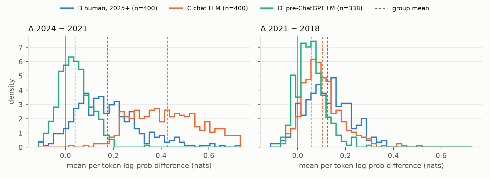

# 00. k=0 신호 확인

- 브랜치: `exp/00-k0-signal`
- 마감: 11/15 (진단까지 포함하면 11/22)
- 장비: 로컬 GTX 1060 6GB (1.3B fp16 추론, 모델 하나씩 로드, batch 1부터)

## 질문

필터 없이(k=0) `Δ_{2024,2021}`이 같은 주제의 사람 글(B)과 AI 글(C)을 가르는가?
그 차이는 AI 이전 구간 `Δ_{2021,2018}`의 차이보다 큰가(DiD)?

## 0단계: 모델 점검 (데이터 만들기 전에)

```bash
python scripts/check_models.py \
  --models datedgpt/datedgpt-2018-base datedgpt/datedgpt-2021-base datedgpt/datedgpt-2024-base \
  --fp-check datedgpt/datedgpt-2021-base
```

- 토크나이저: 세 모델의 어휘와 샘플 토큰화가 완전히 같아야 함. 다르면 중단하고 대체 계열 검토.
- fp16: inf/nan 없음, CPU fp32 대비 평균 log-prob 차이 < 0.05. 넘으면 fp32를 CPU에서 돌리거나(느림) 클라우드 bf16 사용.
- 학습 스텝·데이터 양은 모델 카드와 논문 값을 이 문서 아래에 기록.

## 가설

- H1: C의 Δ가 B보다 크다 (짝 승률 > 50%, Cohen's d > 0).
- H2: Δ 단독 AUROC ≥ 0.70, 95% CI 하한 > 0.5.
- H3: Δ는 단일 모델 log-likelihood와 다른 정보를 담는다 (|r| < 0.8).
- H4: DiD > 0 이고 95% CI 하한 > 0.

## 데이터

`data/pairs.jsonl` (B/C 짝): `{"id", "human", "ai", "generator", "domain"}`
`data/extra.jsonl` (D′ 등 추가): `{"id", "text", "group": "D", "pair_id": <B의 id>, "generator"}`

- **B (사람)**: 2025년 이후 작성분만. 두 모델 모두 학습하지 않았어야 함.
  1순위 arXiv cs 초록 2025-06 이후 (제목 + 초록). 출처 선정 기준을 기록.
- **C (AI)**: 같은 제목을 주고 초록 생성. 생성기 `Qwen2.5-1.5B-Instruct`, `Llama-3.2-1B-Instruct` (+ 예산이 되면 API 모델 1개).
- **D′ (옛 세대 AI)**: 같은 제목으로 `gpt2-xl` 또는 `EleutherAI/gpt-neo-1.3B`가 이어 쓴 초록.
- 규모: 도메인 1개 × B 200개, C는 생성기마다 200개, D′ 200개
- 길이: 모든 글을 앞 200 토큰으로 자름(길이 효과 통제). 200 토큰 미만은 제외하거나 길이를 기록.

## 절차

```bash
cat data/pairs.jsonl data/extra.jsonl > data/all.jsonl
python scripts/score_texts.py --input data/all.jsonl --out outputs/k0.jsonl \
  --models datedgpt/datedgpt-2018-base datedgpt/datedgpt-2021-base datedgpt/datedgpt-2024-base
python scripts/evaluate.py --scores outputs/k0.jsonl --new 2024 --old 2021 --pre-new 2021 --pre-old 2018
```

보고 항목: AUROC [95% CI], AUPRC, TPR@1%·5% FPR, 짝 승률, 그룹별 평균 Δ [95% CI], Cohen's d,
Δ 분포 히스토그램(B/C/D′), DiD [95% CI]. 신뢰구간은 짝(pair_id) 단위 cluster bootstrap 1000회.

학습 없는 방법이라 00에는 학습/평가 분할이 없음. 04에서 결합 분류기를 학습할 때는 **원문(pair_id) 단위로 분할**.

## 판단 기준

| 결과 | 다음 단계 |
| --- | --- |
| H1·H2·H4 성립 | 02·01 진행 |
| H1 성립, H2 미달 (AUROC 0.55~0.70) | 진단 1주 후 결정 (아래) |
| H1 불성립 | 진단 1주 후에도 신호가 없으면 축소하거나 중단, 부정적 결과로 기록 |

진단 (1주 이내): Δ 분포가 실제로 다른가 / 길이·도메인 통제 후 달라지는가 / 특정 생성기에서만 효과가 있는가 /
전체 평균에서는 차이가 없지만 특정 토큰 유형에서는 차이가 있는가(03 일부를 앞당김).

## 산출물

- `outputs/k0.jsonl` (git에 올리지 않음), 결과 표와 그림을 이 문서 아래에 추가

## 구현하면서 정한 것 (2026-11-12, 11-13 갱신)

이 실험은 계획이 B/C/D′·DiD 구조로 바뀌기 전에 시작했습니다(11-12). 데이터와 코드는 새 구조로 옮겼고, 명세와 다른 점은 아래 표에 이유와 함께 적었습니다.

| 항목 | 결정 | 이유 |
| --- | --- | --- |
| B (사람) | arXiv API에서 첫 버전 제출일이 2025-07~2026-10이고 primary category가 cs.*인 초록. 월별로 무작위 구간 2개(100편씩)를 읽고 40편씩, 총 640편 수집 (`scripts/fetch_arxiv.py`) | 두 모델 모두 못 본 글이면서 기간을 고르게 덮도록. API는 offset 10,000 이상에서 HTTP 500을 내서, 달의 뒤쪽 절반은 내림차순으로 읽음 |
| B 필터 | 150~400단어, `$` 4개 이하(수식 위주 초록 제외), 철회 논문 제외 | 200토큰을 채우고 수식 토큰이 점수를 좌우하지 않도록 |
| B 규모 | **400편**: 생성기마다 서로 다른 200편 (명세는 B 200편 공유) | 같은 사람 글이 AUROC에 두 번 들어가지 않고, 생성기별 결과가 독립된 두 번의 반복이 됨. 이전 계획에서 정한 것 |
| C 프롬프트 | `Write the abstract of a computer science research paper titled "{title}". Respond with only the abstract text, as a single paragraph of about 200 words.` (user 메시지 하나, 각 모델의 기본 chat template) | |
| C 디코딩 | 각 생성기의 `generation_config` 기본값 (Qwen: T=0.7, top-p 0.8, top-k 20, rep 1.1 / Llama: T=0.6, top-p 0.9), 최대 400토큰 | 사용자가 그대로 쓸 때의 글 |
| C 후처리 | "Here is…", "Abstract:", 마크다운, 제목 반복 줄 제거 후 한 문단으로 합침. 거절 응답 제외 (`scripts/generate_ai.py`) | 거절 0건, 남은 표식 0건 |
| D′ (옛 세대 AI) | `EleutherAI/gpt-neo-1.3B` (2021, Pile 학습. arXiv 포함). 프롬프트 `{title}\n\nAbstract\n\n`, T=0.7, top-p 0.9, rep 1.1, 최대 320토큰. 빈 줄 두 개나 Introduction·Keywords에서 자르고 한 문단으로 합침. B와 같은 `$` 필터 적용 (`scripts/generate_old_lm.py`) | 디코딩을 C와 비슷하게 둬서 C와 D′의 차이가 샘플링이 아니라 모델 세대에서 오도록. GPT-2는 WebText에 arXiv가 거의 없어 제외. LaTeX 프롬프트(`\begin{abstract}`)는 8개 시험에서 `\item` 목록과 링크만 만들어 버림 |
| 길이 | 각 글을 BOS 포함 200토큰(채점 토큰 최대 199개)으로 자른 뒤, **같은 `pair_id`(B·C·D′)의 글을 가장 짧은 글 길이로** 맞춤. 채점 토큰 100개 미만은 생성 단계에서 제외. `n_tokens`와 `n_tokens_full`을 기록 (`score_texts.py` 기본값, `--no-pair-truncate`로 끔) | 명세의 "앞 200토큰"으로는 Qwen 초록(중앙값 121단어, 175토큰)의 80%가 빠짐. 긴 출력만 고르면 선택 편향이 생기고 프롬프트를 바꾸면 생성기 간 조건이 달라짐. causal LM이라 채점 후 잘라도 잘라서 채점한 것과 같음 |
| 배치 | `--batch-size 8` (명세는 1부터) | 길이순 정렬 배치로 1.3B·200토큰에서 VRAM 6GB 안에 들어감 |
| 파일럿 그룹 | 이전 프로젝트의 사람 글(XSum·WritingPrompts·PubMedQA, 2021년 이전)은 **A**, davinci(GPT-3)는 **D′**, GPT-3.5/4·Qwen·Llama는 **C** (`scripts/convert_raw_data.py`) | 사람 글이 2025년 이후가 아니므로 B가 아님 |

## 미리 적어둔 예측

### 예측 1 (2026-11-12, 이전 계획 기준, 결과를 보기 전)

H1~H3와 파일럿에 대한 예측입니다. 당시 H1 기준은 "짝 승률 > 0.5, CI 하한 > 0.5"였습니다.

- **데이터 편향은 둘 다 Δ 분리를 어렵게 하는 방향으로 봤습니다.** (1) 사람 글 라벨 노이즈: 2025년 이후 arXiv 초록 일부는 LLM으로 다듬은 글입니다(Liang et al., 2024: CS 초록의 LLM 수정 비율 추정치가 2024-02에 이미 최대 17.5%). (2) 지식 노이즈: 사람 초록에 2021 모델이 모르는 새 이름이 더 많으면 사람 쪽 Δ가 올라갑니다. 방향을 몰라서 토큰을 직접 읽기로 했습니다.
- 파일럿: GPT-3.5/4와 Qwen·Llama는 Δ 짝 승률 > 0.6, AUROC 0.65~0.85. davinci는 승률 약 0.5, AUROC 0.45~0.60. 근거는 이전 프로젝트 TiC-LM 결과입니다(2023-01 → 2024-07 컷오프에서 채팅 모델 글의 AI−사람 likelihood 차이가 0.640 → 0.770으로 커졌고, davinci는 변화 없음). davinci가 채팅 세트만큼 높으면 신호가 AI 문체 흡수가 아니라는 뜻이므로 02를 앞당기기로 했습니다.
- 본 실험: H1 성립(짝 승률 0.60~0.75), H2 경계(AUROC 0.62~0.75), H3 성립(|r| < 0.6).

### 예측 2 (2026-11-13, 2018 모델과 D′ 점수를 계산하기 전)

이 시점에 알고 있던 것은 두 가지입니다. 하나는 이전 계획으로 돌린 B/C의 Δ2024−2021 결과(AUROC 0.920, AI−사람 평균 차이 +0.263, 아래 결과 절의 숫자와 거의 같음)이고, 다른 하나는 2개 모델로 돌린 파일럿 결과(davinci ≈ 사람)입니다. 2018 모델 점수와 D′ 글은 아직 없었습니다.

- **H4 (C vs B의 DiD).** 2018 → 2021 사이에도 ML 분야 어휘가 크게 바뀌었습니다(transformer, BERT, GPT-3 등). 그래도 B와 C가 같은 주제라 이 변화는 양쪽에 비슷하게 들어간다고 봅니다. 예측: |gap_pre| < 0.05, DiD 0.20~0.30, CI 하한 > 0 (H4 성립).
  - 반대 시나리오: gap_pre가 gap_post에 가까우면(> 0.15) "최근 모델일수록 채팅 문체를 선호"하는 AI와 무관한 추세(데이터 필터 변화 등)라는 뜻이고, AI 노출 해석이 약해집니다.
- **D′ (GPT-Neo-1.3B).** 파일럿 davinci처럼 Δ2024−2021이 B와 비슷할 것으로 봅니다. 예측: Cohen's d (D′ vs B)가 −0.3~+0.3이고, D′ vs B의 DiD CI가 0을 포함합니다. GPT-Neo 글은 품질이 낮고 반복이 많아 두 모델 모두 낮은 확률을 주겠지만, Δ는 차이라 상쇄된다고 봅니다.
- **파일럿 DiD (A 대비).** C(GPT-3.5/4·Qwen·Llama)는 DiD > 0, D′(davinci)는 DiD ≈ 0입니다.

## 0단계 결과: 모델 점검 (2026-11-13)

| 항목 | 결과 |
| --- | --- |
| 1. 토크나이저 동일성 | 2018·2021·2024의 `tokenizer.model`·`tokenizer.json` 파일 해시가 같음. `check_models.py`의 샘플 3개와 B 초록 640편 전체에서 토큰 id 완전 일치 → **통과** |
| 2. fp16 안전성 | 세 모델 모두 `check_models.py --fp-check`(GTX 1060 fp16 vs CPU fp32, 샘플 3개): inf/nan 없음, 토큰 log-prob 최대 차이 0.012, 평균 log-prob 차이 최대 0.0012 (기준 < 0.05) → **통과**. 이전에 2021·2024를 글 16개로 따로 비교했을 때도 Δ 최대 차이 0.0008, fp16/fp32 Δ 상관 0.99999였음 |
| 모델 구성 | 세 모델 `config.json`의 구조 값이 같음 (hidden 2048, 24층, FFN 5504, vocab 32000, 배포 dtype bf16) |
| 3. 학습량·스텝 | 논문(DatedGPT, arXiv 2603.11838v2, Sec. 3.1·Table 6): 모든 연도 모델이 처음부터 25,000 iteration, 약 100B 토큰, 배치 2048, 시퀀스 2048, LR 2e-4. 연도별로 다르다는 언급 없음. 모델당 A100 약 2,000시간 |
| 4. 연도 외 파이프라인 차이 | 연도는 FineWeb-Edu 문서의 **크롤 시점**(연 단위)으로 나눔(Sec. 2.1). 문서 작성 시점이 아님. "컷오프까지의 데이터"라고만 쓰여 있어 누적(2013~해당 연도) 데이터인지 그 해 크롤만인지는 **명시되지 않음**. 중복 제거, 연도 가중, 사전학습 단계의 LLM 기반 필터는 언급 없음. FineWeb-Edu 자체의 교육적 품질 분류기는 모든 연도에 공통 |
| 5. 2024 데이터의 AI 글 비율 | 논문에 언급 없음. 직접 측정 불가 |

크롤 시점 기준이라는 점이 해석에 영향을 줍니다. 2024년 크롤에는 오래전에 쓴 페이지도 들어 있으므로, A 그룹(2021년 이전 사람 글)은 2018·2021·2024 모델 모두 봤을 수 있습니다. 2023~2024년 크롤에 섞인 AI 생성 페이지는 2024 모델만 봅니다.

## 결과

### 본 실험: arXiv cs 초록, B 400 · C 400 · D′ 338 (2026-11-13)

```bash
python scripts/fetch_arxiv.py --start 2025-07 --end 2026-10 --per-month 40 --out data/human_arxiv.jsonl   # B 640편 수집
python scripts/generate_ai.py --human data/human_arxiv.jsonl --out data/pairs.jsonl --per-generator 200    # B 400 / C 400
python scripts/generate_old_lm.py --pairs data/pairs.jsonl --out data/extra.jsonl                         # D′ 338
cat data/pairs.jsonl data/extra.jsonl > data/all.jsonl
python scripts/score_texts.py --input data/all.jsonl --out outputs/k0.jsonl --batch-size 8 \
    --models datedgpt/datedgpt-2018-base datedgpt/datedgpt-2021-base datedgpt/datedgpt-2024-base
python scripts/evaluate.py --scores outputs/k0.jsonl --new 2024 --old 2021 --pre-new 2021 --pre-old 2018 \
    --by-generator --json outputs/k0_eval.json
python scripts/token_contrib.py --scores outputs/k0.jsonl --input data/all.jsonl --ai-group C --human-group B
python scripts/token_contrib.py --scores outputs/k0.jsonl --input data/all.jsonl --ai-group D --human-group B
python scripts/diag_residual.py --scores outputs/k0.jsonl --groups B C
python scripts/plot_delta_hist.py --scores outputs/k0.jsonl --out docs/experiments/figs/00-delta-hist.png
```

환경: GTX 1060 6GB, torch 2.14.1+cu126, transformers 5.22.2, fp16, batch 8. 3개 모델로 글 1,138개 채점에 약 5분. C 생성 540개 약 15분, D′ 생성 400개 약 12분.

데이터: B는 640편 중 400편 사용(첫 제출 2025-07-02 ~ 2026-10. 수집분 기준 cs.CV 133 · cs.LG 119 · cs.CL 79 · cs.AI 62 · cs.RO 49 · 기타). C는 거절 0건. D′는 400개 중 338개(62개는 100토큰 미만). 같은 주제의 글을 가장 짧은 길이로 맞춘 결과, 채점 토큰은 중앙값 180개(10분위 123, 최소 100)입니다. 이 맞춤으로 B의 62%, C의 32%, D′의 28%가 잘렸습니다.

**1. 탐지 (B vs C, Δ2024−2021, k=0)** — 괄호는 짝 단위 cluster bootstrap 1000회 95% CI

| | Δ AUROC | AUPRC | TPR@1% | TPR@5% | 짝 승률 | `log p_2024` AUROC | `log p_2021` AUROC |
| --- | --- | --- | --- | --- | --- | --- | --- |
| **합계 (400쌍)** | **0.899** [0.878, 0.919] | 0.877 | 0.160 | 0.425 | 0.938 | 0.990 | 0.958 |
| Qwen2.5-1.5B-Instruct | 0.967 [0.952, 0.980] | 0.966 | 0.615 | 0.755 | 0.985 | 0.985 | 0.931 |
| Llama-3.2-1B-Instruct | 0.840 [0.800, 0.875] | 0.750 | 0.000 | 0.140 | 0.890 | 0.997 | 0.992 |

corr(Δ, `log p_2024`): 전체 +0.60, 사람 글 안에서 +0.26, AI 글 안에서 −0.10.

**2. 그룹별 평균 Δ** [95% CI]

| 그룹 | n | Δ2024−2021 (AI 이후 구간) | Δ2021−2018 (AI 이전 구간) |
| --- | --- | --- | --- |
| B 사람 (2025+) | 400 | 0.175 [0.162, 0.189] | 0.125 [0.116, 0.134] |
| C 채팅 모델 | 400 | **0.427** [0.414, 0.441] | 0.103 [0.094, 0.111] |
| D′ GPT-Neo-1.3B | 338 | 0.040 [0.033, 0.046] | 0.055 [0.048, 0.062] |
| Cohen's d, C vs B | | **+1.79** | −0.25 |
| Cohen's d, D′ vs B | | −1.23 | −0.87 |

**3. 이중차분 (DiD)**

| 비교 | gap (2024−2021) | gap (2021−2018) | DiD [95% CI] |
| --- | --- | --- | --- |
| **C − B (합계)** | +0.252 | −0.022 | **+0.274** [0.254, 0.294] |
| C − B (Qwen) | +0.346 | −0.022 | +0.368 [0.340, 0.396] |
| C − B (Llama) | +0.158 | −0.022 | +0.180 [0.156, 0.204] |
| D′ − B | −0.136 | −0.070 | −0.066 [−0.085, −0.047] |



*그림: 그룹별 Δ 분포. 점선은 그룹 평균, 숫자는 위 표 2. 왼쪽(AI 이후 구간)에서만 채팅 모델 글(C)이 사람 글(B)과 갈라집니다.*

**가설 판정 (명세의 기준)**

| 가설 | 기준 | 결과 | 판정 |
| --- | --- | --- | --- |
| H1 | 짝 승률 > 50%, Cohen's d > 0 | 93.8%, d = +1.79 | 성립 |
| H2 | AUROC ≥ 0.70, CI 하한 > 0.5 | 0.899 [0.878, 0.919] | 성립 |
| H3 | \|corr(Δ, `log p_2024`)\| < 0.8 | 0.60 | 성립 |
| H4 | DiD > 0, CI 하한 > 0 | +0.274 [0.254, 0.294] | 성립 |

**예측과 비교**

| 예측 | 결과 | |
| --- | --- | --- |
| (예측 1) 짝 승률 0.60~0.75, AUROC 0.62~0.75, \|r\| < 0.6 | 0.938, 0.899, 0.60 | 신호를 크게 과소평가. 라벨 노이즈 영향을 과대평가함 |
| (예측 2) \|gap_pre\| < 0.05, DiD 0.20~0.30, CI 하한 > 0 | −0.022, 0.274, 0.254 | 맞음 |
| (예측 2) D′ ≈ B: Cohen's d −0.3~+0.3, D′−B DiD의 CI가 0 포함 | d = −1.23, DiD −0.066 [−0.085, −0.047] | **틀림.** D′는 두 구간 모두 B보다 Δ가 낮음 (아래 해석) |

**토큰 단위 (`token_contrib.py`)**

- **C − B (AI 이후 구간)**: 차이가 넓게 퍼져 있습니다(기여 상위 200개 토큰이 전체 |기여|의 46%). 상위에는 ChatGPT 문체로 알려진 단어가 모입니다. `By`(C 3.46회/1k토큰 vs B 0.36회, 토큰당 Δ +2.34 vs +1.09), `leverage`(3.72 vs 0.42), `various`(2.58 vs 0.13), `enhance`, `Through`, `ensure`, `integrate`, `complex`, `more`. 기능어도 같은 방향입니다(`and`: Δ +0.427 vs −0.043, 쉼표: +0.312 vs +0.041). 2024 모델은 이런 단어를 사람 글에서도 더 기대하지만(`various` B에서도 Δ +1.83), 채팅 모델 글이 훨씬 자주 씁니다.
- **B − D′**: 사람 글의 Δ를 D′보다 높이는 토큰은 거의 모두 2022년 이후 LLM 분야 용어입니다. `prompt`(B 1.01회/1k vs D′ 0.11회, B에서 토큰당 Δ +3.88), Large Language Model의 `Lar`·`Language`·`LL`, hallucination의 `hall`, fine-tuning의 `fine`이 그렇습니다. **`diffusion`이 대표적입니다.** D′는 옛 의미(물리 확산)로 써서 Δ −0.11이고, B는 "diffusion model"로 써서 Δ +3.24입니다.

**강건성**

| 확인 | 결과 |
| --- | --- |
| 위약 검사: AI 이전 쌍(2021−2018)으로 B vs C 탐지 | AUROC **0.420**. 같은 "두 모델 대조"인데 ChatGPT 이전 모델끼리는 채팅 글을 가르지 못함(오히려 약간 반대) |
| "새 모델이 예측 쉬운 글을 우대" (`diag_residual.py`) | 사람 글 안에서 corr(Δ, `log p_2021`) = −0.01. `log p_2021`로 보정한 잔차 AUROC 0.902 (원래 0.899) |
| 놀람 필터 k = 0 / 0.05 / 0.1 / 0.2 | AUROC 0.899 / 0.920 / 0.918 / 0.910. DiD 0.274 / 0.275 / 0.262 / 0.228 (모두 CI 하한 > 0.2) |
| 길이 맞춤에 D′를 넣지 않을 때 (B/C만 채점, `outputs/k0_bc_only.jsonl`) | AUROC 0.920 [0.902, 0.938] (Qwen 0.974, Llama 0.873), DiD +0.287 [0.269, 0.307]. 본 분석보다 조금 높음: D′가 짧은 주제에서 B/C도 잘려 토큰이 줄었기 때문. 이전 계획으로 돌린 2-모델 실행의 0.920과 같음 |

**사람 글 쪽 꼬리.** B의 Δ 분포는 오른쪽 꼬리가 깁니다(p50 0.157, p90 0.367, p99 0.587. C의 p10은 0.243). Δ가 가장 높은 사람 초록 8편은 이전 실행에서 모두 LLM·멀티모달·RAG·프롬프트 주제였습니다. 여럿은 AI로 다듬은 듯한 문장이었습니다("have demonstrated remarkable proficiency across diverse tasks", "plays a crucial role", "To bridge this gap"). 이 꼬리 때문에 TPR@1%FPR이 낮습니다(합계 0.16, Llama 0.00). 지식 노이즈와 라벨 노이즈 중 어느 쪽인지는 이 데이터만으로 가를 수 없습니다.

### 파일럿: 이전 프로젝트 데이터, A 2,250 · C 1,800 · D′ 450 (2026-11-13)

사람 글이 2021년 이전 글(A)이라 판정에는 쓰지 않습니다. 대신 2023~2024년 웹에 실제로 퍼진 GPT-3.5/4 글과, **같은 시대**의 ChatGPT 이전 AI 글(davinci)을 볼 수 있습니다.

```bash
python scripts/convert_raw_data.py --out data/pilot_pairs.jsonl \
    ../Study-AIText_Detection/data/fastdetectgpt/raw/*.raw_data.json \
    ../Study-AIText_Detection/data/generated/raw/{xsum,writing,pubmed}_{qwen25-1.5b-instruct,llama32-1b-instruct}.raw_data.json
python scripts/score_texts.py --input data/pilot_pairs.jsonl --out outputs/pilot.jsonl --batch-size 8 \
    --models datedgpt/datedgpt-2018-base datedgpt/datedgpt-2021-base datedgpt/datedgpt-2024-base
python scripts/evaluate.py --scores outputs/pilot.jsonl --detect-groups A C --human-group A \
    --pre-new 2021 --pre-old 2018 --by-generator
python scripts/evaluate.py --scores outputs/pilot.jsonl --generators davinci --detect-groups A D --human-group A \
    --pre-new 2021 --pre-old 2018
```

생성기별(XSum·WritingPrompts·PubMedQA 합계 450쌍, 각 세트의 사람 글과 비교):

| 생성기 | 그룹 | Δ AUROC [95% CI] | `log p_2024` AUROC | DiD [95% CI] |
| --- | --- | --- | --- | --- |
| GPT-3.5-turbo | C | 0.929 [0.911, 0.945] | 0.940 | +0.217 [0.203, 0.231] |
| GPT-4 | C | **0.901** [0.881, 0.918] | **0.850** | +0.148 [0.134, 0.162] |
| Llama-3.2-1B-Instruct | C | 0.878 [0.858, 0.898] | 0.880 | +0.156 [0.142, 0.170] |
| Qwen2.5-1.5B-Instruct | C | 0.863 [0.840, 0.886] | 0.926 | +0.153 [0.138, 0.168] |
| davinci (GPT-3) | D′ | 0.471 [0.444, 0.499] | 0.588 | −0.026 [−0.040, −0.011] |

그룹 평균 Δ: A는 AI 이후 쌍 −0.019, AI 이전 쌍 +0.009입니다. C는 +0.157, +0.016이고, D′는 −0.029, +0.022입니다. C−A의 DiD 합계는 +0.168 [0.161, 0.176]입니다.

- **본 실험과 같은 패턴입니다.** 채팅 모델 글의 gap은 AI 이후 쌍에서만 생깁니다(C−A: AI 이후 +0.176, AI 이전 +0.007).
- **2023~2024년 웹의 주류였던 GPT-3.5/4 글에도 효과가 있습니다**(DiD +0.217, +0.148). GPT-4 글에서는 Δ가 단일 모델 likelihood보다 좋습니다(0.901 vs 0.850).
- **같은 시대 대조군인 davinci는 사람 글과 구분되지 않습니다**(AUROC 0.471). DiD는 −0.026으로 CI가 0을 살짝 벗어나지만, 채팅 모델 DiD의 1/6 크기이고 부호가 반대입니다.
- **사람 글의 Δ 자체는 쓰인 시기(와 도메인)에 크게 좌우됩니다.** A(2021년 이전, 뉴스·소설·의학)는 −0.019이고, B(2025년 이후 arXiv)는 +0.175입니다. 같은 주제로 짝짓고 DiD를 쓰는 이유이고, 02에서 arXiv 안에서 시기별로 잽니다.
- 한계: A는 두 모델 모두 학습했을 수 있습니다. 이 데이터는 사람 글에서만 줄바꿈이 지워져 있는데(AI 글의 줄바꿈 토큰 Δ −0.23), 이건 AI 쪽 Δ를 낮추는 보수적 방향입니다.

예측 2의 파일럿 부분: C의 DiD > 0은 맞았습니다(+0.148~+0.217). davinci "DiD ≈ 0"은 대체로 맞았지만, CI가 0을 포함하지는 않았습니다(−0.026).

### 해석과 한계

**해석**

1. **AI/사람 차이는 ChatGPT 이후 구간에만 있습니다.** AI 이전 쌍(2021−2018)에서는 채팅 모델 글이 사람 글보다 오히려 약간 낮고(gap −0.022), 탐지 AUROC도 0.42입니다. AI 이후 쌍(2024−2021)에서만 gap이 +0.25로 벌어집니다. "서로 다른 두 모델을 대조한 효과"나 일반적인 시간 변화로는 이 비대칭을 설명할 수 없습니다(DiD +0.274).
2. **차이를 만드는 것은 채팅 모델 문체입니다.** `leverage`, `By ...`, `various`, `enhance`, `ensure` 같은 단어와 나열식 흐름의 기능어입니다. 지식 노이즈(LLM 분야 신조어)는 사람 글 쪽 Δ를 올려서 오히려 가설에 불리하게 작용했습니다.
3. **D′는 "기계 글 일반이 아니다"를 지지하지만, 깨끗한 대조는 아닙니다.** GPT-Neo 글의 Δ는 채팅 모델 글보다 훨씬 낮습니다(0.040 vs 0.427). 다만 사람 글보다도 낮은데, 그 차이는 문체가 아니라 지식(GPT-Neo가 2020년 이후 용어를 쓰지 않음)에서 옵니다. 같은 시대 글끼리 비교한 파일럿(davinci vs 2021년 이전 사람 글)이 더 깨끗한 대조입니다. 이후 실험에서 D′를 쓸 때는 지식 시대를 맞춰야 합니다.
4. **생성기마다 크기가 다릅니다.** DiD가 Qwen 0.37, Llama 0.18입니다. 원인(학습 데이터에 합성·증류 데이터가 얼마나 들어갔는지 등)은 이 실험으로 알 수 없습니다.

**한계**

1. **이 데이터에서는 단일 모델 likelihood가 Δ보다 좋습니다**(`log p_2024` AUROC 0.990 vs Δ 0.899). 1B 모델이 기본 디코딩(T = 0.6~0.7)으로 쓴 글은 쉽습니다. 00은 "Δ에 AI 노출 신호가 있다"를 보였지, "Δ가 기존 방법보다 낫다"를 보인 것이 아닙니다. 그건 04에서 likelihood가 약해지는 조건(강한 생성기, 높은 temperature, paraphrase)으로 확인해야 합니다.
2. **생성기가 2024년에 공개된 1B급 두 개뿐입니다.** 2023~2024년 웹에 퍼진 글의 주류는 GPT-3.5/4 계열이고, 그 결과는 사람 글 시기가 다른 파일럿에만 있습니다.
3. **MIA 혼동은 피했을 뿐 재지 않았습니다.** B를 두 모델 모두 못 본 2025년 이후 글로 골라서 피했습니다. 2024 모델이 학습한 사람 글에서 Δ가 얼마나 오르는지는 02에서 잽니다.
4. **사람 글 쪽 꼬리가 낮은 FPR 성능을 깎습니다**(TPR@1%FPR 0.16). LLM 주제의 초록이거나 AI로 다듬은 듯한 초록입니다. 둘을 가르려면 같은 주제의 ChatGPT 이전 사람 글이 필요합니다(02).
5. **도메인이 arXiv cs 초록 하나**이고, 모델 계열도 DatedGPT 하나입니다.
6. **DatedGPT의 연도별 데이터가 누적인지는 논문에 없습니다.** A 그룹 해석과 02의 "학습 포함" 판정에 영향을 줍니다.

### 판단

명세의 판단 기준에서 "H1·H2·H4 성립"에 해당하므로 **02·01로 진행합니다.** 00에서 얻은 것을 반영한 제안은 아래와 같습니다.

- **02 (MIA·시간 변화 분리)**: 사람 글을 시기별로 나눕니다. 2019(2021·2024 모델이 봤을 수 있음), 2022년 1~10월(ChatGPT 이전, 2024 모델만), 2024(2024 모델만, AI 보조 글 가능), 2025+(B)입니다. 각 시기마다 같은 제목의 C를 짝지어 주제·지식 차이를 빼고, "학습 포함 사람 글"이 C와 얼마나 가까워지는지를 잽니다. 같은 방법으로 AI 이전 쌍(2021−2018)에서 2019년 글과 2022년 글을 비교하면 AI 문체가 전혀 없는 MIA 효과 크기를 따로 얻습니다. 2019·2022·2024년 초록은 이미 수집했습니다(`data/human_arxiv_{2019,2022,2024}.jsonl`, 각 월 40편).
- **04용 어려운 데이터를 미리 만듭니다**: temperature 1.0 샘플링과 paraphrase는 로컬 모델로 만들 수 있습니다. API 생성기는 모델과 예산이 정해져야 합니다.
- **01 (연도 곡선)**: 나머지 vintage 9개(약 24GB)를 받으면 채점은 모델당 약 2분입니다.
