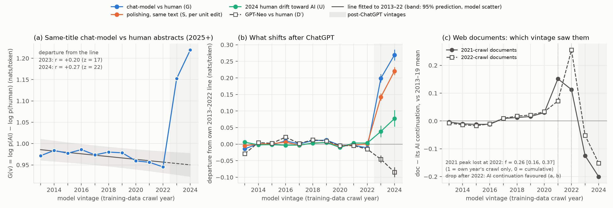

# 01. 연도 곡선: 12개 vintage로 본 AI 문체 흡수 시점

- 브랜치: `exp/01-year-curve`
- 마감: 11/29 (논문의 대표 그림)
- 장비: 로컬 GTX 1060 6GB (00·02·05와 같은 채점 설정)

## 질문

00은 2018·2021·2024 세 모델만 썼습니다. B/C에서 Δ2024−2021의 AI−사람 gap은 +0.263, AI 이전 쌍(2021−2018)은 −0.024입니다. 세 점만으로는 아래 질문에 답할 수 없습니다.

- Q1. AI 글 선호는 ChatGPT 이후 vintage에서만 생기나? 그 크기가 2013~2022년 vintage 사이의 해마다 흔들림보다 큰가? 이 흔들림에는 vintage마다 따로 학습해서 생기는 모델 잡음도 들어 있습니다.
- Q2. **언제부터 보이나?** 2023 vintage부터인가, 2024부터인가? 변화점은 미리 정하지 않고 데이터로 찾습니다(plan.md 4절).
- Q3. **무엇이 퍼졌나?** 비교 대상은 두 가지입니다. 하나는 ChatGPT 이전 세대 모델이 쓴 글(D′, GPT-Neo)이고, 다른 하나는 사람 초록을 채팅 모델로 다듬은 글(05-a)입니다. 이 글들도 같은 vintage에서 오르나?
- Q4. **사람 글로의 확산도 같은 시점인가?** 02는 2024년과 2025년 이후 사람 초록에서 Δ가 오르는 것을 봤습니다(polish_24 +0.074). 이 상승이 AI 글 선호와 같은 vintage에서 시작하나?
- Q5. (모델 점검) **DatedGPT의 연도별 데이터는 누적인가, 그해 크롤만인가?** 02에는 간접 증거가 있습니다. 2021년 크롤 문서(W21)가 2024 모델에서 오히려 낮았습니다(−0.093). 이번에는 12개 vintage로 직접 확인합니다. 답에 따라 곡선의 뜻이 달라집니다. 연도별이면 vintage v의 값은 "그해 웹"을, 누적이면 "그때까지의 웹"을 반영합니다.

## 데이터 (새로 생성하지 않음)

| 묶음 | 사람 | 비교 글 | 쌍 수 | 출처 | 역할 |
| --- | --- | --- | --- | --- | --- |
| **B / C** | arXiv cs 2025-07~2026-10 | 같은 제목의 채팅 모델 초록 (Qwen 200, Llama 200) | 400 | 00 | **주 곡선.** 모든 vintage의 크롤 이후 글이라 학습 포함이 없음(02의 교훈) |
| B / D′ | 위와 같음 | 같은 제목의 GPT-Neo-1.3B 초록 | 338 | 00 | 채팅 문체가 아닌 기계 글 |
| H22 / P22 | arXiv cs 2022-01~10 | 같은 초록을 로컬 채팅 모델로 다듬은 판본 (proof 389, polish 372, rewrite 340) | 1,101 | 05-a | **같은 글**이라 지식 효과가 없는 채팅 문체 곡선 |
| H19·H22·H24 / C19·C22·C24 | 2019, 2022, 2024년 초록 | 같은 제목의 채팅 모델 초록 | 400, 400, 399 | 02 | 시기별 곡선, 사람 쪽 이동 |
| W21 / CW21, W22 / CW22 | FineWeb-Edu 2021-49 크롤(URL 2020·2021년), 2022-40 크롤(URL 2022년) | 앞 30단어에서 이어 쓴 채팅 모델 글 | 395, 398 | 02-b | 학습 포함의 vintage별 흔적 (Q5) |

글은 모두 6,223개입니다. 12개 vintage(2013~2024)로 채점합니다. 설정은 fp16, 배치 8, 최대 200토큰이고, 길이는 자르지 않습니다(`--no-pair-truncate`). 공통 길이로 자르는 것은 05처럼 비교마다 분석 단계에서 합니다. 채점은 vintage마다 파일을 따로 써서, 중간에 멈춰도 이어서 할 수 있게 합니다. 2018·2021·2024도 다시 채점합니다. 그래야 모든 점이 한 번의 실행에서 나옵니다.

## 측정 (`scripts/year_curve.py`)

글 x의 vintage v 점수 ℓ_v(x)는 앞 n토큰의 log p_v 평균입니다. 비교하는 두 글은 짧은 쪽 길이 n으로 자릅니다.

| 양 | 식 | 뜻 |
| --- | --- | --- |
| **G(v)** | mean_i [ℓ_v(c_i) − ℓ_v(b_i)], B/C 400쌍 | vintage v가 같은 제목의 AI 초록을 사람 초록보다 얼마나 선호하나. G(2024) − G(2021)이 00의 gap_post |
| 추세 | 2013~2022년 vintage 10개의 G에 맞춘 직선 | ChatGPT 이전 vintage 사이의 변화(언어 변화, 지식, 모델마다 다른 점) |
| **r(v)** | G(v) − 추세(v), v = 2023, 2024 | 추세에서 벗어난 AI 선호. r(2024)는 00 DiD의 일반화 |
| **z(v)** | r(v) / (s·√(1 + 1/10 + (v − v̄)²/Sxx)) | 모델 잡음 대비 크기. s는 추세 잔차의 표준편차(자유도 8)이고, \|z\| > 2.31이면 95% 예측구간 밖 |
| J(v) | G(v) − G(v−1) | 해마다의 변화. J(2023), J(2024)를 ChatGPT 이전 9개(J(2014)~J(2022))와 비교 |
| **τ̂** | 꺾은선 G(v) = a + b(v − 2013) + c·max(0, v − τ)를 τ = 2015~2023마다 맞추고, 잔차제곱합이 가장 작은 τ | 변화점. 기울기가 τ 다음 vintage부터 바뀝니다(첫 이탈 vintage = τ̂ + 1) |

같은 식(추세, r, z, J, τ̂)을 다른 곡선에도 씁니다.

| 곡선 | 식 | 비고 |
| --- | --- | --- |
| G_D(v) | mean_i [ℓ_v(d_i) − ℓ_v(b_i)], B/D′ 338쌍 | D′는 지식 시대가 2020년 이전이라(00), B의 새 용어를 배우는 vintage에서 내려갈 수 있음 |
| **S(v)** | Σ e·[ℓ_v(p) − ℓ_v(h)] / Σ e², 원점을 지나는 기울기 | 다듬기 기울기. e는 05의 편집 비율. S(2024) − S(2021)이 05의 s_post(0.216) |
| G_p(v) | 시기 p의 C−H, p = 2019, 2022, 2024, 2025+ | G_2025+ = G |
| **U(v)** | G_2022(v) − G_2024(v) | 사람 쪽 이동. U(2024) − U(2021)이 02의 polish_24(+0.074). B로는 U_B(v) = G_2022(v) − G_2025+(v) |
| M_y(v) | mean_i [ℓ_v(w_i) − ℓ_v(cw_i)], y = 21, 22 | 사람 웹 문서 − 같은 앞부분의 AI 이어쓰기. 학습 포함이면 올라감 |
| **f** | [M_21(2021) − M_21(2022)] / [M_21(2021) − mean M_21(2013~2019)] | 2021년 크롤 문서의 2021 봉우리가 2022 vintage에서 얼마나 꺼지나. 1이면 그해 크롤만, 0이면 누적 |

추가로 보고하는 것:
- **생성기별** G(v)(Qwen, Llama).
- **견고성**: 추세를 (i) 2017~2022년 직선, (ii) 2019~2022년 평균(추세 없음)으로 바꿨을 때의 r(2024), r(2023)
- **탐지 (탐색)**: vintage마다 단일 모델 log p_v의 AUROC(C vs B), 그리고 옛 모델을 바꿔 가며 잰 Δ2024−v의 AUROC(v = 2013~2023). 04에서 어떤 쌍을 쓸지 정하는 데 씁니다.
- **CI**: 묶음마다 짝(다듬기는 원문 논문, 웹은 문서) 단위로 2,000회 bootstrap합니다. 곡선 전체와 추세, r, J, τ̂를 매번 다시 계산합니다. 이 CI는 **12개 모델을 고정했을 때의 글 표본 오차**입니다. 모델 잡음은 z로 따로 봅니다.

분석 코드는 채점 결과를 보기 전에 합성 점수 파일로 검증했습니다. 합성 파일은 실제와 같은 글 id·그룹·짝을 쓰고, vintage마다 모델 잡음(표준편차 0.015)을 넣었습니다.

| 심은 값 | 되찾은 값 |
| --- | --- |
| G의 r(2023) 0.084, r(2024) 0.21 | 0.080, 0.206 |
| 변화점 τ = 2022 | 2022 (bootstrap 100%) |
| S의 r(2024) 0.22 | 0.198 |
| U의 r(2024) 0.09 | 0.091 |
| G_D의 r(2024) −0.14 | −0.136 |
| f = 1 | 1.08 |

효과를 심지 않은 합성 데이터에서는 H1·H2·H3 (a)·H4가 모두 불성립으로 나왔습니다. 다만 몇몇 곡선에서 글 bootstrap CI만으로는 0을 벗어났습니다(예: G_2022의 r(2024) [+0.006, +0.027]). 글 bootstrap은 모델 잡음을 담지 못하기 때문입니다. 그래서 판정에는 z 기준을 함께 씁니다.

## 파이프라인 확인 (2026-11-13, 채점 전)

새 vintage 9개(2013~2017, 2019, 2020, 2022, 2023)를 받았습니다. 2021과 토크나이저가 같은지, fp16(GPU)과 fp32(CPU)의 log p가 같은지 확인했습니다(`scripts/check_models.py`, 결과 아래). 데이터 점수는 아직 하나도 계산하지 않았습니다.

| vintage | 토크나이저 (2021과) | fp16 vs fp32, 토큰별 최대 차이 (샘플 3개) | 글 평균의 최대 차이 |
| --- | --- | --- | --- |
| 2013 | 같음 | 0.009 | 0.0011 |
| 2014 | 같음 | 0.028 | 0.0019 |
| 2015 | 같음 | 0.041 | 0.0019 |
| 2016 | 같음 | 0.028 | 0.0016 |
| 2017 | 같음 | 0.026 | 0.0017 |
| 2019 | 같음 | 0.016 | 0.0015 |
| 2020 | 같음 | 0.009 | 0.0010 |
| 2022 | 같음 | 0.031 | 0.0017 |
| 2023 | 같음 | 0.015 | 0.0008 |

모두 inf/nan이 없고, 글 평균의 차이는 0.002 이하입니다. 재려는 효과(0.01~0.3)보다 훨씬 작으므로 00과 같이 fp16을 씁니다. 로그는 `outputs/fp16_check_01.log`에 있습니다.

## 가설

- **H1 (ChatGPT 이후 vintage의 이탈)**: r(2024)의 bootstrap 95% CI가 0보다 크고, z(2024) > 2.31입니다(모델 잡음으로 본 95% 예측구간 밖).
- **H2 (시점)**: τ̂ ∈ {2022, 2023}입니다. 즉 첫 이탈 vintage가 2023 또는 2024입니다. 또 max(J(2023), J(2024))가 ChatGPT 이전 9개 \|J\|보다 모두 큽니다.
- **H3 (퍼진 것은 채팅 문체)**: 두 조건입니다. (a) 다듬기 기울기도 같은 곳에서 벗어납니다. r_S(2024)의 CI가 0보다 크고 z_S(2024) > 2.31입니다. (b) D′는 그만큼 벗어나지 않습니다. r_D(2024)의 CI 상한이 r(2024)/3보다 작습니다.
- **H4 (사람 글로의 확산도 같은 vintage에서)**: r_U(2024)의 CI가 0보다 크고 z_U(2024) > 2.31입니다.
- 점검 (Q5): f ≥ 0.5면 "대부분 그해 크롤", f ≤ 0.2면 "누적", 그 사이면 "섞임"으로 판정합니다.

## 판단 기준

| 결과 | 해석과 다음 단계 |
| --- | --- |
| H1·H2 성립 | 논문의 대표 그림이 됩니다. "AI 글 선호는 τ̂+1 vintage부터 나타나고, 그 전 10년 동안 vintage가 흔들린 폭보다 크다." 00의 DiD는 세 점 비교 대신 12개 점의 추세에서 벗어난 값으로 보고합니다 |
| H1 불성립 (2024가 예측구간 안) | 00의 DiD가 모델 하나(2024 또는 2021)의 특이성일 수 있습니다. 다른 시간 잘린 모델 계열(ChronoGPT 등)로 재현하기 전에는 주장을 약하게 씁니다 |
| τ̂ < 2022 (ChatGPT 이전부터 이탈) | GPT-3 시대에 생성된 글이 섞였거나, 웹 문체 전반이 변했을 수 있습니다. D′ 곡선과 생성기별 곡선으로 확인하고, "ChatGPT 이후"라고 쓰지 않습니다 |
| τ̂ = 2023 (2023 vintage는 추세 안, 2024만 이탈) | 크롤 시차로 봅니다. 가설과 모순되지 않지만 "2024 vintage부터 보인다"로 보고합니다. 04에서 2023 vintage를 옛 모델로 쓸 수 있는지 확인합니다 |
| H3 (a) 불성립 | 다듬기는 처음부터 쓴 AI 글과 다른 경로로 반응합니다. 05의 보정을 vintage 축에 연결하지 않습니다 |
| H3 (b) 불성립 (D′도 이탈) | 채팅 문체가 아니라 기계 글 일반의 성질일 수 있습니다. 해석을 고칩니다 |
| H4 불성립 | 02의 사람 초록 상승이 AI 노출과 다른 시점에 나타납니다. 지식·주제 변화일 가능성을 먼저 분석합니다 |
| f가 누적을 가리킴 | vintage 곡선은 누적 웹을 반영하고, 2024 vintage의 AI 비중은 여러 해 데이터로 희석된 값입니다. 02의 W21 해석도 고칩니다 |

## 미리 적어둔 예측 (2026-11-13, 새 vintage 채점 전)

이 시점에 아는 것은 다음과 같습니다.
- 00: B/C의 G(2024) − G(2021) = +0.263, G(2021) − G(2018) = −0.024. D′는 −0.136, −0.070. 생성기별 DiD는 Qwen 0.368, Llama 0.180.
- 02: 시기별 gap_post(2019 0.380, 2022 0.356, 2024 0.281, 2025+ 0.263)과 gap_pre(±0.025 안), W21과 W22의 결과.
- 05: s_post 0.216, s_pre −0.013.
- 위의 fp16 점검.

새 vintage 9개의 데이터 점수는 하나도 계산하지 않았습니다.

- **추세**: 2013~2022년 G의 기울기는 −0.015~+0.005/년입니다(00의 2018 → 2021은 −0.008/년). 잔차 표준편차 s는 0.01~0.05, ChatGPT 이전 \|J\|의 최댓값은 0.08 이하입니다.
- **r(2024) 0.22~0.35, z(2024) > 5.** → **H1 성립**.
- **r(2023)은 r(2024)의 0.25~0.75배이고 z(2023) > 2.31입니다. τ̂ = 2022**, 즉 2023 vintage부터 벗어납니다. → **H2 성립**. 확신은 중간입니다. 크롤 시차가 있고, 2023년 크롤에서 그해 새로 쓰인 글의 비중이 작을 수 있습니다.
- 생성기별: Qwen의 r(2024)는 Llama의 약 2배이고 시점은 같습니다.
- **D′**: r_D(2024)는 −0.12~0.00입니다. 지식 효과 때문에 음수 쪽일 것으로 봅니다. 2023·2024 vintage가 B의 LLM 신조어를 처음 배우기 때문입니다. 추세 기울기도 음수(−0.03~−0.005/년)입니다. → **H3 (b) 성립**.
- **다듬기**: r_S(2024)는 0.15~0.28이고, r_S(2023)/r_S(2024)는 주 곡선의 비율과 ±0.2 안에서 같습니다. ChatGPT 이전 S는 평평합니다(기울기 ±0.01/년 안). → **H3 (a) 성립**.
- **시기별**: r_2019(2024)와 r_2022(2024)는 0.30~0.42, r_2024(2024)와 r_2025+(2024)는 0.22~0.33입니다. 사람 쪽 이동 r_U(2024)는 0.04~0.10, r_U_B(2024)는 0.05~0.12이고, 2023 vintage에서는 각각 그 0.2~0.8배입니다. → **H4 성립**.
- **웹 문서**:
  - M_21은 2021 vintage에서 가장 높습니다(2013~2019년 평균보다 +0.08~+0.18).
  - 2020 vintage에서는 일부만 오릅니다. URL이 2020년인 문서가 156편이기 때문입니다.
  - 2022 vintage에서 절반 이상 꺼집니다(f ≥ 0.5). → **연도별 데이터**.
  - M_22는 2013~2022 중 2022에서 가장 높습니다.
- **탐지 (탐색)**:
  - 단일 모델 log p_v의 AUROC(C vs B)는 v ≤ 2022에서 0.90~0.98, 2024에서 0.99입니다.
  - Δ2024−v의 AUROC는 v = 2013~2022에서 0.87~0.95로 비슷하고, v = 2023에서 0.60~0.85로 낮습니다. 2023 vintage도 AI 문체를 일부 흡수했기 때문입니다.

## 한계 (미리)

- vintage마다 학습이 한 번뿐이라, 모델 잡음은 ChatGPT 이전 vintage의 추세 잔차로만 잽니다. 잔차가 서로 독립이고 크기가 같다고 가정합니다. 10개 점이라 예측구간이 넓습니다.
- vintage의 연도는 **크롤 시점**입니다. 문서가 쓰인 해가 아닙니다(00). 이탈 시점도 크롤 연도 기준입니다.
- 지식 효과가 같은 시점에 겹칩니다. 2023·2024 vintage가 B의 LLM 분야 신조어를 처음 배우기 때문입니다.
  - 주 곡선에서는 같은 제목 짝으로 대부분 상쇄됩니다. 00에서는 남은 몫이 가설에 불리한 방향(사람 쪽 Δ를 올림)이었습니다.
  - 다듬기 곡선 S(v)는 같은 글을 비교하므로 지식 효과가 없습니다.
- 2013~2015년 크롤은 양이 적어 그 vintage들이 데이터를 더 반복했을 수 있습니다(모델 카드에 없음). 추세 앞쪽이 흔들릴 수 있어 견고성 추세 두 가지를 함께 봅니다.
- D′는 지식 시대가 B와 맞지 않습니다(00). 그래서 "기계 글 일반"과의 대조로는 깨끗하지 않습니다.
- f는 문서 자체를 외운 효과와 그 크롤 시기의 웹 언어에 익숙한 효과를 가르지 못합니다(02와 같음). 또 같은 페이지가 다음 해 크롤에 다시 들어갔을 수 있어, 그해 크롤만 쓴 경우에도 f가 1보다 작게 나옵니다.

## 결과 (2026-11-14)

```bash
cat data/02_all.jsonl data/extra.jsonl data/polish_2022.jsonl > data/01_all.jsonl          # 6,223개
for y in 2013 2014 2015 2016 2017 2018 2019 2020 2021 2022 2023 2024; do
  python scripts/score_texts.py --input data/01_all.jsonl --out outputs/yc_$y.jsonl \
      --models datedgpt/datedgpt-$y-base --batch-size 8 --no-pair-truncate
done
python scripts/year_curve.py --scores outputs/yc_20*.jsonl --polish data/polish_2022.jsonl --json outputs/yc_eval.json > outputs/yc_eval.txt
python scripts/plot_year_curve.py --eval outputs/yc_eval.json --out docs/experiments/figs/01-year-curve.png
python scripts/web_doc_curves.py --scores outputs/yc_20*.jsonl > outputs/yc_q5_human_only.txt   # 탐색 (4절)
```

채점은 vintage 하나에 약 18분, 12개에 3시간 34분 걸렸습니다(2026-11-13 20:58 ~ 11-14 00:32). 모든 글이 12개 vintage로 채점됐고, 토큰 수는 파일마다 같습니다(`year_curve.py`가 확인).

**확인.** 같은 글, 같은 길이에서 이전 실험의 숫자가 그대로 나옵니다.

| 양 | v2024 − v2021 | v2021 − v2018 | 이전 실험 |
| --- | --- | --- | --- |
| G (B/C) | +0.263 | −0.024 | 02의 B/C gap (00 사전 실행도 +0.263) |
| S | +0.216 | −0.013 | 05 s_post, s_pre |
| G_2019 / G_2022 / G_2024 | +0.380 / +0.356 / +0.281 | +0.015 / −0.014 / −0.015 | 02 gap_post, gap_pre |
| U | +0.074 | +0.001 | 02 polish_24 |

그 밖에 Δ2024−2021의 AUROC 0.920은 00의 B/C만 쓴 사전 실행과 같습니다. 00의 결과 표 0.899는 제목마다 B·C·D′ 중 가장 짧은 길이로 잘랐기 때문에 다릅니다. W21 사람 문서의 ℓ(2024) − ℓ(2021) = −0.093도 02와 같습니다.



(a) G(v)와 2013~2022년 직선, 모델 잡음으로 잰 95% 예측구간. (b) 곡선마다 자기 직선에서 벗어난 값. 2023·2024의 세로 막대는 글 bootstrap 95% CI입니다. (c) 웹 문서 − AI 이어쓰기(M), 2013~2019년 평균 대비.

### 1. 주 곡선: 2023 vintage부터 벗어남

| vintage | 2013 | 2014 | 2015 | 2016 | 2017 | 2018 | 2019 | 2020 | 2021 | 2022 | 2023 | 2024 |
| --- | --- | --- | --- | --- | --- | --- | --- | --- | --- | --- | --- | --- |
| G | 0.971 | 0.984 | 0.977 | 0.986 | 0.974 | 0.980 | 0.978 | 0.960 | 0.956 | 0.945 | **1.152** | **1.219** |
| G, Qwen | 0.763 | 0.783 | 0.770 | 0.776 | 0.778 | 0.779 | 0.780 | 0.755 | 0.754 | 0.741 | **1.003** | **1.109** |
| G, Llama | 1.180 | 1.184 | 1.185 | 1.195 | 1.169 | 1.182 | 1.177 | 1.164 | 1.159 | 1.150 | **1.301** | **1.330** |
| 사람 B 평균 ℓ | −3.325 | −3.315 | −3.308 | −3.288 | −3.229 | −3.191 | −3.150 | −3.111 | −3.067 | −3.027 | −2.968 | −2.899 |
| AI C 평균 ℓ | −2.353 | −2.331 | −2.331 | −2.302 | −2.255 | −2.211 | −2.172 | −2.151 | −2.111 | −2.082 | −1.815 | −1.679 |

- 2013~2022년 10개 vintage의 G는 거의 평평합니다. 기울기는 −0.003/년이고, 직선 잔차의 표준편차(모델 잡음) s는 0.009입니다. 해마다 변화 |J|는 최대 0.019입니다.
- 2023에서 한 해에 **+0.207**, 2024에서 +0.067 오릅니다. J(2023)은 이전 최대 |J|의 11배입니다.
- 꺾은선의 변화점은 τ̂ = 2022, 즉 2023 vintage부터 기울기가 바뀝니다. bootstrap 2,000회 모두 같은 τ̂입니다.
- 이탈은 거의 다 **AI 글 쪽**에서 생깁니다. ChatGPT 이전에는 B와 C의 평균 ℓ이 해마다 약 0.03씩 같이 오릅니다. 2023에서 C는 +0.267 오르고 B는 +0.059 오릅니다. 새 vintage가 사람 글을 못 맞히게 된 것이 아니라, AI 글을 훨씬 잘 맞히게 된 것입니다.

| 곡선 | 기울기/년 (2013~22) | s | r(2023) [95% CI] | z | r(2024) [95% CI] | z | 첫 이탈 vintage (bootstrap) |
| --- | --- | --- | --- | --- | --- | --- | --- |
| **G** | −0.003 | 0.009 | **+0.199** [0.187, 0.211] | 17.3 | **+0.269** [0.254, 0.284] | 22.4 | 2023 (100%) |
| G, Qwen | −0.003 | 0.012 | +0.251 [0.236, 0.266] | 17.3 | +0.360 [0.341, 0.379] | 23.7 | 2023 (100%) |
| G, Llama | −0.004 | 0.009 | +0.147 [0.132, 0.161] | 13.6 | +0.179 [0.162, 0.196] | 15.8 | 2023 (100%) |
| **S** (다듬기, 같은 글) | −0.002 | 0.004 | +0.142 [0.132, 0.152] | 27.1 | **+0.221** [0.210, 0.231] | 40.1 | 2023 (100%) |
| **G_D** (GPT-Neo) | −0.019 | 0.015 | −0.046 [−0.056, −0.035] | −2.5 | **−0.084** [−0.098, −0.071] | −4.4 | 불안정 (2022: 50%, 2020: 33%) |
| G_2019 | +0.004 | 0.006 | +0.252 [0.241, 0.263] | 35.2 | +0.370 [0.355, 0.384] | 49.2 | 2023 (100%) |
| G_2022 | −0.002 | 0.009 | +0.241 [0.230, 0.253] | 22.4 | +0.362 [0.347, 0.377] | 32.1 | 2023 (100%) |
| G_2024 | −0.002 | 0.008 | +0.203 [0.191, 0.215] | 21.0 | +0.284 [0.267, 0.302] | 28.0 | 2023 (100%) |
| **U** (2024 사람 초록의 이동) | +0.000 | 0.005 | +0.038 [0.022, 0.055] | 6.1 | **+0.077** [0.054, 0.102] | 11.7 | 2023 (98%) |
| U_B (2025+ 사람 초록) | +0.001 | 0.006 | +0.042 [0.027, 0.059] | 5.4 | +0.092 [0.071, 0.114] | 11.3 | 2023 (87%) |

**견고성.** 추세를 바꿔도 G의 r(2024)는 +0.26~+0.28입니다. 2017~2022년 직선으로는 +0.284 [0.267, 0.301], 2019~2022년 평균으로는 +0.260 [0.245, 0.274]입니다. r(2023)은 +0.210, +0.192입니다. 다른 곡선도 부호와 크기가 그대로입니다(`outputs/yc_eval.txt`).

### 2. 무엇이 퍼졌나: 채팅 문체

- **다듬기(S).** 같은 사람 초록을 채팅 모델로 다듬기만 한 글입니다. 지식 효과가 없는데도 같은 2023 vintage에서 벗어납니다(r_S(2024) +0.221, z 40). ChatGPT 이전에는 평평합니다(−0.002/년).
- **GPT-Neo(D′).** 오르지 않습니다. 오히려 자기 직선 아래로 더 내려갑니다(r_D(2024) −0.084, z −4.4). 하락폭은 2020년쯤부터 커집니다(J: −0.033, −0.019, −0.030, −0.049, −0.058). 변화점도 2020과 2022 사이에서 정해지지 않습니다. 그래서 ChatGPT에 맞물린 꺾임으로 보지는 않습니다. 사람 B의 ℓ은 해마다 오르는데 D′는 그 절반쯤만 따라갑니다. 00에서 본 지식 시대 차이(D′는 2020년 이전 지식)와 맞는 모양이지만 따로 확인하지는 않았습니다.
- **생성기.** Qwen의 r(2024)는 Llama의 2.0배입니다(0.360 vs 0.179). 시점은 둘 다 2023입니다.

### 3. 사람 글로의 확산: 같은 2023 vintage에서

- 2024년 사람 초록이 AI 쪽으로 옮겨 간 정도 U도 2023 vintage부터 벗어납니다(r_U(2024) +0.077, z 11.7). 2025년 이후 사람 초록(U_B)은 +0.092입니다. 05의 보정(2024년 초록은 글의 약 1/3이 다듬어진 것과 같음)이 vintage 축에서도 같은 시점에 나타납니다.
- 시기별 곡선 G_2019, G_2022, G_2024, G_2025+도 모두 2023에서 벗어납니다. r(2024)는 학습 이전 초록(2019, 2022)에서 0.37, 0.36이고, AI 이후 초록(2024, 2025+)에서 0.28, 0.27입니다. 02와 같은 순서입니다.
- 2023 vintage의 이탈이 2024 대비 몇 배인지는 G 0.74, S 0.64, U 0.49입니다. 사람 쪽이 늦게 따라오는 순서로 보이지만, 비율의 CI는 계산하지 않았으므로 차이를 주장하지 않습니다.

### 4. 모델 점검: vintage의 데이터는 누적인가 (Q5)

**사전 등록한 판정.**
- M_21(2021년 크롤 문서 − AI 이어쓰기)은 2021 vintage에서 가장 높습니다. 2013~2019년 평균보다 +0.152이고, 2020 vintage에서는 그 20%(+0.030)만 오릅니다.
- M_22는 2022 vintage에서 가장 높습니다(+0.256).
- 2022 vintage에서 2021 봉우리가 꺼지는 비율은 **f = 0.26 [0.16, 0.37]**입니다. 판정 기준(0.2 < f < 0.5)으로는 **섞임**입니다. 예측(f ≥ 0.5)은 틀렸습니다.
- M은 2023 이후 크게 내려갑니다(그림 c). 학습 포함과는 무관합니다. AI 이어쓰기 쪽이 선호되는, 1절과 같은 이동입니다.

**탐색 (사전 등록 안 함, `scripts/web_doc_curves.py`).** AI 쪽을 빼고 사람 글만 봤습니다. 비교 대상은 같은 시기의 arXiv 사람 초록입니다. 이 초록은 학습 풀 밖입니다(02).

| 사람 글 | 학습 풀 | 크롤 다음 vintage − 크롤 vintage | 2024 − 크롤 vintage |
| --- | --- | --- | --- |
| W21 (2021-49 크롤) | 안 | 2022 − 2021: −0.005 [−0.016, +0.007] | −0.093 [−0.123, −0.064] |
| W22 (2022-40 크롤) | 안 | 2023 − 2022: −0.097 [−0.127, −0.068] | −0.141 [−0.179, −0.102] |
| H19 (arXiv 2019) | 밖 | 2022 − 2021: +0.012 [+0.007, +0.017] | +0.023 [+0.017, +0.029] |
| H22 (arXiv 2022) | 밖 | 2023 − 2022: +0.014 [+0.008, +0.021] | +0.031 [+0.024, +0.038] |

- **2022 vintage는 2021년 크롤 문서를 2021 vintage만큼 잘 맞힙니다.** f가 작게 나온 이유는 이것입니다. M_21이 2022에서 조금 내려간 것은 대부분 AI 이어쓰기 쪽이 오른 탓입니다.
- **2023·2024 vintage에서는 웹 문서의 ℓ이 0.09~0.14 내려갑니다.** 같은 시기 arXiv 초록은 오히려 0.01~0.03 오릅니다.
  - 순수 누적이라면 2023·2024 vintage도 이 문서들을 계속 학습합니다. 그러면 이 하락은 "AI 이후 vintage가 ChatGPT 이전 사람 웹 글을 전반적으로 덜 맞힌다"는 추가 가정이 있어야 설명됩니다.
  - 가장 단순한 설명은 **그해 크롤 중심에 다음 해까지 이월**되는 것입니다. 같은 페이지가 다음 해 크롤에 다시 들어가는 경우입니다(한계에 미리 적은 것).
- 다만 W22는 2023 vintage에서 바로 0.097 내려갑니다. 이월만으로는 이 비대칭이 설명되지 않습니다. 2023 vintage가 AI 이후라는 점과 겹쳐서, 위 두 설명을 이 데이터로는 가르지 못합니다.
- 정리: **순수 누적은 아닌 쪽**입니다. vintage v의 값은 대략 "v년 크롤 + 그 전해 일부"의 웹을 반영합니다. 2024 vintage의 AI 비중이 10년치 데이터로 희석됐다는 걱정은 하지 않아도 됩니다. 02의 결론(탐지 주장은 새 모델 크롤 이후 글로 한정)은 그대로입니다.

### 5. 탐지 (탐색): 04에서 쓸 쌍

C vs B, 짝마다 공통 길이. 괄호는 TPR@5% FPR입니다.

| vintage v | 2013 | 2015 | 2017 | 2019 | 2020 | 2021 | 2022 | 2023 | 2024 |
| --- | --- | --- | --- | --- | --- | --- | --- | --- | --- |
| log p_v | 0.960 (0.73) | 0.961 (0.74) | 0.964 (0.77) | 0.965 (0.75) | 0.963 (0.77) | 0.965 (0.78) | 0.965 (0.76) | 0.989 (0.94) | **0.993** (0.97) |
| Δ2024−v | 0.817 (0.28) | 0.809 (0.27) | 0.843 (0.30) | 0.874 (0.46) | 0.901 (0.50) | 0.920 (0.52) | **0.950** (0.65) | 0.745 (0.17) | |

(2014, 2016, 2018은 이웃과 비슷합니다. 전체는 `outputs/yc_eval.txt`.)

- Δ는 옛 모델이 ChatGPT 직전에 가까울수록 좋아집니다. 2013의 0.817에서 2022의 0.950까지 오릅니다. 지나서 2023이 되면 0.745로 떨어집니다. 해석은 다음과 같습니다.
  - AI 부분은 ChatGPT 이전 vintage 어디서나 비슷합니다(1절 평평한 G).
  - 반면 AI와 무관한 모델 간 차이는 vintage 간격만큼 쌓여 글마다 잡음이 됩니다.
- 04의 주 쌍은 **2024 − 2022**로 합니다(00의 2024 − 2021보다 AUROC +0.03, TPR@5% 0.52 → 0.65). 2024 − 2021은 00과 잇는 용도로 함께 보고합니다.
- 이 데이터에서는 여전히 단일 모델 log p_2024(0.993)가 위입니다(00과 같음). Δ의 쓸모는 04에서 likelihood가 약해지는 조건으로 확인해야 합니다.

### 가설 판정

| 가설 | 기준 | 결과 | 판정 |
| --- | --- | --- | --- |
| H1 | r(2024) CI > 0, z(2024) > 2.31 | +0.269 [0.254, 0.284], z 22.4 | **성립** |
| H2 | τ̂ ∈ {2022, 2023}, max(J(2023), J(2024)) > ChatGPT 이전 \|J\| 전부 | τ̂ = 2022 (100%), J(2023) +0.207 > 0.019 | **성립** (2023 vintage부터) |
| H3 (a) | r_S(2024) CI > 0, z_S > 2.31 | +0.221 [0.210, 0.231], z 40.1 | **성립** |
| H3 (b) | r_D(2024) CI 상한 < r(2024)/3 = 0.090 | −0.084 [−0.098, −0.071] | **성립** (D′는 위가 아니라 아래로 벗어남, z −4.4) |
| H4 | r_U(2024) CI > 0, z_U > 2.31 | +0.077 [0.054, 0.102], z 11.7 | **성립** |
| 점검 Q5 | f ≥ 0.5 그해 크롤, ≤ 0.2 누적 | 0.26 [0.16, 0.37] | **섞임** (탐색으로는 "그해 크롤 + 이월" 쪽) |

### 예측과 비교

| 예측 (채점 전) | 결과 | |
| --- | --- | --- |
| 추세 기울기 −0.015~+0.005/년 | −0.003 | 맞음 |
| 잔차 s 0.01~0.05 | 0.009 | 조금 아래. 모델 잡음이 예상보다 작음 |
| ChatGPT 이전 max \|J\| ≤ 0.08 | 0.019 | 맞음 |
| r(2024) 0.22~0.35, z > 5 | +0.269, z 22 | 맞음 |
| r(2023) = r(2024)의 0.25~0.75배, z(2023) > 2.31, τ̂ = 2022 | 0.74배, z 17, τ̂ = 2022 | 맞음. 비율은 상한 끝이라 2023 vintage가 예상보다 많이 흡수 |
| Qwen ≈ Llama의 2배, 같은 시점 | 2.0배, 둘 다 2023 | 맞음 |
| r_D(2024) −0.12~0.00, 기울기 −0.03~−0.005 | −0.084, −0.019 | 맞음 |
| r_S(2024) 0.15~0.28, 2023/2024 비율이 G와 ±0.2 안, 이전 기울기 ±0.01 | +0.221, 0.64 vs 0.74, −0.002 | 맞음 |
| r_2019·r_2022 0.30~0.42, r_2024·r_2025+ 0.22~0.33 | 0.370, 0.362 / 0.284, 0.269 | 맞음 |
| r_U 0.04~0.10, r_U_B 0.05~0.12, 2023은 0.2~0.8배 | 0.077, 0.092, 0.49배·0.46배 | 맞음 |
| M_21 봉우리 2021, +0.08~+0.18, 2020은 일부 | 2021, +0.152, 2020은 20% | 맞음 |
| f ≥ 0.5 (그해 크롤) | 0.26 | **틀림.** 2022 vintage가 2021 크롤 문서를 그대로 기억 |
| M_22 봉우리 2022 | 2022 | 맞음 |
| log p_v AUROC: v ≤ 2022는 0.90~0.98, 2024는 0.99 | 0.960~0.965, 0.993 | 맞음 |
| Δ2024−v AUROC: v ≤ 2022는 0.87~0.95로 비슷 | 0.802~0.950, v가 2022에 가까울수록 높음 | **틀림.** 10개 중 6개(2013~2018)가 범위 아래이고, 비슷하지 않음 |
| Δ2024−2023 AUROC 0.60~0.85 | 0.745 | 맞음 |

### 해석과 판단

1. **논문의 대표 그림이 정해졌습니다.** 2013~2022년 10년 동안 vintage는 같은 제목의 AI 초록을 거의 같은 정도로 선호합니다. 기울기는 −0.003/년이고 모델 사이의 흔들림은 0.009입니다. 이 선호가 2023 vintage에서 한 해에 0.2 뛰고, 2024에서 조금 더 오릅니다. 00의 세 점 DiD는 판단 기준대로 이제 12개 점 추세에서 벗어난 값 r(2024) = +0.269 (z 22)로 보고합니다.
2. **ChatGPT 공개 뒤 첫 해 크롤(2023)에서 이미 대부분(74%)이 보입니다.** 크롤 시차 때문에 2024부터 보일 수 있다는 우려는 해당하지 않았습니다. 2023 크롤에 AI 글이 얼마나 있었는지는 직접 잴 수 없습니다. FineWeb-Edu의 교육 품질 필터가 AI스러운 글을 더 골랐다면 일반 웹보다 비중이 커졌을 수 있습니다(plan.md 5절).
3. **퍼진 것은 채팅 문체입니다.** 같은 글을 다듬기만 해도 같은 vintage에서 오르고(S), ChatGPT 이전 세대 기계 글(D′)은 오르지 않습니다. 이탈도 사람 글을 덜 맞혀서가 아니라 AI 글을 더 잘 맞혀서 생깁니다.
4. **사람 초록의 AI 쪽 이동(U)도 같은 2023 vintage에서 시작합니다.** 02의 polish_24와 05의 보정이 "다듬은 글의 채팅 문체"라는 해석과 시점까지 맞습니다.
5. **vintage의 데이터는 순수 누적이 아닙니다.** 그해 크롤 중심이고, 전해 일부가 이월된 것으로 보입니다(f 0.26은 이월 때문). 곡선 해석에는 문제가 없습니다. 2023 vintage에 2022년 크롤이 일부 섞였다면 2023의 이탈은 오히려 희석된 값입니다.
6. **04:** 옛 모델은 2022 vintage로 합니다. 2024 − 2022가 이 데이터에서 Δ의 최선입니다(AUROC 0.950, TPR@5% 0.65).

### 한계 (결과 후 추가)

- z는 10개 점의 직선 잔차로 잰 모델 잡음에 기댑니다. s가 0.009 안팎으로 작아서 G 계열 곡선의 z가 13~49로 큽니다. 잔차의 독립·등분산 가정이 틀려 z가 몇 배 부풀었더라도 결론은 같습니다. 2023의 변화(0.207)가 이전 최대 해 변화(0.019)의 11배이기 때문입니다.
- 2023의 이탈이 AI 글 때문인지, 2023 크롤에 생긴 다른 변화(필터, 데이터 구성) 때문인지는 DatedGPT 계열 안에서는 완전히 가를 수 없습니다. S와 D′의 대조가 채팅 문체를 가리키지만, 다른 시간 잘린 모델 계열(ChronoGPT 등)로 재현하면 더 강해집니다.
- 4절의 사람 글 분석은 사전 등록하지 않았습니다. 웹 문서와 arXiv 초록은 도메인이 달라 깨끗한 대조가 아닙니다.
- 그림을 결과를 본 뒤 바꿨습니다. 숫자와 판정에는 영향이 없습니다.
  - (a)의 점별 오차 막대(글 bootstrap CI)를 뺐습니다. 모든 vintage에 같은 400쌍이 들어가서, 수준의 CI(±0.05)가 vintage 사이 차이를 실제보다 불확실해 보이게 했기 때문입니다. 이탈의 CI는 (b)에 있습니다.
  - (a)의 r 표시를 왼쪽 위로 옮겼습니다.
  - (c)에 2023 이후 하락이 학습 포함이 아니라는 문구를 넣었습니다.
