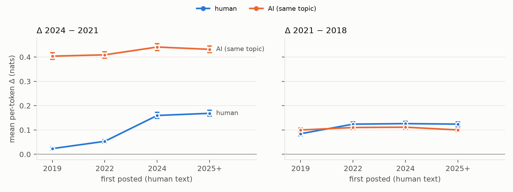

# 02. MIA·시간 변화 분리

- 브랜치: `exp/02-mia-control`
- 마감: 11/22
- 장비: 로컬 GTX 1060 6GB (00과 같은 설정: fp16, batch 8, 짝 단위 길이 맞춤)

## 질문

Δ는 수식상 참조 모델 기반 MIA 점수와 같습니다(*Machine Text Detectors are MIAs*, ICML 2026). 그래서 "AI 글을 잡는 게 아니라 **새 모델이 학습한 글**을 잡는 것 아니냐"가 가장 큰 반론입니다. 00은 사람 글(B)을 두 모델 모두 못 본 2025년 이후 글로 골라 이 문제를 피했을 뿐, 크기를 재지는 않았습니다.

- Q1. 새 모델이 학습했을 수 있는 사람 글은 Δ가 얼마나 더 큰가? (학습 포함 효과, 이하 MIA 효과)
- Q2. 그 크기는 AI 문체 효과(00의 C−B gap +0.25)에 비해 얼마인가? 학습했을 수 있는 사람 글을 상대로도 C를 가려내는가?
- Q3. AI 보조 글(2023년 이후 사람 글에 섞인 LLM 수정)은 MIA 효과와 구분해서 얼마인가?

## 그룹

모두 arXiv cs 초록입니다. 00의 B와 같은 수집·필터(`scripts/fetch_arxiv.py`)를 쓰고, 첫 버전 제출 시점으로 나눕니다. DatedGPT는 FineWeb-Edu 문서를 **크롤 시점**으로 연도를 나누므로, 어떤 해에 처음 올라온 초록 페이지는 그해 이후 크롤에만 들어갈 수 있습니다.

| 그룹 (사람 / 같은 제목 AI) | 제출 시점 | 2018 모델 | 2021 모델 | 2024 모델 | AI 보조 글 |
| --- | --- | --- | --- | --- | --- |
| H19 / C19 | 2019-01~12 | 학습 불가 | 학습 가능 | 학습 가능 | 없음 |
| H22 / C22 | 2022-01~10 | 학습 불가 | 학습 불가 | 학습 가능 | 없음 (ChatGPT 이전) |
| H24 / C24 | 2024-01~10 | 학습 불가 | 학습 불가 | 학습 가능 | 섞일 수 있음 |
| B / C (00 재사용) | 2025-07~2026-10 | 학습 불가 | 학습 불가 | 학습 불가 | 섞일 수 있음 |

C는 00과 같은 프롬프트·생성기·디코딩으로 같은 제목의 초록을 씁니다. 사람 글이 크롤에 들어갔는지는 AI 글에 영향을 주지 않으므로, C는 주제와 지식 시대를 맞춘 **기준점**입니다. 시기에 따라 C−H gap이 변하면, 그 변화는 사람 글 쪽에서 일어난 일(학습 포함, AI 보조)입니다.

## 설계상 주의: 학습 포함 효과와 AI 보조 효과가 섞이는 비교

처음에는 H22(2024 모델이 학습 가능)와 B(학습 불가)를 비교하려 했습니다. 하지만 B에는 AI로 다듬은 초록이 섞여 있어 B의 Δ도 부풀려져 있습니다(00의 사람 글 꼬리). 그래서 이 비교는 **"학습 포함 효과 − B의 AI 보조 효과"**가 되고, 두 효과가 서로 상쇄될 수 있습니다. 그래서 학습 포함 효과는 **둘 다 ChatGPT 이전인 H19와 H22로만** 잽니다.

## 측정 (`scripts/mia_contrast.py`)

시기 p마다 `gap_m(p) = mean Δ_m(C_p) − mean Δ_m(H_p)`이고, m은 post(2024−2021) 또는 pre(2021−2018)입니다. 양수는 "사람 글의 Δ를 올림"을 뜻합니다. 시기마다 독립 표본이므로 시기 안에서 짝 단위로 1000회 bootstrap합니다.

| 대비 | 식 | 무엇을 재나 |
| --- | --- | --- |
| **mia_pre** | gap_pre(22) − gap_pre(19) | AI 이전 쌍에서의 학습 포함 효과. H19는 2021 모델만 학습 가능, H22는 둘 다 불가. 둘 다 AI 보조 글 없음 |
| **mia_post_clean** | gap_post(19) − gap_post(22) | AI 이후 쌍에서의 학습 포함 효과. H22는 2024 모델만 학습 가능, H19는 둘 다 학습 가능(효과가 상쇄된다고 가정). AI 보조 글 없음 |
| polish_24 | gap_post(22) − gap_post(24) | 둘 다 2024 모델이 학습 가능. 차이는 H24의 AI 보조 글(+ 지식 시대 차이) |
| mia_minus_polish_B | gap_post(25) − gap_post(22) | H22의 학습 포함 효과 − B의 AI 보조 효과 (섞인 값, 참고용) |

추가 보고: 시기별 사람·AI 평균 Δ, 시기별 탐지 AUROC(C_p vs H_p, Δ2024−2021).

**실제 중복 검증** (MIA 추정과 따로 보고, `scripts/fineweb_presence.py`): 각 초록의 `arxiv.org/abs/<id>` 페이지가 FineWeb-Edu 덤프에 있는지 URL로 찾습니다. FineWeb-Edu의 2022~2024 덤프는 21개, 덤프당 parquet 약 50~60GB이고, `url` 열만 범위 요청으로 읽습니다. 먼저 파일 하나로 크기와 시간을 재고, 덤프 2개로 포함률을 추정한 뒤 전체 스캔 여부를 정합니다. 포함률이 충분하면 **같은 시기 안에서** "있는 글 vs 없는 글"을 비교합니다. 시기와 AI 보조 효과가 같으므로 가장 깨끗한 비교입니다. FineWeb-Edu에 있다는 것은 "학습 가능"이지 "학습함"이 아니고(DatedGPT는 약 100B 토큰을 뽑아 씀), arxiv.org 밖의 사본은 못 잡습니다.

## 가설

- H1: 학습 포함 효과가 AI 문체 효과의 절반보다 작다. mia_pre와 mia_post_clean의 95% CI 상한이 0.13 미만입니다(00의 B/C-only gap +0.263의 절반).
- H2: 학습 가능 사람 글 상대로도 탐지가 유지된다: AUROC(C22 vs H22) ≥ 0.80.
- H3: 학습 포함 효과는 AI 노출과 무관한 모델 계열의 성질이다: mia_post_clean − mia_pre의 95% CI가 0을 포함합니다.
- (탐색) polish_24 > 0: 2024년 사람 초록에 AI 보조 글이 섞여 C와 가까워집니다.

## 판단 기준

| 결과 | 해석과 다음 단계 |
| --- | --- |
| H1·H2 성립 | "Δ는 MIA일 뿐"이라는 반론에 대한 답. 논문의 핵심 통제로 씀 |
| H1 불성립 (학습 포함 효과 ≥ AI 문체 효과의 절반) | 학습된 사람 글을 AI로 오판할 위험이 큼. 탐지 주장을 "새 모델의 크롤 이후에 쓰인 글"로 한정하고, 01·04 설계에 반영 |
| 실제 중복 검증에서 포함률이 매우 낮음 | "학습 가능" 그룹의 대부분이 실제로는 비학습 → MIA 추정이 과소일 수 있음. 포함이 확인된 글만으로 다시 계산 |

## 데이터 (2026-11-13)

- 사람 글: `data/human_arxiv_{2019,2022,2024}.jsonl` (월 40편, 2019 480 / 2022 400 / 2024 400, 모두 해당 연도 첫 제출, 중복 없음)
- 시기마다 400편을 Qwen 200 + Llama 200으로 나눔(사람 글은 생성기마다 서로 다름, 00과 같은 설계). 2019는 480편 중 400편.
- `python scripts/generate_ai.py --human data/human_arxiv_2022.jsonl --out data/pairs_2022.jsonl --per-generator 200 --reserve 0 --human-group H22 --ai-group C22` (2019, 2024도 같은 방식)

## 미리 적어둔 예측 (2026-11-13, 채점 전)

이 시점에 아는 것: 00 결과(B의 Δ2024−2021 +0.175, C +0.427, B/C-only gap +0.263, 파일럿 A −0.019). 02의 점수는 하나도 계산하지 않았습니다.

- 사람 글의 평균 Δ2024−2021은 시기 순으로 올라갈 것입니다. H19 0.00~0.08 → H22 0.08~0.15 → H24 0.12~0.20 → B 0.175(알려짐). 주된 이유는 학습 포함이 아니라 지식 시대입니다(2022년 이후 내용은 2024 모델만 앎). 이런 수준 차이는 C에도 같이 생기므로 gap에서 빠집니다.
- gap_post는 모든 시기에서 +0.20~+0.30입니다.
- mia_pre, mia_post_clean: 0.00~0.03(작음). CI가 0을 포함해도 이상하지 않습니다. 1.3B 모델이 약 100B 토큰 중 한두 번 본 초록 하나의 흔적은 작다고 봅니다. → **H1 성립, H3 성립**으로 예측합니다.
- AUROC(C22 vs H22): 0.88~0.94. B(0.920, B/C-only)와 비슷합니다. → **H2 성립**.
- polish_24: +0.01~+0.05. mia_minus_polish_B: −0.04~+0.02.
- 추정이 낮게 나올 수 있는 이유: 사람 초록을 학습했다면, 같은 제목 단어를 쓰는 C의 확률도 같이 올라갈 수 있습니다. 그러면 gap에서 학습 포함 효과가 일부 상쇄되므로, 위 MIA 추정은 하한일 수 있습니다.

## 설계 변경: arXiv 초록은 사실상 학습 데이터 밖이다 (2026-11-13, 02 채점 전)

C 생성 중에 실제 중복 검증의 시험 스캔을 먼저 돌렸습니다(`fineweb_presence.py`의 URL 열만 읽기).

| 덤프 (파일 하나) | 문서 수 | `arxiv.org/abs` 페이지 | 기타 |
| --- | --- | --- | --- |
| CC-MAIN-2022-49 `train-00000-of-00026` | 769,859 | 0 | |
| CC-MAIN-2024-10 `000_00000` | 621,759 | 14 (+ `export.arxiv.org/abs` 2) | ar5iv 전문 4, 요약 사이트 3 등 |

- 2024-10 덤프는 파일 50개, 약 3,100만 문서입니다. 이 비율이면 덤프당 arXiv 초록 페이지는 약 800개입니다. arXiv 논문이 약 200만~250만 편이므로, **특정 논문의 초록 페이지가 2022~2024년 덤프 21개 중 하나에라도 있을 확률은 1% 미만**입니다(덤프마다 독립이라 가정하고 합한 상한).
- URL 열만 읽어도 파일당 3~4분이 걸려, 21개 덤프 전체(약 800개 파일)를 스캔하려면 40시간 이상 필요합니다. 포함률이 이 정도면 전체 스캔은 할 가치가 없습니다.

**결론과 영향**

1. **00에는 유리합니다.** arXiv 초록은 연도와 상관없이 DatedGPT 학습 풀에 거의 없습니다(arxiv.org 밖 사본은 못 셌지만, 요약·미러 사이트도 드물게 보임). 그러므로 00의 B/C 차이가 MIA 때문일 가능성은 낮습니다.
2. **02의 arXiv 시기 비교로는 학습 포함 효과를 잴 수 없습니다.** H19·H22는 "학습 가능"이 아니라 사실상 "학습 안 됨"입니다. 그래서 위 H1·H3(학습 포함 효과)은 arXiv 데이터로 판정하지 않습니다. mia_pre·mia_post_clean은 계산하되 "학습 포함이 거의 없을 때의 값"(기대값 0, 대조 기준선)으로만 보고합니다.
3. **arXiv 시기 비교(H19/H22/H24/B)는 그대로 돌립니다.** 학습 포함 효과가 없는 조건에서 사람 글의 Δ가 시기에 따라 어떻게 변하는지(지식 시대, AI 보조 글)와, 시기마다 탐지가 유지되는지(H2)를 봅니다. 위에 적은 예측 중 시기별 평균 Δ, gap_post, H2, polish_24 예측은 그대로 유효합니다.

**학습 포함 효과는 FineWeb-Edu 문서 자체로 잽니다 (02-b, 다음 단계)**

- 사람 글을 FineWeb-Edu에서 직접 뽑습니다. 학습 풀에 들어 있다는 것이 보장됩니다. AI 생성 글이 섞이지 않도록 **ChatGPT 이전 크롤만** 씁니다.
  - 학습 가능 (2021 모델 풀): 2021년 덤프(CC-MAIN-2021-xx)의 문서 중 URL에 `/2020/`·`/2021/` 날짜 경로가 있는 것. 2018 모델 풀에는 없음
  - 학습 불가 (2018·2021 모델 풀 모두): 2022년 1~10월 덤프(CC-MAIN-2022-05~40)의 문서 중 URL에 `/2022/`가 있는 것
- AI 기준점: 같은 문서의 앞부분(약 30토큰)을 주고 C 생성기가 이어 쓰게 합니다(Fast-DetectGPT 방식). 주제와 지식 시대가 맞습니다.
- 측정: AI 이전 쌍(2021−2018)에서 `mia_pre = gap_pre(학습 불가) − gap_pre(학습 가능)`. AI 보조 글이 없는 조건에서 "풀에 들어 있음"의 효과를 잽니다.
- 남는 불확실성: DatedGPT가 풀에서 약 100B 토큰만 뽑았는지(누적 풀이면 문서당 학습 확률이 낮음), 해당 연도 크롤 전체를 썼는지 논문에 없습니다. 그래서 결과는 "풀에 들어 있음"의 효과이고, 실제 학습 효과보다 작게 나올 수 있습니다.

### 02-b 데이터와 예측 (2026-11-13, 생성·채점 전)

```bash
export MSYS_NO_PATHCONV=1   # Git Bash: 안 하면 "/2022/"가 Windows 경로로 바뀜
python scripts/sample_fineweb.py --dump CC-MAIN-2021-49 --url-regex "/202[01]/" --n 450 --out data/fw_2021.jsonl
python scripts/sample_fineweb.py --dump CC-MAIN-2022-40 --url-regex "/2022/" --n 450 --out data/fw_2022.jsonl
python scripts/generate_continuation.py --human data/fw_2021.jsonl --out data/pairs_fw2021.jsonl --per-generator 200 --human-group W21 --ai-group CW21
python scripts/generate_continuation.py --human data/fw_2022.jsonl --out data/pairs_fw2022.jsonl --per-generator 200 --human-group W22 --ai-group CW22
```

| 그룹 | 출처 | 2018 풀 | 2021 풀 | 2024 풀 | 문서 |
| --- | --- | --- | --- | --- | --- |
| W21 / CW21 | CC-MAIN-2021-49, URL에 `/2020/`·`/2021/` | 없음 | **있음** | 있음 (누적이면) | 450편 (URL 연도 2021: 294, 2020: 156), 고유 사이트 435 |
| W22 / CW22 | CC-MAIN-2022-40 (2022-09~10 크롤), URL에 `/2022/` | 없음 | 없음 | 있음 (누적이거나 다시 크롤됐으면) | 450편, 고유 사이트 426 |

- 본문은 중앙값 약 700단어, FineWeb-Edu 교육 점수 중앙값 약 2.9입니다. 무작위 순서로 row group을 돌며 날짜 URL이 맞는 문서를 모았습니다(2021: 22개, 2022: 46개 row group).
- C 기준점은 문서의 첫 30단어를 주고 "이 문장으로 시작하는 약 250단어 글"을 쓰게 합니다(생성기와 디코딩은 00과 같음). 사람 글과 AI 글은 모두 공백을 한 칸으로 정리해 한 문단으로 만듭니다(파일럿의 줄바꿈 결함 방지). 앞 30단어는 양쪽이 같아서 gap을 조금 희석합니다.
- 한계: 일부 문서는 SEO 블로그로 보이며, ChatGPT 이전의 글 짜깁기 도구로 만든 글일 수 있습니다. 두 그룹에 비슷하게 섞여 있다고 가정합니다.

**대비**
- `mia_pre_web = gap_pre(W22) − gap_pre(W21)`: AI 이전 쌍에서 "2021 풀에 있음"의 효과. 둘 다 ChatGPT 이전이라 AI 보조 글 효과가 없습니다.
- `mia_post_web = gap_post(W21) − gap_post(W22)`: AI 이후 쌍. W22는 2024 풀에만 있을 수 있고, W21은 2021·2024 풀 모두에 있을 수 있습니다.

**예측**
- mia_pre_web: +0.00 ~ +0.03 (작음). 한 번 본 문서의 흔적은 1.3B·100B 토큰 학습에서 작다고 봅니다(사전학습 LLM에 대한 MIA가 무작위에 가깝다는 기존 보고와 같은 방향). → 웹 문서에서도 **H1 성립**(CI 상한 < 0.13).
- mia_post_web: +0.00 ~ +0.03.
- 사람 글 평균 Δ2021−2018은 W21이 W22보다 0.05~0.15 높습니다. 주된 원인은 학습 포함이 아니라 지식입니다(2020~2021년 사건과 COVID-19 같은 용어는 2021 모델만 앎). 이 차이는 CW21에도 같이 생겨 gap에서 빠집니다.
- gap_post(W21), gap_post(W22): +0.15 ~ +0.25 (앞 30단어 공유로 arXiv보다 약간 작음). gap_pre: −0.03 ~ +0.03.
- 탐지 AUROC (CW vs W, Δ2024−2021): 0.80 ~ 0.92.

## 결과 (2026-11-13)

```bash
cat data/pairs_2019.jsonl data/pairs_2022.jsonl data/pairs_2024.jsonl data/pairs.jsonl \
    data/pairs_fw2021.jsonl data/pairs_fw2022.jsonl > data/02_all.jsonl          # 2,392쌍
python scripts/score_texts.py --input data/02_all.jsonl --out outputs/mia.jsonl --batch-size 8 \
    --models datedgpt/datedgpt-2018-base datedgpt/datedgpt-2021-base datedgpt/datedgpt-2024-base
python scripts/mia_contrast.py --scores outputs/mia.jsonl --periods 19:H19:C19 22:H22:C22 24:H24:C24 25:B:C
python scripts/mia_contrast.py --scores outputs/mia.jsonl --periods w21:W21:CW21 w22:W22:CW22 \
    --contrasts "mia_pre_web=pre:w22-pre:w21" "mia_post_web=post:w21-post:w22" --diffs "mia_post_web-mia_pre_web"
python scripts/plot_period_means.py --scores outputs/mia.jsonl \
    --periods 2019:H19:C19 2022:H22:C22 2024:H24:C24 2025+:B:C --out docs/experiments/figs/02-period-means.png
```

데이터: arXiv H19/C19 400, H22/C22 400, H24/C24 399(Qwen 1개가 100토큰 미만), B/C 400(00 재사용). FineWeb-Edu W21/CW21 395, W22/CW22 398(Llama 이어쓰기 7개가 100토큰 미만). 3개 모델로 글 4,784개 채점에 약 25분.

### 1. arXiv 초록: 학습 풀 밖에서 시기별 변화

| 사람 글 시기 | 사람 Δ2024−2021 | AI Δ2024−2021 | gap_post [95% CI] | gap_pre [95% CI] | 탐지 AUROC [95% CI] | TPR@5% | AI 표지어 /1k단어 (사람) |
| --- | --- | --- | --- | --- | --- | --- | --- |
| 2019 (H19) | 0.023 | 0.404 | +0.380 [0.366, 0.396] | +0.015 [0.008, 0.023] | 0.996 [0.991, 0.999] | 0.985 | 3.0 |
| 2022 (H22) | 0.053 | 0.409 | +0.356 [0.341, 0.369] | −0.014 [−0.023, −0.005] | 0.991 [0.987, 0.995] | 0.970 | 4.1 |
| **2024 (H24)** | **0.160** | 0.441 | +0.281 [0.264, 0.298] | −0.015 [−0.024, −0.005] | 0.918 [0.902, 0.934] | 0.506 | **7.5** |
| 2025+ (B) | 0.169 | 0.432 | +0.263 [0.248, 0.279] | −0.024 [−0.033, −0.014] | 0.920 [0.902, 0.938] | 0.515 | 4.9 |

AI 표지어는 LLM 보조 글에서 늘었다고 보고된 단어 18개입니다(delve, intricate, showcase, pivotal, meticulous, notably, realm, underscore, leverage, enhance, comprehensive, crucial, various, seamless, innovative, robust, ensure 등). 같은 제목의 AI 글은 시기와 상관없이 1,000단어당 21~22개입니다.



*그림: arXiv 사람 초록(파랑)과 같은 제목의 AI 초록(주황)의 평균 Δ, 95% bootstrap 구간. 왼쪽 AI 이후 쌍에서는 사람 초록만 2022 → 2024 사이에 뛰어오르고, 오른쪽 AI 이전 쌍에서는 모든 시기에 두 선이 겹칩니다.*

| 대비 | 값 [95% CI] | 의미 |
| --- | --- | --- |
| mia_pre | −0.029 [−0.041, −0.017] | 학습 포함이 거의 없을 때 시기 간 대비의 크기(기대값 0) → **시기 비교 방법 자체의 오차 범위는 ±0.03 정도** |
| mia_post_clean | +0.025 [+0.004, +0.046] | 위와 같음 |
| **polish_24** | **+0.074** [+0.054, +0.096] | 2022 → 2024 사람 초록의 Δ 상승 중, 같은 제목의 AI 기준점으로 설명되지 않는 몫 |
| mia_minus_polish_B | −0.093 [−0.114, −0.071] | B에도 같은 상승이 있음 |

- **ChatGPT 이후에 쓰인 사람 초록의 Δ만 계단처럼 뜁니다.** 2022년 0.053에서 2024년 0.160이 되는 동안, 같은 제목의 AI 기준점은 0.409에서 0.441로 0.032만 오릅니다. arXiv 초록은 학습 풀에 거의 없으므로 학습 포함으로는 설명되지 않습니다. 같은 시기에 AI 표지어도 1.8배가 됩니다(4.1 → 7.5). **LLM 보조 글이 사람 글에 스며든 흔적을 Δ가 잡는 것과 일치**합니다. 연구 질문("시간 차이가 웹에 퍼진 AI 글을 드러내는가")에 직접 답하는 결과입니다.
- 다만 전부 AI 보조로 볼 수는 없습니다. 토큰 단위로 보면 polish_24는 넓게 퍼져 있습니다(상위 30개 토큰이 7%). LLM 분야 용어(`prompt`, Large Language Model, `LLM`)가 약 12%로, 사람이 기준점보다 구체적인 분야 용어를 더 쓰는 지식 효과입니다. 나머지 상위 토큰에는 LLM이 선호한다고 알려진 단어가 많습니다(`significantly`, `utilize`, `demonstrate`, `highlight`, `substantial`, `particularly`, `various`, `challenges`).
- 탐지에는 라벨 노이즈로 나타납니다. ChatGPT 이전 초록 상대로는 AUROC 0.99 이상(TPR@5% 0.97 이상)이지만, 2024년 이후 초록 상대로는 0.92(TPR@5% 0.51)입니다.
- AI 이전 쌍에서는 모든 시기의 gap이 ±0.025 안에 있습니다. 00의 위약 검사와 같습니다.

### 2. FineWeb-Edu 문서: 학습 풀 안의 사람 글 (02-b)

| 그룹 | 사람 Δ2024−2021 | AI Δ2024−2021 | 사람 Δ2021−2018 | AI Δ2021−2018 | gap_post [95% CI] | gap_pre [95% CI] | 탐지 AUROC [95% CI] | TPR@5% | `log p_2024` AUROC |
| --- | --- | --- | --- | --- | --- | --- | --- | --- | --- |
| W21 (2021 풀) | **−0.093** | 0.259 | **0.202** | 0.063 | +0.352 [0.314, 0.394] | −0.139 [−0.183, −0.097] | **0.967** [0.954, 0.979] | 0.901 | 0.945 |
| W22 (2021 풀 밖) | **+0.078** | 0.302 | 0.061 | 0.007 | +0.224 [0.210, 0.238] | −0.054 [−0.081, −0.032] | **0.882** [0.855, 0.907] | **0.063** | 0.934 |

| 대비 | 값 [95% CI] |
| --- | --- |
| **mia_pre_web** = gap_pre(W22) − gap_pre(W21) | **+0.085** [+0.040, +0.134] |
| mia_post_web = gap_post(W21) − gap_post(W22) | +0.128 [+0.086, +0.172] |
| mia_post_web − mia_pre_web | +0.043 [+0.014, +0.074] |

- **학습 풀에 들어 있으면 그 모델 쪽으로 확률이 올라갑니다.** AI 이전 쌍에서 2021 풀에 있는 문서는 AI 기준점 대비 Δ2021−2018이 0.085 더 높습니다. arXiv에서 본 오차 범위(±0.03)보다 뚜렷이 큽니다. AI 문체 효과(00의 gap +0.26)의 약 1/3입니다.
- **방향이 탐지에 결정적입니다.** AI 이후 쌍에서 W21은 **옛 모델(2021)** 풀에 있으므로 Δ2024−2021이 음수(−0.093)가 되어 AI 글과 더 멀어집니다(AUROC 0.967, TPR@5% 0.90, likelihood 0.945보다 좋음). 반대로 W22처럼 **새 모델의 크롤 시기에만** 속한 사람 글은 Δ가 양수(+0.078)로 AI 쪽에 붙습니다. AUROC는 0.882지만 **TPR@5%FPR이 0.063으로 무너집니다.**
- mia_post_web이 mia_pre_web보다 큰 이유가 있습니다. "W21은 2021·2024 풀 모두에 있어 효과가 상쇄된다"는 가정이 틀렸습니다. W21의 Δ2024−2021이 −0.093이므로, W21은 2024 모델보다 2021 모델에 훨씬 강하게 학습돼 있습니다. 2024 모델이 2021년 크롤을 쓰지 않았거나(연도별 데이터) 비중이 작다는 뜻이고, DatedGPT 데이터가 누적인지에 대한 간접 증거입니다. 그래서 mia_post_web은 "옛 모델 학습 효과 + 새 모델 학습 효과"의 합입니다.
- 한계: 여기서의 "학습 포함"은 문서 자체를 외운 효과와 같은 크롤 시기의 웹 언어에 익숙한 효과를 가르지 못합니다. AI 기준점은 지식 시대를 맞추지만(CW21의 Δ2021−2018 +0.063 vs CW22 +0.007), 그 시기 사람 웹 글 특유의 표현까지 맞추지는 못합니다. 그러므로 0.085는 문서 단위 MIA 효과의 상한에 가깝습니다.

### 가설 판정

| 가설 | 기준 | 결과 | 판정 |
| --- | --- | --- | --- |
| H1 | 학습 포함 효과의 CI 상한 < 0.13 (AI 문체 효과의 절반) | 웹: mia_pre_web [0.040, **0.134**], mia_post_web [0.086, **0.172**]. arXiv는 학습 포함이 없어 판정 불가 | **불성립** (점추정 0.085는 1/3이지만 CI 상한이 기준을 넘음) |
| H2 | 학습 가능 사람 글 상대 AUROC ≥ 0.80 | arXiv H22 0.991, 웹 W22 0.882, W21 0.967 | 성립. 단 W22의 TPR@5%는 0.063 |
| H3 | mia_post − mia_pre의 CI가 0 포함 | arXiv +0.054 [0.031, 0.077], 웹 +0.043 [0.014, 0.074] | 불성립. "두 풀 모두에 있으면 상쇄" 가정이 틀림 (위 설명) |
| (탐색) | polish_24 > 0 | +0.074 [0.054, 0.096] | 성립 |

### 예측과 비교

| 예측 | 결과 | |
| --- | --- | --- |
| 사람 Δ: H19 0.00~0.08, H22 0.08~0.15, H24 0.12~0.20 | 0.023, 0.053, 0.160 | H22만 예측보다 낮음 (2022 → 2024의 계단을 과소평가) |
| gap_post 모든 시기 0.20~0.30 | 0.380, 0.356, 0.281, 0.263 | ChatGPT 이전 시기는 예측보다 큼 |
| arXiv mia_pre·mia_post_clean 0.00~0.03 | −0.029, +0.025 | 크기는 맞음 (학습 포함이 없어서였음) |
| AUROC(C22 vs H22) 0.88~0.94 | 0.991 | 예측보다 높음 |
| polish_24 +0.01~+0.05 | +0.074 | 방향은 맞고 크기는 과소평가 |
| 웹 mia_pre_web·mia_post_web 0.00~0.03 | +0.085, +0.128 | **틀림.** 학습 포함 효과를 크게 과소평가 |
| 웹 사람 Δ2021−2018: W21이 W22보다 0.05~0.15 높음 | +0.141 | 맞음 |
| 웹 gap_post 0.15~0.25, gap_pre −0.03~+0.03 | W21 0.352 / −0.139, W22 0.224 / −0.054 | W22의 gap_post만 맞음 |
| 웹 AUROC 0.80~0.92 | W21 0.967, W22 0.882 | W22만 범위 안 |

### 해석과 판단

명세의 판단 기준에서 "H1 불성립"에 해당합니다. **새 모델이 학습한 사람 글은 AI 쪽으로 밀립니다.** 효과는 AI 문체 효과의 약 1/3이고, 낮은 오탐률에서는 탐지를 무너뜨릴 만큼 큽니다(W22 TPR@5% 0.063). 반대로 옛 모델이 학습한 사람 글은 AI에서 더 멀어집니다.

1. **탐지 주장의 범위**: Δ 탐지는 "새 모델의 크롤 시기에 속하지 않은 글"(00의 B처럼 새 모델 이후에 쓰였거나, arXiv처럼 크롤에 거의 없는 출처)에서만 주장합니다. 새 모델 크롤 시기의 웹 글을 판정하는 데 쓰면 오탐이 많습니다.
2. **00 결과는 유지됩니다.** 00의 B(2025년 이후 arXiv)는 어느 모델의 풀에도 없으므로 이 효과의 영향을 받지 않습니다(arXiv 포함률 1% 미만).
3. **논문의 새 결과: 사람 글로의 AI 문체 확산.** arXiv 사람 초록의 Δ는 ChatGPT 이후에만 계단처럼 오르고(polish_24 +0.074), 같은 시기 AI 표지어도 1.8배가 됩니다. 학습 포함이 없는 출처에서 나온 결과라 MIA로는 설명되지 않습니다. "시간 차이가 AI 글의 확산을 드러내는가"라는 원래 질문에 대한 가장 직접적인 증거입니다. 지식 효과(약 12%)를 뺀 몫을 더 정확히 재는 것이 다음 과제입니다.
4. **01·04 설계에 반영**: 01(연도 곡선)은 평가할 사람 글이 모든 vintage의 크롤 이후 것이어야 합니다(지금처럼 B). 04는 "새 모델 크롤 시기의 사람 웹 글"을 어려운 음성 집합으로 넣어 낮은 FPR 성능을 따로 보고합니다.
5. **DatedGPT 데이터 구성에 대한 간접 증거**: 2021년 크롤 문서가 2024 모델에서 확률이 오히려 떨어지므로(−0.093), 2024 모델은 2021년 크롤을 쓰지 않았거나 비중이 작습니다(누적이 아닐 가능성). 논문에 명시되지 않은 부분이라, 이후 해석에 이 가능성을 반영합니다.
