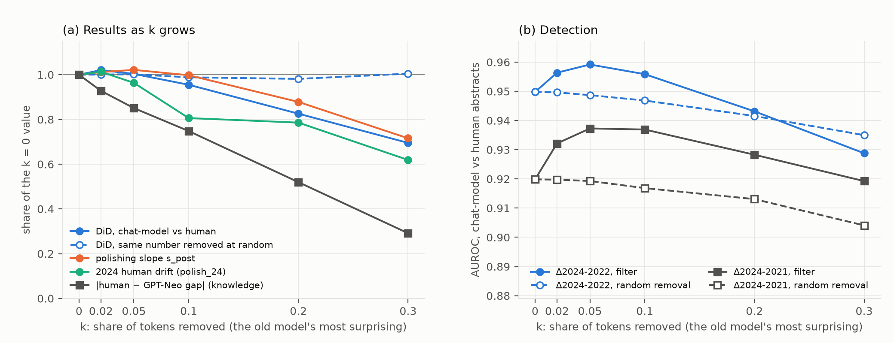

# 03. 놀람 기반 지식 토큰 필터: k 스윕과 제거 토큰 유형

- 브랜치: `exp/03-k-sweep`
- 마감: 12/11 (후순위)
- 장비: 새 채점 없음. 01의 점수 파일(`outputs/yc_20*.jsonl`, 글 6,223개 × 12 vintage, 토큰별 log p와 토큰 id)을 그대로 씁니다.

## 질문

Δ = log p_새 − log p_옛에는 AI 문체 말고 **지식**도 섞입니다. 예를 들어 2024 모델은 "LLM", "prompt", "diffusion model" 같은 2022년 이후 용어를 압니다. 00의 토큰 분석에서는 B(사람 초록)의 Δ를 D′(GPT-Neo 글)보다 높이는 토큰이 거의 모두 이런 LLM 분야 용어였습니다. 02에서는 사람 초록의 Δ 상승(polish_24) 가운데 약 12%가 이런 용어였습니다.

계획(plan.md 7절)의 필터는 **옛 모델이 가장 놀란 토큰**(log p_옛이 가장 낮은 토큰)을 글마다 비율 k만큼 빼고 Δ를 다시 잽니다. 옛 모델이 모르는 지식이면 놀랄 것이라는 생각입니다(`src/trd/scoring.py`의 `keep_mask`).

- Q1. **결론이 k에 따라 바뀌나?** 00의 DiD, AI 이전 쌍의 위약, 05의 다듬기 기울기, 02의 사람 초록 상승이 k를 키워도 남나?
- Q2. **필터가 실제로 지식을 덜어내나?** 지식 효과가 있는 것으로 아는 비교(B vs D′)에서 차이가 줄어드나? 빠지는 토큰은 어떤 종류인가(고유명사·약어, 숫자, 단어 중간 조각, LLM 분야 용어)?
- Q3. **(탐색) 탐지에 도움이 되나?** 같은 비율의 토큰을 무작위로 뺀 것과 비교합니다. 04에서 k를 쓸지 정합니다.

## 데이터 (01과 같음, 새로 생성·채점하지 않음)

| 묶음 | 쌍 수 | 쓰는 곳 |
| --- | --- | --- |
| B / C (2025+ 사람 초록 / 같은 제목 AI 초록) | 400 | 주 DiD, 탐지 |
| B / D′ (GPT-Neo) | 338 | 지식 효과 점검 |
| H19·H22·H24 / C19·C22·C24 | 400, 400, 399 | 시기별 gap, polish_24 |
| H22 / P22 (05-a 다듬은 판본) | 1,101 | 다듬기 기울기 |

비교하는 두 글은 짧은 쪽 길이로 자른 뒤 필터를 적용합니다(01과 같은 길이). 필터의 놀람은 그 쌍의 **옛 모델** 기준입니다. Δ2024−2021은 2021 모델, Δ2021−2018은 2018 모델, Δ2024−2022는 2022 모델의 log p로 고릅니다. 빼는 토큰 수는 floor(k·n)입니다.

## 측정 (`scripts/k_sweep.py`)

k ∈ {0, 0.02, 0.05, 0.1, 0.2, 0.3}마다 다음을 계산합니다. 글 x의 Δ_k(x)는 남은 토큰의 (log p_새 − log p_옛) 평균입니다.

| 양 | 식 | k = 0 값 (00·01·02·05에서 이미 앎) |
| --- | --- | --- |
| **DiD** | gap_post − gap_pre. gap_post = mean[Δ_k(c) − Δ_k(b)] (2024−2021), gap_pre는 같은 식 (2021−2018) | 0.287 (gap_post 0.263, gap_pre −0.024) |
| gap_pre (위약) | 위 | −0.024 |
| **D′ 간격** | mean[Δ_k(d) − Δ_k(b)], 2024−2021 | −0.137 (지식 효과: B의 신조어) |
| 시기별 gap_post | H19, H22, H24, B | 0.380, 0.356, 0.281, 0.263 |
| **polish_24 (U)** | gap_post(H22) − gap_post(H24) | 0.074 |
| U_B | gap_post(H22) − gap_post(B) | 0.093 |
| **s_post, s_pre** | Σ e·[Δ_k(p) − Δ_k(h)] / Σ e² (05의 다듬기 기울기) | 0.216, −0.013 |
| 탐지 | C vs B의 AUROC, TPR@5%FPR. Δ2024−2021, Δ2024−2022 | AUROC 0.920, 0.950 |

추가로 보고하는 것:
- **무작위 제거 대조**: 같은 수의 토큰을 무작위로 뺀 Δ로 DiD와 탐지를 다시 잽니다(고정 seed). 필터의 효과가 "토큰이 줄어서"인지 "어떤 토큰을 뺐는지"인지 가릅니다.
- **제거 토큰 유형** (k = 0.1, Δ2024−2021, 2021 모델 기준): B, C, D′에서 빠진 토큰을 아래 유형으로 나눕니다. 품사 태거가 없으므로 SentencePiece 토큰 문자열로 정한 규칙입니다.
  - 단어 중간 조각: 단어 시작 표시(▁)가 없는 글자 토큰
  - 대문자 단어 시작: 문장 첫 단어가 아닌데 대문자로 시작(고유명사·약어의 대리)
  - 숫자 포함
  - 기호·문장부호
  - 기능어: 흔한 영어 기능어 목록(관사, 전치사, 대명사, 조동사 등)
  - LLM 분야 용어: 토큰이 속한 단어가 미리 정한 목록(llm, prompt, chatgpt, gpt, hallucination, diffusion, transformer, fine-tuning, instruction, rlhf, in-context, zero-shot, few-shot, multimodal, agent, lora, rag 등)에 있음
  - 유형마다 "제거된 토큰 중 비율 / 전체 토큰 중 비율"(농축 배수)과, 제거된 토큰과 남은 토큰의 평균 토큰별 Δ를 보고합니다.
- **CI**: 묶음마다 짝(다듬기는 원문 논문) 단위로 2,000회 bootstrap합니다. k 사이의 차이(예: D′ 간격의 k = 0.1 − k = 0)도 같은 표본으로 계산합니다.

## 가설

- **H1 (결론 불변)**: k = 0.05, 0.1, 0.2에서 DiD의 95% CI 하한이 0보다 크고, 점추정이 k = 0 값의 절반 이상입니다.
- **H2 (위약 유지)**: 모든 k에서 |gap_pre| ≤ 0.05입니다.
- **H3 (필터가 지식을 덜어냄)**: 두 조건입니다.
  - (a) D′ 간격이 k = 0.1에서 0 쪽으로 25% 이상 줄고, 그 변화의 CI가 0을 포함하지 않습니다.
  - (b) B에서 빠진 토큰에 대문자 단어 시작, 숫자, LLM 분야 용어가 농축됩니다(셋 모두 농축 배수 > 1, 기능어는 < 1).
- **H4 (사람 쪽 확산 신호 유지)**: k = 0.1에서 polish_24의 CI가 0보다 크고, s_post의 CI도 0보다 큽니다.
- (탐색) 탐지: AUROC가 가장 높은 k와, 필터가 같은 k의 무작위 제거보다 나은지.

## 판단 기준

| 결과 | 해석과 다음 단계 |
| --- | --- |
| H1·H2 성립 | 00·01의 결론은 지식 토큰에 기대지 않습니다. 본문은 k = 0으로 쓰고 k 곡선은 부록에 넣습니다 |
| H1 불성립 | AI 신호의 상당 부분이 옛 모델이 놀란 토큰에서 옵니다. 그 토큰이 지식인지 문체인지 유형 분석으로 확인하고, 문체가 아니면 주장을 약하게 씁니다 |
| H2 불성립 | 필터 자체가 Δ를 기계적으로 비틉니다(옛 모델이 우연히 낮게 본 토큰을 빼면 Δ가 내려가는 평균 회귀). k > 0 결과는 해석하지 않습니다 |
| H3 불성립 | 놀람 필터는 지식 필터로 작동하지 않습니다. 논문에서 필터를 "지식 통제"라고 부르지 않고, 지식 통제는 짝 설계와 다듬기(같은 글) 비교로 한다고 씁니다 |
| H4 불성립 | 사람 초록의 Δ 상승이 놀람 큰 토큰(지식일 수 있음)에 몰려 있습니다. 05의 β 해석을 "지식 포함 상한"으로 약하게 씁니다 |
| 탐지에서 필터 > 무작위, AUROC 상승 | 04에서 그 k를 씁니다. 단 k를 이 데이터로 골랐으므로 04의 다른 데이터에서 다시 확인합니다 |

## 미리 적어둔 예측 (2026-11-14, k > 0 계산 전)

이 시점에 아는 것:
- 00 예비 결과: 제목마다 B·C·D′ 중 가장 짧은 길이로 자른 데이터에서, k = 0 / 0.05 / 0.1 / 0.2일 때 AUROC 0.899 / 0.920 / 0.918 / 0.910, DiD 0.274 / 0.275 / 0.262 / 0.228. 이번에는 B/C만 맞춘 더 긴 길이를 쓰므로 숫자가 조금 다를 것입니다.
- 위 표의 k = 0 값. 그 밖의 k > 0 값은 이번 데이터로 하나도 계산하지 않았습니다.

예측:
- **DiD**: k = 0.05에서 0.27~0.30, 0.1에서 0.25~0.29, 0.2에서 0.20~0.27, 0.3에서 0.16~0.25. 모두 CI 하한 > 0. → **H1 성립**.
- **gap_pre**: 모든 k에서 −0.05~+0.02. → **H2 성립**. 확신은 중간입니다. 평균 회귀로 AI 이전 쌍에서도 사람 글 쪽 Δ가 더 내려갈 수 있습니다.
- **D′ 간격**: k = 0.1에서 −0.11~−0.05(k = 0의 −0.137보다 20~60% 줄어듦). → **H3 (a)** 는 확신이 낮습니다. 2021 모델이 2020~2021년에 이미 나온 용어(prompt, diffusion model 일부)에는 크게 놀라지 않을 수 있습니다.
- **제거 토큰 유형 (B, k = 0.1)**: 단어 중간 조각 ×1.5~3, 대문자 단어 시작 ×1.5~3, 숫자 ×1.5~5로 농축되고, 기능어는 ×0.2~0.6으로 적게 빠집니다. LLM 분야 용어는 농축 배수 > 1이지만 빠진 토큰 중 비율은 10% 미만입니다. → **H3 (b) 성립**. C에서 빠진 토큰은 B보다 기능어·흔한 단어 비율이 높습니다(C에는 놀랄 토큰이 적음).
- **polish_24**: k = 0.1에서 0.045~0.075이고 CI > 0. **s_post**: k = 0.1에서 0.17~0.23이고 CI > 0. → **H4 성립**.
- **탐지 (탐색)**: Δ2024−2021 AUROC는 k = 0.02~0.1에서 가장 높고(0.925~0.95), k = 0.3에서는 k = 0 근처로 돌아옵니다. Δ2024−2022는 0.950에서 최대 0.97까지 오릅니다. 같은 k의 무작위 제거는 k = 0보다 낫지 않습니다(+0.005 이하). 그래서 k = 0.05에서 필터 > 무작위입니다.

## 한계 (미리)

- 놀람은 지식의 대리 지표일 뿐입니다. 드문 문체 표현도, 오타도, 우연히 옛 모델이 낮게 본 토큰도 빠집니다. plan.md 8절의 경고대로 "놀람 점수로 지식과 문체가 완벽히 갈리지 않는다"를 결과와 함께 적습니다.
- **평균 회귀**: 옛 모델이 가장 낮게 본 토큰은 모델 잡음 때문에 낮았을 수 있어, 그 토큰의 Δ는 위로 치우쳐 있습니다. 그래서 필터는 모든 글의 Δ를 기계적으로 내립니다. 그 몫은 gap(AI − 사람)에서는 대부분 상쇄되지만 완전히는 아닙니다. 위약(gap_pre)과 무작위 제거 대조로 봅니다.
- 토큰 유형은 품사 태거 없이 문자열 규칙으로 정합니다. LLM 분야 용어 목록은 미리 정한 것이라 빠진 용어가 있을 수 있습니다.
- 연도 곡선(01)의 G(v)는 단일 모델 값이라 이 필터(옛 모델 기준)를 그대로 적용할 수 없습니다. 이번에는 Δ 기반 양만 봅니다.

## 결과 (2026-11-14)

```bash
python scripts/k_sweep.py --scores outputs/yc_20*.jsonl --polish data/polish_2022.jsonl --json outputs/k_sweep.json > outputs/k_sweep.txt
python scripts/plot_k_sweep.py --eval outputs/k_sweep.json --out docs/experiments/figs/03-k-sweep.png
```

새 채점 없이 1분 안에 돕니다. 순서는 이렇습니다.
1. 명세와 예측을 커밋했습니다(`e47d971`).
2. 스크립트를 커밋했습니다(`ae39b5e`). 이 시점에는 k = 0만 돌려서 11개 양이 00·01·02·05와 소수 셋째 자리까지 같은 것만 확인했습니다(gap_post 0.263, gap_pre −0.024, DiD 0.287, D′ −0.137, 시기별 gap 0.380 / 0.356 / 0.281 / 0.263, U 0.074, U_B 0.093, s 0.216 / −0.013, AUROC 0.920 / 0.950).
3. 그 뒤에 k > 0을 계산했습니다.

아래 "(사후)" 표시는 결과를 본 뒤 스크립트에 추가한 분석입니다. 다른 숫자는 바뀌지 않았습니다.



(a) 각 양을 k = 0 값 대비 비율로 그렸습니다. 점선은 같은 수의 토큰을 무작위로 뺀 DiD입니다. (b) AUROC(C vs B)입니다. 실선은 필터, 점선은 무작위 제거입니다.

### 1. Δ 기반 결과는 k = 0.1까지 거의 그대로

| 양 (95% CI) | k = 0 | 0.02 | 0.05 | 0.1 | 0.2 | 0.3 |
| --- | --- | --- | --- | --- | --- | --- |
| **DiD** | +0.287 [0.267, 0.308] | +0.293 | +0.288 | **+0.274** [0.257, 0.292] | +0.237 [0.221, 0.255] | +0.200 [0.185, 0.215] |
| DiD, 무작위 제거 | +0.287 | +0.287 | +0.288 | +0.284 | +0.282 | +0.289 |
| gap_pre (위약) | −0.024 | −0.022 | −0.021 | −0.025 | −0.029 | −0.025 |
| **D′ 간격** (지식) | −0.137 [−0.153, −0.120] | −0.127 | −0.116 | **−0.102** [−0.116, −0.088] | −0.071 | −0.040 |
| gap H19 / H22 / H24 / B | 0.380 / 0.356 / 0.281 / 0.263 | | | 0.341 / 0.319 / 0.259 / 0.250 | | 0.233 / 0.219 / 0.173 / 0.175 |
| **polish_24 (U)** | +0.074 [0.051, 0.098] | +0.075 | +0.072 | **+0.060** [0.040, 0.081] | +0.058 | +0.046 [0.030, 0.062] |
| U_B | +0.093 | +0.090 | +0.082 | +0.069 | +0.057 | +0.044 |
| **s_post** | +0.216 [0.204, 0.228] | +0.219 | +0.221 | **+0.216** [0.204, 0.227] | +0.190 | +0.155 |
| s_pre | −0.013 | −0.017 | −0.020 | −0.020 | −0.019 | −0.016 |

k = 0과의 차이는 같은 bootstrap 표본으로 계산했습니다.
- **DiD**: k = 0.05에서 +0.001 [−0.005, +0.007], 0.1에서 −0.013 [−0.020, −0.006], 0.3에서 −0.088입니다.
- **gap_pre**: 모든 k에서 ±0.005 안이고, CI가 0을 포함합니다.
- **D′ 간격**: k = 0.1에서 +0.034 [+0.029, +0.040]으로 0 쪽으로 25% 줄고, 0.3에서는 71% 줍니다.

읽는 법:
- k = 0.1까지는 DiD, 다듬기 기울기, 사람 초록 상승이 모두 k = 0의 80~100%를 유지합니다. 그보다 크게 빼면 셋 다 줄어듭니다(k = 0.3에서 62~72%).
- 같은 수를 무작위로 빼면 DiD가 그대로입니다. 그러니 줄어드는 것은 토큰 수가 아니라 **어떤 토큰을 뺐는지** 때문입니다.
- 위약(gap_pre)은 k와 상관없이 그대로입니다. 걱정했던 평균 회귀(옛 모델이 우연히 낮게 본 토큰을 빼서 생기는 기계적 치우침)는 AI−사람 차이에서는 상쇄됐습니다.

### 2. 필터가 빼는 것: 사람 글에서는 분야 용어, AI 글에서는 채팅 문체 단어

k = 0.1, Δ2024−2021, 2021 모델 기준입니다. 표의 값은 "전체 토큰 중 비율 → 빠진 토큰 중 비율 (농축 배수)"입니다.

| 유형 | B (사람) | C (AI) | D′ (GPT-Neo) |
| --- | --- | --- | --- |
| 대문자 단어 시작 (이름·약어) | 3.9% → 9.8% (**×2.49**) | 2.8% → 8.3% (×2.95) | 3.1% → 7.7% (×2.50) |
| LLM 분야 용어 | 1.9% → 3.1% (**×1.64**) | 1.4% → 2.0% (×1.50) | 1.1% → 2.4% (×2.16) |
| 단어 중간 조각 | 22.6% → 7.2% (×0.32) | 20.2% → 7.5% (×0.37) | 13.1% → 7.4% (×0.57) |
| 숫자 포함 | 1.5% → 0.2% (**×0.14**) | 0.4% → 0.2% (×0.38) | 1.0% → 0.3% (×0.27) |
| 기호·문장부호 | 12.7% → 2.0% (×0.16) | 10.2% → 1.5% (×0.15) | 10.1% → 2.1% (×0.21) |
| 기능어 | 19.9% → 1.8% (×0.09) | 23.6% → 4.6% (×0.19) | 35.1% → 7.1% (×0.20) |
| 토큰별 Δ: 빠진 것 / 남은 것 | +0.787 / +0.102 | +1.170 / +0.344 | +0.348 / +0.009 |

빠진 토큰은 대부분 **단어의 첫 내용어 토큰**입니다. 단어 중간 조각, 숫자, 기호, 기능어는 오히려 덜 빠집니다. 단어가 시작되면 나머지 조각은 쉽게 맞히고, 숫자는 한 자리씩 쪼개져 어느 정도만 놀랍기 때문입니다. 가장 자주 빠진 토큰을 보면 그룹마다 성격이 다릅니다.

| 그룹 | 가장 자주 빠진 토큰 (상위 일부) | 성격 |
| --- | --- | --- |
| B (사람) | prompt, Lar(ge), language, large, reasoning, Language, diffusion, LM, benchmark, agents, foundation, semantic | **2022년 이후 LLM 분야 용어** (지식) |
| C (AI) | introdu(ce), Through, By, lever(age), integr(ate), compreh(ensive), complex, advanced, various, designed, traditional, diverse, enh(ance), ens(ure), rig(orous) | **채팅 모델 문체 단어** (00의 토큰 분석과 같은 단어들) |
| D′ (GPT-Neo) | model, data, paper, models, We, framework, learning, problem, propose | 흔한 학술 단어 |

**옛 모델이 가장 놀란 토큰은 지식만이 아닙니다.** 사람 글에서는 새 분야 용어이고, AI 글에서는 AI 문체 단어 자체입니다. 그래서 필터는 사람 쪽에서 지식을 빼는 동시에 AI 쪽에서 신호(문체)도 뺍니다. k가 작을 때는 둘이 비슷하게 상쇄되어 DiD가 그대로이고, k가 크면 문체 단어가 더 많이 빠져 DiD가 줄어듭니다. 다듬기 기울기(s_post)가 k = 0.2부터 줄어드는 것도 같은 이유입니다. 다듬기는 같은 글이라 지식 차이가 없기 때문입니다.

### 3. 탐지 (탐색): 필터가 사람 쪽 오탐 꼬리를 줄임

| AUROC (TPR@5%FPR) | k = 0 | 0.02 | 0.05 | 0.1 | 0.2 | 0.3 |
| --- | --- | --- | --- | --- | --- | --- |
| Δ2024−2022, 필터 | 0.950 (0.65) | 0.956 (0.71) | **0.959 (0.73)** | 0.956 (0.75) | 0.943 (0.71) | 0.929 (0.67) |
| Δ2024−2022, 무작위 | 0.950 (0.65) | 0.950 (0.65) | 0.949 (0.68) | 0.947 (0.68) | 0.942 (0.68) | 0.935 (0.64) |
| Δ2024−2021, 필터 | 0.920 (0.52) | 0.932 (0.55) | **0.937 (0.66)** | 0.937 (0.67) | 0.928 (0.61) | 0.919 (0.60) |
| Δ2024−2021, 무작위 | 0.920 (0.52) | 0.920 (0.50) | 0.919 (0.51) | 0.917 (0.56) | 0.913 (0.51) | 0.904 (0.47) |

- 필터는 k = 0.05~0.1에서 AUROC를 0.01~0.02 올립니다. 특히 TPR@5%FPR을 크게 올립니다(2024−2022: 0.65 → 0.73~0.75, 2024−2021: 0.52 → 0.66~0.67).
- 무작위 제거는 k = 0보다 낫지 않습니다.
- **(사후) 이유.** Δ가 가장 높은 사람 초록 5%는 LLM 분야 용어 비율이 전체의 2.8배입니다(0.053 vs 0.019). 00에서 낮은 FPR 성능을 깎은 "LLM 주제 초록"이 이들입니다.
  - k = 0.05에서 사람 Δ의 95백분위는 0.418 → 0.328로 0.090 내려갑니다(Δ2024−2021). 같은 동안 AI 평균은 0.036만 내려갑니다.
  - 사람 글마다 Δ가 내려간 정도는 LLM 용어 비율과 상관 +0.28입니다.
  - 즉 필터는 사람 쪽 오탐 꼬리를 깎아서 탐지에 도움이 됩니다. 이 꼬리가 다 사라지지는 않습니다(필터 뒤에도 상위 5%의 LLM 용어 비율은 0.050).

### 가설 판정

| 가설 | 기준 | 결과 | 판정 |
| --- | --- | --- | --- |
| H1 | k = 0.05, 0.1, 0.2에서 DiD CI 하한 > 0, k = 0의 절반 이상 | 0.288, 0.274, 0.237 (k = 0의 100%, 95%, 83%), CI 하한 모두 > 0.22 | **성립** |
| H2 | 모든 k에서 \|gap_pre\| ≤ 0.05 | −0.021 ~ −0.029 | **성립** |
| H3 (a) | D′ 간격이 k = 0.1에서 25% 이상 줄고 변화의 CI가 0 제외 | 25.5% 줄어듦, 변화 +0.034 [0.029, 0.040] | **성립** (기준 바로 위) |
| H3 (b) | B에서 대문자·숫자·LLM 용어 농축 > 1, 기능어 < 1 | ×2.49, **×0.14**, ×1.64, ×0.09 | **불성립** (숫자가 오히려 덜 빠짐) |
| H4 | k = 0.1에서 polish_24와 s_post의 CI > 0 | +0.060 [0.040, 0.081], +0.216 [0.204, 0.227] | **성립** |
| (탐색) 탐지 | 필터 > 무작위, AUROC 상승 | k = 0.05에서 0.959 vs 0.949, 0.937 vs 0.919 | 필터가 나음 |

### 예측과 비교

| 예측 (k > 0 계산 전) | 결과 | |
| --- | --- | --- |
| DiD: 0.05에서 0.27~0.30, 0.1에서 0.25~0.29, 0.2에서 0.20~0.27, 0.3에서 0.16~0.25 | 0.288, 0.274, 0.237, 0.200 | 맞음 |
| gap_pre −0.05~+0.02 (확신 중간, 평균 회귀 걱정) | −0.021 ~ −0.029 | 맞음. 평균 회귀는 상쇄됨 |
| D′ 간격 k = 0.1에서 −0.11~−0.05 (20~60% 줄어듦, 확신 낮음) | −0.102 (25%) | 맞음 (범위 끝 쪽) |
| B에서 빠진 토큰: 단어 중간 조각 ×1.5~3 | ×0.32 | **틀림.** 반대 방향. 놀람은 단어 첫 토큰에 몰림 |
| 대문자 단어 시작 ×1.5~3 | ×2.49 | 맞음 |
| 숫자 ×1.5~5 | ×0.14 | **틀림.** 반대 방향. 숫자는 한 자리씩 쪼개져 크게 놀랍지 않음 |
| 기능어 ×0.2~0.6 | ×0.09 | 틀림. 예상보다 더 안 빠짐 |
| LLM 용어 농축 > 1, 빠진 토큰 중 10% 미만 | ×1.64, 3.1% | 맞음 |
| C에서 빠진 토큰은 B보다 기능어·흔한 단어가 많음 | 기능어 4.6% vs 1.8% | 맞음. 다만 핵심은 **C에서 채팅 문체 단어가 빠진다**는 것으로, 예측하지 못함 |
| polish_24 k = 0.1에서 0.045~0.075, CI > 0 | 0.060 [0.040, 0.081] | 맞음 |
| s_post k = 0.1에서 0.17~0.23, CI > 0 | 0.216 | 맞음 |
| AUROC(2024−2021) 최대 0.925~0.95, k = 0.02~0.1에서 | 0.937 (k = 0.05~0.1) | 맞음 |
| k = 0.3에서 k = 0 근처로 돌아옴 | 0.919 vs 0.920 | 맞음 |
| AUROC(2024−2022) 최대 0.97까지 | 0.959 | 맞음 (범위 안) |
| 무작위 제거는 k = 0보다 +0.005 이하 | 최대 +0.000 | 맞음 |

### 해석과 판단

판단 기준의 "H1·H2 성립"과 "H3 불성립" 행에 해당합니다.

1. **00·01의 결론은 놀람 큰 토큰에 기대지 않습니다.** 토큰의 10%를 빼도 DiD는 95%가 남고, 위약은 그대로입니다. 본문은 k = 0으로 쓰고 k 곡선은 부록에 넣습니다.
2. **놀람 필터는 지식 필터가 아닙니다.** 사람 글에서는 실제로 LLM 분야 용어를 빼고, 그래서 지식 효과로 알려진 B−D′ 간격이 줄어듭니다(H3 (a)). 하지만 AI 글에서는 `leverage`, `comprehensive`, `Through`, `By` 같은 채팅 문체 단어를 뺍니다. 옛 모델에게는 새 지식도 새 문체도 똑같이 "놀라운 첫 내용어"이기 때문입니다. H3 (b)는 숫자 조건 때문에 불성립했지만, 더 중요한 문제는 이것입니다.
   - 논문에서 이 필터를 "지식 통제"라고 부르지 않습니다. 지식 통제는 짝 설계(같은 제목)와 다듬기 비교(같은 글, 05·01의 S)로 한다고 씁니다.
   - plan.md 8절의 경고("놀람 점수로 지식과 문체가 완벽히 갈리지 않음")를 이 표로 뒷받침합니다.
3. **사람 초록의 상승(polish_24)은 k = 0.1에서 81%가 남습니다.** 02에서 토큰으로 본 "LLM 분야 용어 약 12%"와 비슷한 크기가 빠집니다. 05의 β·α는 "지식을 조금 포함한 값"으로 읽는 기존 해석을 유지합니다.
4. **탐지에는 쓸모가 있습니다.** 이유는 지식 통제가 아니라 사람 쪽 오탐 꼬리(LLM 주제 초록)를 깎는 데 있습니다. 판단 기준대로 04에서 k = 0.05를 씁니다(Δ2024−2022: AUROC 0.959, TPR@5% 0.73). 이 k는 이 데이터로 골랐으므로, 04의 다른 데이터에서 k = 0과 함께 보고해 다시 확인합니다.

### 한계 (결과 후 추가)

- 토큰 유형은 문자열 규칙입니다. "LLM 분야 용어" 목록에 없는 분야 용어(reasoning, foundation model, benchmark 등)는 다른 유형으로 셌습니다. 그래서 LLM 용어의 농축 배수(×1.64)는 실제 지식 토큰 비율의 하한입니다.
- 4절(탐지)의 "사람 꼬리" 분석은 결과를 본 뒤 추가했습니다. 상관(+0.28)은 약한 편이라, 꼬리를 깎는 다른 이유(우연히 낮게 본 토큰의 평균 회귀)도 섞여 있을 수 있습니다.
- 도메인이 arXiv cs 초록 하나입니다. 놀란 토큰이 지식인지 문체인지는 도메인마다 다를 수 있습니다.
