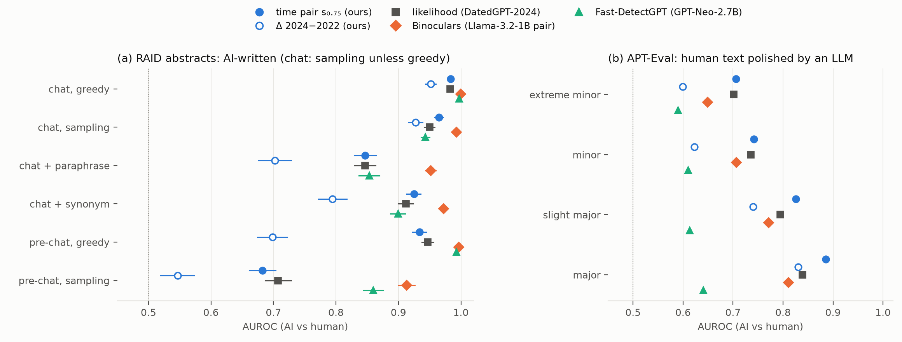

# 04. 기존 탐지기와 비교: 공개 벤치마크에서 시간 쌍 점수의 자리

- 브랜치: `exp/04-complement`
- 마감: 12/11
- 장비: 로컬 GTX 1060 6GB. API 없음. 기존 탐지기는 6GB에 맞는 작은 모델로 돌립니다(아래). 원 논문 설정(7B)은 결과를 보고 RunPod에서 할지 정합니다.

## 질문

지금까지는 우리가 만든 데이터에서 가장 약한 기준선(단일 모델 likelihood)과만 비교했습니다. 00과 05에서 본 것은 두 가지입니다.
- 처음부터 AI가 쓴 글: likelihood가 Δ보다 낫습니다(0.990 vs 0.899).
- 사람이 쓰고 AI가 많이 다듬은 글: Δ가 likelihood보다 낫습니다(0.875 vs 0.792).

03 뒤의 탐색에서는 둘을 섞은 점수 s_λ = log p_2024 − λ·log p_2022가 두 경우 모두에서 좋았습니다(아래 표).

- Q1. 공개 벤치마크에서 Δ와 s_λ는 likelihood, 그리고 기존 zero-shot 탐지기(Binoculars, Fast-DetectGPT)와 비교해 어디쯤인가? 같은 GPU 예산(1~3B, fp16)에서 봅니다.
- Q2. 어떤 조건에서 이기고 지나? 생성기 종류(채팅 모델 vs ChatGPT 이전 base 모델), 디코딩(greedy vs sampling), 공격(paraphrase, 동의어 치환), AI 다듬기 강도로 나눠 봅니다.
- Q3. **상보성**: 기존 탐지기가 놓친 AI 글을 시간 쌍 점수가 잡나? 둘을 합치면 좋아지나?
- Q4. **시간 경계 대조**: 같은 식을 AI 이전 쌍(2021, 2018)으로 만들면 이득이 사라지나? 사라져야 "ChatGPT를 사이에 둔 시간 차이 덕분"이라고 말할 수 있습니다.

## 데이터

| 묶음 | 내용 | 글 수 | 역할 |
| --- | --- | --- | --- |
| **RAID 초록** (Dugan et al., ACL 2024, MIT) | 사람 초록 1,766편 중 400편(seed 0)과 같은 제목의 생성 글. 생성기 11종 × greedy·sampling(반복 억제 없음). 채팅 생성기 4종(ChatGPT, GPT-4, Llama-2-chat, Mistral-chat)의 sampling 글에는 paraphrase·synonym 공격판도 넣고, 같은 공격을 받은 사람 초록과 비교 | 13,200 | 시험 |
| **APT-Eval** (Saha & Feizi, Findings of ACL 2025, MIT) | 사람 원문 300편(블로그, 이메일, 게임 리뷰, 뉴스, 논문 초록, 연설 각 약 50편)과 실제 LLM 5종(GPT-4o, DeepSeek-V3, Llama3.1-70B, Llama3-8B, Llama2-7B)이 4단계(extreme_minor, minor, slight_major, major)로 다듬은 판본 5,227편 | 5,527 | 시험 (**주 시나리오**: 사람이 쓰고 AI가 다듬은 글) |
| 개발 세트 | B/C(00), H22/C22(02), H22/P22(05) | 2,701 | λ를 고른 데이터. 결과는 따로 보고 |

- RAID는 `scripts/fetch_raid.py`로 11.8GB를 받으면서 초록 도메인만 남겼습니다(741,720행). 그다음 `scripts/convert_raid.py`로 위 표본을 만들었습니다.
- APT-Eval은 `scripts/convert_apt_eval.py --domain all --polish-type degree-based --prefix apt04`로 만들었습니다. 05의 출력은 같은 스크립트로 그대로 재현됩니다.
- **생성기 분류(미리 정함)**:
  - 채팅 생성기: chatgpt, gpt4, cohere-chat, llama-chat, mistral-chat, mpt-chat
  - 채팅 이전 생성기: gpt2, gpt3, cohere, mistral, mpt (base 모델)
  - Δ는 "ChatGPT 이후 채팅 문체"를 재므로, 채팅 이전 생성기의 글은 측정 범위 밖으로 봅니다(00의 파일럿에서 davinci ≈ 사람).
- **학습 포함**:
  - RAID의 사람 글은 arXiv 초록입니다. 02에 따르면 FineWeb-Edu에 거의 없어 어느 vintage도 학습하지 않았습니다. ChatGPT 이전에 쓰인 초록이라 AI로 다듬어졌을 가능성도 낮습니다.
  - APT-Eval의 원문(MixSet)은 출처와 시기가 도메인마다 다르고, 학습 포함 여부를 모릅니다. 그래서 도메인별로도 보고합니다.

## 탐지기 (모두 로컬, fp16, 글마다 자기 길이 최대 200토큰)

| 이름 | 모델 | 점수 (AI 쪽 방향) |
| --- | --- | --- |
| likelihood | DatedGPT-2024 | 평균 log p (높을수록) |
| Δ | DatedGPT-2024, 2022 | 평균 (log p_2024 − log p_2022) (높을수록) |
| Δ (k = 0.05) | 같음 | 03의 놀람 필터, 옛 모델이 가장 놀란 5% 토큰 제외 |
| **s_0.75, s_0.9** | DatedGPT-2024, 2022 | 평균 log p_2024 − λ·평균 log p_2022 (높을수록) |
| 대조: likelihood_2021, s_λ(2021, 2018) | DatedGPT-2021, 2018 | 같은 식을 AI 이전 쌍으로 |
| **Binoculars** | observer Llama-3.2-1B, performer Llama-3.2-1B-Instruct | log-PPL / X-PPL (낮을수록) |
| **Fast-DetectGPT** | GPT-Neo-2.7B (참조 = 채점 모델) | 해석적 샘플링 불일치 (높을수록) |
| 결합 | s_0.75 + Binoculars | 각 시험 묶음 안에서 백분위 순위의 평균. 라벨을 쓰지 않음 |

- 기존 탐지기 식은 공식 구현을 따릅니다(`scripts/baseline_scores.py`, 모델 없이 식을 확인하는 테스트 `tests/test_baselines.py`).
- **원 논문 설정이 아닙니다.**
  - Binoculars 원 논문은 Falcon-7B 쌍, Fast-DetectGPT의 최선 설정은 Falcon-7B/-instruct입니다.
  - 여기서는 6GB에 맞춘 1B·2.7B 모델을 씁니다. gemma-3-1b 쌍은 생성기와 계열이 겹치지 않아 가장 공정하지만, base 모델이 fp16에서 값이 넘쳐(non-finite) 쓸 수 없었습니다.
  - Llama-3.2-1B-Instruct는 Llama 3.1에서 증류된 모델이라, APT의 Llama 계열 다듬기 글과 개발 세트 C의 Llama 절반에서 Binoculars가 유리할 수 있습니다. 그래서 생성기별로도 보고합니다.
- **λ는 개발 세트에서 미리 고정합니다** (03 뒤 탐색, 2026-11-14, 각 글 자기 길이, Δ2024−2022):

  | 개발 과제 | λ = 0 (likelihood) | 0.75 | 0.9 | 1 (Δ) |
  | --- | --- | --- | --- | --- |
  | 처음부터 AI (C vs B) | 0.995 | 0.998 | 0.989 | 0.954 |
  | 다듬기 polish (P22 vs H22) | 0.792 | 0.887 | 0.902 | 0.886 |
  | 다시 쓰기 rewrite | 0.829 | 0.929 | 0.945 | 0.935 |

## 측정 (`scripts/det04.py`)

- **조건별 AUROC, TPR@5%FPR**:
  - RAID 생성 그룹은 RAID.H와 비교합니다. 공격 그룹은 같은 공격을 받은 사람 그룹과 비교합니다.
  - APT는 다듬기 단계별로 APT.H와 비교합니다(다듬은 LLM과 도메인을 합쳐서). 다듬은 LLM별, 도메인별 결과는 탐색으로 봅니다.
  - 5% FPR 문턱은 그 비교의 사람 글에서 정합니다.
- **묶음**:
  - RAID 채팅·sampling(6개 생성기)
  - RAID 채팅·greedy
  - RAID 채팅 이전(5개 생성기, greedy와 sampling)
  - RAID 공격(paraphrase, synonym)
  - APT 강(slight_major + major)
  - APT 약(extreme_minor + minor)
- **상보성**: 각 탐지기의 5% FPR 문턱에서 Binoculars(또는 Fast-DetectGPT)가 놓친 AI 글 중 s_0.75가 잡는 비율(구제율)과, 결합 점수의 AUROC·TPR을 봅니다.
- **CI**: 출처 단위(RAID는 사람 초록 source_id, APT는 원문 id)로 2,000회 bootstrap합니다. 탐지기 간 차이는 같은 표본으로 계산합니다.

분석 코드(`scripts/det04.py`)와 그림 코드(`scripts/plot_det04.py`)는 시험 점수를 보기 전에 합성 점수로 검증했습니다. 합성 점수는 실제 글 id·그룹·출처를 그대로 씁니다.
- **효과를 심은 경우**:
  - 채팅 AI 글에는 2024 모델에서만 오르는 성분을 넣었습니다. 그 결과 Δ AUROC가 채팅 글에서 1.0, 채팅 이전 글에서 0.50으로 나왔습니다.
  - sampling한 base 모델 글은 사람보다 likelihood를 낮게 심었습니다. 그 결과 likelihood AUROC가 0.09로 나왔습니다.
  - 시간 경계 대조 값, 구제율, 결합 값도 심은 대로 나왔습니다.
- **효과가 없는 경우**: 모든 탐지기가 0.48~0.52이고, H1~H5가 모두 불성립입니다.

## 가설

- **H1 (sampling에서 시간 쌍의 이득)**: RAID 채팅·sampling 묶음에서 AUROC(s_0.75) − AUROC(likelihood) ≥ 0.03이고, 그 CI가 0보다 큽니다.
- **H2 (측정 범위)**: RAID 채팅 이전 묶음에서 AUROC(Δ) < 0.65이고, 채팅 묶음(greedy + sampling)에서 AUROC(Δ) ≥ 0.80입니다. 즉 Δ는 채팅 문체를 잡고, 채팅 이전 기계 글은 잡지 않습니다.
- **H3 (AI가 다듬은 글)**:
  - (a) APT 강 묶음에서 AUROC(s_0.9) − AUROC(likelihood)의 CI가 0보다 큽니다.
  - (b) AUROC(s_0.9) − AUROC(Binoculars)의 CI 하한이 −0.03보다 큽니다(크게 뒤지지 않음).
- **H4 (상보성)**: RAID 채팅(greedy + sampling)과 APT 강, 두 묶음 각각에서 Binoculars가 놓친 AI 글의 25% 이상을 s_0.75가 잡습니다. 또 적어도 한 묶음에서 결합 점수의 AUROC가 둘 중 나은 쪽보다 높고, 그 차이의 CI가 0보다 큽니다.
- **H5 (시간 경계)**: APT 강과 RAID 채팅·sampling 각각에서 다음 값의 CI가 0보다 큽니다.

  ```
  [AUROC(s_0.75; 2024, 2022) − AUROC(likelihood_2024)] − [AUROC(s_0.75; 2021, 2018) − AUROC(likelihood_2021)]
  ```

## 판단 기준

| 결과 | 해석과 다음 단계 |
| --- | --- |
| H1·H3 (a)·H5 성립 | 시간이 잘린 옛 모델을 빼는 것이 likelihood에 더하는 탐지 가치가 있고, 그 이유가 ChatGPT 경계입니다. 논문의 탐지 절에서 s_λ를 주장합니다 |
| H3 (b) 또는 H4 성립 | s_λ는 기존 탐지기와 견줄 만하거나 상보적입니다. "기존 탐지기에 더하는 신호"로 쓰고 결합을 권합니다 |
| H3 (b)와 H4 모두 불성립 | s_λ는 기존 탐지기에 견줄 수 없습니다. 탐지는 논문에서 작은 절로 줄이고 측정(01·02·05)을 주 기여로 씁니다 |
| H2 불성립 (Δ가 채팅 이전 글도 잡음) | Δ가 채팅 문체만 잡는다는 해석을 고칩니다 |
| H5 불성립 | 이득이 시간 경계가 아니라 "두 모델을 빼는 것" 자체에서 옵니다. Binoculars류와 같은 원리이므로 참신성 주장을 약하게 씁니다 |
| **RunPod 판단** | 핵심 조건(APT 강, RAID 채팅·sampling)에서 s_λ와 로컬 Binoculars의 차이가 0.03 안이면, 원 논문 설정(Falcon-7B)으로 RunPod에서 다시 비교합니다. 0.05 넘게 갈리면 결론이 설정에 덜 민감하므로 우선순위를 낮춥니다 |

## 미리 적어둔 예측 (2026-11-14, 시험 데이터 채점 전)

이 시점에 아는 것:
- 00·02·05·03의 결과와 위의 개발 세트 탐색 결과.
- 시험 데이터에서는 탐지기 점수를 하나도 계산하지 않았습니다. 기존 탐지기는 무작위 40편으로 메모리와 속도만 확인했습니다(점수가 유한한지만 봄).

예측 (AUROC):

| 조건 | likelihood | Δ | s_0.75 | Binoculars (1B) | Fast-DetectGPT (2.7B) |
| --- | --- | --- | --- | --- | --- |
| RAID 채팅·greedy | 0.95~0.99 | 0.90~0.99 | 0.97~1.00 | 0.95~1.00 | 0.95~1.00 |
| RAID 채팅·sampling | 0.70~0.90 | 0.85~0.97 | 0.88~0.98 | 0.85~0.97 | 0.80~0.95 |
| RAID 채팅 이전·greedy | 0.90~0.99 | 0.35~0.65 | 0.85~0.98 | 0.90~0.99 | 0.90~0.99 |
| RAID 채팅 이전·sampling | 0.30~0.60 | 0.35~0.65 | 0.35~0.65 | 0.50~0.80 | 0.50~0.80 |
| APT 약 (extreme_minor + minor) | 0.55~0.70 | 0.50~0.65 | 0.55~0.70 | 0.55~0.75 | 0.55~0.70 |
| APT 강 (slight_major + major) | 0.65~0.80 | 0.70~0.85 | 0.72~0.87 (s_0.9) | 0.72~0.90 | 0.68~0.85 |

- **H1 성립.** sampling은 likelihood를 크게 깎지만, 채팅 문체 단어는 남아 Δ가 버팁니다.
- **H2 성립.**
- **H3 (a) 성립. H3 (b)는 확신이 낮습니다.** Binoculars가 APT에서 더 나을 수 있습니다.
- **H4**: 구제율 25~50%, 결합의 이득 +0.01~0.03. 두 묶음 중 하나에서 성립할 것으로 봅니다(확신 중간).
- **H5 성립.** 이득 차이는 0.02~0.08입니다.
- **공격**: paraphrase(RAID는 채팅 모델이 아닌 paraphraser를 씀)는 채팅 문체도 일부 지워 모든 탐지기를 0.05~0.20 깎습니다. Δ의 하락은 likelihood보다 크지 않습니다. 동의어 치환은 likelihood류를 더 크게 깎습니다.
- **APT 도메인별**: DatedGPT는 교육용 웹 글로 학습했으므로 이메일·게임 리뷰에서 s_λ가 다른 도메인보다 약합니다.

## 한계 (미리)

- 기존 탐지기가 원 논문 설정이 아니므로, 여기서의 순위가 7B 설정에서도 같다고 말할 수 없습니다.
- Binoculars 쌍(Llama 3.2)은 APT의 Llama 3.x 다듬기 글과 계열이 가깝습니다.
- APT의 사람 원문은 300편(도메인마다 약 50편)이라 5% FPR 문턱이 15편으로 정해져 흔들립니다.
- RAID의 사람 초록은 ChatGPT 이전 글이라, Δ에게는 2025년 이후 실제 글(B, 약 1/3이 다듬어진 것과 같음, 05)보다 쉬운 음성 집합입니다. 다른 탐지기에도 같은 조건입니다.
- λ와 k는 개발 세트에서 골랐습니다. 시험 데이터에서는 바꾸지 않습니다.
- DatedGPT는 1.3B이고 FineWeb-Edu(교육용 웹)로 학습했습니다.

## 결과 (2026-11-15)

채점은 로컬 GTX 1060에서 했습니다(11/14 16:58 ~ 11/15 18:16, 로그 `outputs/run_04_score.log`).
- DatedGPT 2024·2022·2021·2018: `scripts/score_texts.py`
- Binoculars, Fast-DetectGPT: `scripts/baseline_scores.py` (모델은 위 탐지기 표와 같음)

```bash
python scripts/det04.py --input data/04_all.jsonl --dated outputs/yc04_20*.jsonl outputs/yc_2018.jsonl \
    outputs/yc_2021.jsonl outputs/yc_2022.jsonl outputs/yc_2024.jsonl \
    --binoculars outputs/b04_binoculars.jsonl --fdgpt outputs/b04_fdgpt.jsonl \
    --json outputs/det04.json > outputs/det04.txt
python scripts/plot_det04.py --eval outputs/det04.json --out docs/experiments/figs/04-detection.png
```

순서는 이렇습니다.
1. 명세와 예측을 커밋했습니다(`7f5f4d5`).
2. 분석·그림 스크립트를 합성 점수로 검증하고 커밋했습니다(`d02effc`).
3. 그 뒤에 시험 데이터를 채점했습니다(21,428편).

스크립트, λ, 묶음은 결과를 본 뒤 바꾸지 않았습니다. 아래 "(탐색)" 표시는 미리 정한 판정에 쓰지 않는 세부 분석입니다.



(a) RAID 초록, AI가 처음부터 쓴 글입니다. 가로줄은 출처 bootstrap 95% CI입니다. (b) APT-Eval, 사람 글을 LLM이 다듬은 판본입니다. 아래로 갈수록 많이 다듬었습니다.

### 가설 판정

| 가설 | 기준 | 값 (95% CI) | 판정 |
| --- | --- | --- | --- |
| H1 | RAID 채팅·sampling에서 AUROC(s_0.75) − AUROC(likelihood) ≥ 0.03, CI > 0 | +0.015 [+0.011, +0.019] | **불성립** (CI는 0보다 크지만 0.03 미만) |
| H2 | 채팅 이전 AUROC(Δ) < 0.65, 채팅 AUROC(Δ) ≥ 0.80 | 0.623 [0.598, 0.646], 0.940 | 성립 |
| H3 (a) | APT 강에서 AUROC(s_0.9) − AUROC(likelihood)의 CI > 0 | +0.032 [+0.012, +0.050] | 성립 |
| H3 (b) | APT 강에서 AUROC(s_0.9) − AUROC(Binoculars)의 CI 하한 > −0.03 | **+0.057** [+0.035, +0.079] | 성립 (뒤지지 않는 정도가 아니라 앞섬) |
| H4 | 구제율 ≥ 25% (두 묶음), 결합 − 나은 쪽의 CI > 0 (한 묶음 이상) | 구제율 33% / 30%; 결합 −0.002 [−0.003, −0.000] / +0.007 [−0.005, +0.018] | **불성립** (구제율은 넘었지만 결합 이득이 없음) |
| H5 | 시간 경계 이득의 CI > 0 (RAID 채팅·sampling, APT 강) | +0.070 [+0.060, +0.080] / +0.039 [+0.025, +0.054] | 성립 |

### 1. 묶음별 AUROC

괄호 안은 95% CI입니다. 굵은 글씨는 그 줄에서 가장 높은 값입니다.

| 묶음 | likelihood | Δ | s_0.75 | s_0.9 | Binoculars | Fast-DetectGPT | 결합 |
| --- | --- | --- | --- | --- | --- | --- | --- |
| RAID 채팅·greedy | 0.983 | 0.952 | 0.984 | 0.976 | **0.999** | 0.997 | 0.996 |
| RAID 채팅·sampling | 0.950 [0.941, 0.958] | 0.928 | 0.965 [0.958, 0.971] | 0.959 | **0.993** [0.990, 0.994] | 0.943 | 0.991 |
| RAID 채팅 이전·greedy | 0.947 | 0.699 | 0.934 | 0.901 | **0.997** | 0.993 | 0.982 |
| RAID 채팅 이전·sampling | 0.707 | 0.547 | 0.682 | 0.636 | **0.913** | 0.860 | 0.837 |
| RAID 채팅 4종·sampling, 공격 없음 | 0.951 | 0.944 | 0.973 | 0.970 | 0.990 | 0.922 | **0.991** |
| 같은 글 + paraphrase | 0.847 | 0.702 | 0.847 | 0.806 | **0.952** | 0.853 | 0.928 |
| 같은 글 + 동의어 치환 | 0.912 | 0.795 | 0.925 | 0.897 | **0.972** | 0.899 | **0.972** |
| APT 약 (extreme_minor + minor) | 0.718 | 0.611 | 0.724 | 0.694 | 0.678 | 0.600 | **0.729** |
| **APT 강** (slight_major + major) | 0.815 [0.795, 0.837] | 0.783 | 0.854 [0.836, 0.873] | 0.847 [0.828, 0.866] | 0.790 [0.770, 0.811] | 0.626 | **0.860** |
| 개발: C vs B | 0.995 | 0.954 | 0.998 | 0.989 | 0.999 | 0.975 | **1.000** |
| 개발: P22.polish vs H22 | 0.792 | 0.886 | 0.887 | 0.902 | 0.874 | 0.644 | **0.921** |

TPR@5%FPR (APT 강): likelihood 0.33, Δ 0.36, s_0.75 0.46, **s_0.9 0.52**, Binoculars 0.42, Fast-DetectGPT 0.23, 결합 0.56.

읽는 법:
- **AI가 처음부터 쓴 글(RAID)에서는 Binoculars가 모든 조건에서 가장 좋습니다**(0.913~0.999). s_0.75는 채팅 글에서 likelihood보다 조금 낫고(채팅 전체 +0.008 [+0.005, +0.011]) Fast-DetectGPT와 비슷합니다.
- **사람이 쓰고 AI가 많이 다듬은 글(APT 강)에서는 시간 쌍 점수가 가장 좋습니다.** s_0.9가 likelihood보다 +0.032, 로컬 Binoculars보다 +0.057, Fast-DetectGPT보다 +0.221 높습니다. 개발 세트(P22)에서 본 순서가 공개 벤치마크에서도 그대로 나왔습니다.
- **약하게 다듬은 글(APT 약)** 에서는 모든 탐지기가 0.60~0.73으로 약합니다. 그래도 s_0.75가 Binoculars보다 +0.046 [+0.022, +0.070] 높습니다.
- **채팅 이전 base 모델이 sampling한 글**에서는 s_0.75(0.682)가 likelihood(0.707)보다도 낮습니다. 시간 쌍은 채팅 문체를 보는 점수라 이런 글에는 쓸모가 없습니다(H2).

### 2. 이득은 ChatGPT 경계에서 온다 (H5)

같은 식을 AI 이전 쌍(2021, 2018)으로 만들면 likelihood보다 오히려 나빠지거나 같습니다.

| 묶음 | s_0.75(2024, 2022) − likelihood_2024 | s_0.75(2021, 2018) − likelihood_2021 | 차이 (H5) |
| --- | --- | --- | --- |
| RAID 채팅·sampling | +0.015 | −0.055 (0.875 vs 0.930) | +0.070 [+0.060, +0.080] |
| APT 강 | +0.039 | −0.001 (0.780 vs 0.781) | +0.039 [+0.025, +0.054] |

그러니 이득은 "두 모델을 빼는 것" 자체에서 오지 않습니다. 옛 모델이 ChatGPT 이전에 잘렸기 때문에 생깁니다. 이 점에서 s_λ는 두 모델의 차이를 쓰는 Binoculars류와 원리가 다릅니다.

### 3. 공격: Δ가 가장 약하다

RAID 채팅 4종의 sampling 글에서 공격 전후 AUROC 변화입니다.

| 공격 | likelihood | Δ | s_0.75 | Binoculars | Fast-DetectGPT |
| --- | --- | --- | --- | --- | --- |
| paraphrase | −0.104 | **−0.242** | −0.126 | −0.038 | −0.069 |
| 동의어 치환 | −0.039 | **−0.149** | −0.048 | −0.018 | −0.023 |

Δ는 채팅 모델이 고르는 단어에 기대므로, 단어를 바꾸는 공격에 가장 약합니다. s_0.75는 likelihood와 비슷하게 떨어집니다. 예측("Δ의 하락은 likelihood보다 크지 않다")은 틀렸습니다.

### 4. 상보성 (H4)

- Binoculars가 5% FPR 문턱에서 놓친 AI 글 중 s_0.75가 잡는 비율은 RAID 채팅 33%(놓친 글이 79편뿐이라 CI [21%, 45%]), APT 강 30% [23%, 37%](1,449편)입니다.
- 그러나 라벨 없이 두 점수의 순위를 평균한 결합은 둘 중 나은 쪽을 넘지 못했습니다(RAID 채팅 −0.002, APT 강 +0.007 [−0.005, +0.018]).
- 두 탐지기가 서로 다른 글을 놓치는 것은 맞습니다. 하지만 단순 평균으로는 그 차이를 살리지 못합니다.

### 5. 다듬은 LLM별, 도메인별 (탐색)

APT 강, AUROC입니다. 사람 글은 모든 비교에서 같습니다(도메인별은 도메인마다 약 50편).

| 다듬은 LLM | likelihood | s_0.75 | Binoculars | Fast-DetectGPT |
| --- | --- | --- | --- | --- |
| DeepSeek-V3 | 0.773 | **0.844** | 0.648 | 0.420 |
| GPT-4o | 0.811 | **0.857** | 0.740 | 0.527 |
| Llama3.1-70B | 0.856 | **0.880** | 0.870 | 0.729 |
| Llama3-8B | 0.850 | 0.871 | **0.883** | 0.777 |
| Llama2-7B | 0.775 | 0.801 | **0.831** | 0.724 |

- Binoculars(Llama-3.2-1B 쌍)는 Llama가 다듬은 글에서 s_0.75와 비슷하거나 낫습니다. 다른 계열(DeepSeek, GPT-4o)이 다듬은 글에서는 크게 뒤집니다. 미리 적은 한계(계열 겹침)가 실제로 보입니다.
- 그러니 APT 강 전체에서 s_λ가 앞선 이유 중 일부는 이 Binoculars 쌍이 작고 Llama 계열이기 때문일 수 있습니다. 7B 설정에서도 같은지는 아래 Runpod 판단과 같이 봅니다.

도메인별 s_0.75 / Binoculars: 게임 리뷰 0.946 / 0.879, 블로그 0.936 / 0.876, 이메일 0.882 / 0.723, 연설 0.855 / 0.811, 뉴스 0.848 / 0.742, 논문 초록 0.804 / 0.752. 여섯 도메인 모두에서 s_0.75가 앞섭니다. "이메일·게임 리뷰에서 약하다"는 예측은 틀렸고, 가장 약한 것은 논문 초록입니다.

### 6. 예측과 비교

- **AUROC 범위**: 30칸 중 17칸이 맞았습니다.
  - 가장 크게 틀린 것은 sampling 글입니다. sampling이 likelihood를 크게 깎는다고 봤는데, RAID 채팅·sampling의 likelihood는 0.950(예측 0.70~0.90)이었습니다. 채팅 이전·sampling에서도 모든 탐지기가 예측보다 높았습니다(Binoculars 0.913, 예측 0.50~0.80).
  - Fast-DetectGPT는 APT 강에서 예측보다 낮았습니다(0.626, 예측 0.68~0.85).
  - Δ는 채팅 이전·greedy에서 예측보다 높았습니다(0.699, 예측 0.35~0.65). 아래 판단 참고.
- **H1**: 성립을 예측했지만 불성립입니다. 위 sampling 오판 때문입니다. likelihood가 이미 0.950이라 더할 여지가 적었습니다. s_0.75는 여전히 likelihood보다 높습니다(TPR@5%FPR 0.88 vs 0.82).
- **H2, H3 (a), H5**: 예측대로 성립했습니다. H5의 이득 차이(0.039, 0.070)도 예측 범위(0.02~0.08) 안입니다.
- **H3 (b)**: 확신이 낮다고 적었는데 성립했고, 오히려 앞섰습니다.
- **H4**: 구제율(30~33%)은 예측(25~50%) 안이지만, 결합 이득(−0.002, +0.007)은 예측(+0.01~0.03)보다 작아 불성립입니다.
- **공격**: Δ의 하락이 likelihood보다 크지 않다는 예측은 틀렸습니다(위 3).
- **도메인**: 틀렸습니다(위 5).

### 판단

- **H1 불성립, H3 (a)·H5 성립**: 시간 쌍이 likelihood에 더하는 가치는 AI가 다듬은 글에서 분명하고(+0.032~0.039), AI가 처음부터 쓴 채팅 글에서는 작습니다(+0.015). 그 가치가 ChatGPT 경계에서 온다는 것(H5)은 두 경우 모두 성립합니다. **논문의 탐지 절은 "사람이 쓰고 AI가 다듬은 글" 시나리오로 한정해 s_λ를 주장합니다.** AI가 처음부터 쓴 글은 Binoculars가 낫다고 그대로 씁니다.
- **H3 (b) 성립, H4 불성립**: APT 강에서 s_λ는 같은 GPU 예산의 Binoculars·Fast-DetectGPT보다 낫습니다. 단순 결합은 이득이 없으므로 결합을 권하지 않습니다. 구제율은 "두 탐지기가 다른 글을 놓친다"는 근거로만 씁니다.
- **H2 성립**: Δ가 채팅 문체를 본다는 해석을 유지합니다. 다만 채팅 이전 base 모델의 greedy 글에서도 0.70(생성기별 0.657~0.745)이라, "채팅 이전 기계 글은 전혀 잡지 않는다"고는 쓰지 않습니다. 반복이 많은 greedy 글을 새 모델이 조금 더 잘 맞히는 것으로 보이지만, 이 실험으로 원인을 가를 수는 없습니다.
- **Runpod 판단 (미리 정한 규칙)**:
  - RAID 채팅·sampling에서 s_0.75 − Binoculars = −0.028로 0.03 안입니다. 규칙상 원 논문 설정(Falcon-7B)으로 다시 비교합니다.
  - APT 강에서 s_0.9 − Binoculars = +0.057로 0.05를 넘습니다. 규칙상 우선순위가 낮습니다.
  - (사후 판단) 결론을 뒤집을 수 있는 쪽은 오히려 APT 강입니다. RAID 채팅·sampling에서는 Binoculars가 이미 앞서 있어, 7B로 바꿔도 순서는 그대로일 것입니다. APT 강의 우위는 다듬은 LLM이 Llama가 아닐 때 크므로(위 5), 7B 쌍이 이 차이를 좁힐 수 있습니다. Runpod에서 돌린다면 두 조건을 모두 돌리는 것을 권합니다. 비용이 드는 일이라 사용자 승인 뒤에 합니다.

### 한계 (결과 뒤)

- 기존 탐지기는 6GB에 맞춘 작은 모델입니다. 특히 APT 강에서 s_λ의 우위가 7B Binoculars에서도 유지되는지는 아직 모릅니다.
- Binoculars 쌍과 Llama 계열 다듬기 글의 겹침이 실제로 결과에 보입니다(위 5).
- 다듬은 LLM별, 도메인별 결과는 사람 글이 같고 도메인마다 약 50편이라 탐색으로만 봅니다.
- RAID의 사람 초록은 ChatGPT 이전 글이라 쉬운 음성 집합입니다. 2025년 이후 실제 사람 글(약 1/3이 다듬어진 것과 같음, 05)을 음성으로 쓰면 Δ와 s_λ의 FPR은 더 나빠질 것입니다(02).
