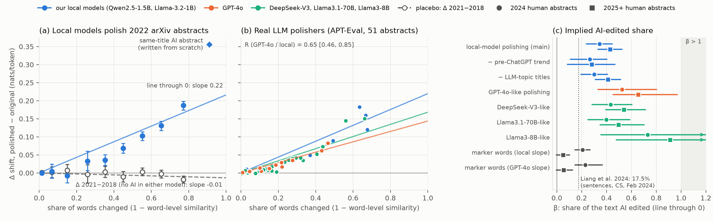

# 05. AI 다듬기 보정: 사람 초록의 Δ 상승을 "AI가 고친 글의 비중"으로 바꾸기

- 브랜치: `exp/05-polish-calibration`
- 마감: 11/22 (02의 후속)
- 장비: 로컬 GTX 1060 6GB (다듬기 생성은 00·02의 C 생성기, 채점은 00·02와 같은 설정)

## 질문

02에서 ChatGPT 이후에 쓰인 사람 arXiv 초록의 Δ2024−2021이 계단처럼 올랐습니다. 같은 제목의 AI 기준점으로 설명되지 않는 몫이 2024년 +0.074 [0.054, 0.096], 2025년 이후(B) +0.093입니다. arXiv 초록은 학습 풀 밖이라 학습 포함(MIA)으로는 설명되지 않습니다. 이 숫자는 아직 "Δ 단위"일 뿐이라, AI 수정이 얼마나 많았다는 뜻인지 말할 수 없습니다.

- Q1. 사람 초록을 LLM으로 다듬으면 Δ가 얼마나 오르나? 고친 양에 비례하나?
- Q2. 소형 로컬 모델로 잰 값이 실제 LLM(GPT-4o 등)으로 다듬은 글에도 맞나?
- Q3. 2024년과 2025년 이후 초록에서 **AI가 고친 글의 비중**은 얼마인가? AI 표지어로 따로 잰 값, 그리고 기존 추정(Liang et al. 2024: CS 초록에서 2024년 2월까지 최대 17.5%)과 맞나?
- Q4. (04로 연결) Δ로 다듬은 글을 얼마나 잡아내나?
- Q5. (탐색) 상승은 일부 초록이 많이 바뀐 결과(혼합)인가, 모든 초록이 조금씩 바뀐 결과(균일 이동)인가?

## 설계

### 05-a. 로컬 모델로 ChatGPT 이전 초록 다듬기 (`scripts/polish_texts.py`)

- 원문: 02의 H22(2022-01~10, 400편)와 H19(2019, 400편). H22는 세 단계를 모두, H19는 polish 단계만 다듬습니다(시기에 따라 효과가 달라지는지 확인).
- 각 초록은 **그 초록의 AI 기준점을 쓴 생성기**가 다듬습니다(Qwen2.5-1.5B-Instruct 200편, Llama-3.2-1B-Instruct 200편). 그래서 생성기 구성이 C와 같습니다.
- 디코딩은 각 모델의 기본 generation_config입니다(C와 같음, "사용자가 그냥 쓸 때"). 프롬프트는 사용자 메시지 하나입니다.

| 단계 | 프롬프트 (뒤에 빈 줄과 원문) |
| --- | --- |
| proof | Proofread the following abstract. Correct only errors in grammar, spelling and punctuation, and keep the original wording wherever possible. Respond with only the corrected abstract. |
| polish | Polish the following abstract to improve its clarity, fluency and academic tone, keeping all of its content. Respond with only the polished abstract. |
| rewrite | Rewrite the following abstract in your own words, keeping all of its content. Respond with only the rewritten abstract. |

- 정리: 앞의 "Here is the polished abstract:"류 문장, 머리말, 뒤의 변경 설명("Note:", "Changes made:", 목록)을 지웁니다. 다음 경우는 버립니다: 거절, DatedGPT 토큰 100개 미만(02와 같음), 원문 대비 단어 수 비율이 0.5~2.0 밖.
- **편집 비율** `e = 1 − (원문과 다듬은 글의 소문자 단어 열 difflib 유사도)`입니다. 0이면 그대로이고, 클수록 많이 바뀐 것입니다.

### 05-b. 실제 LLM으로 다듬은 글: APT-Eval (`scripts/convert_apt_eval.py`)

- APT-Eval(Saha & Feizi, Findings of ACL 2025, MIT 라이선스)은 MixSet의 사람 글 300편을 GPT-4o, Llama3.1-70B, DeepSeek-V3, Llama3-8B, Llama2-7B로 다듬은 데이터입니다. 강도는 정도 기반 4단계(extreme_minor, minor, slight_major, major)와 바꿀 단어 비율 기반 7단계(1~75%)입니다. 여기서는 **paper_abstract 51편과 그 다듬은 글 2,641개**만 씁니다.
- 다듬은 글에는 원문 id가 없습니다. 그래서 단어 열 유사도가 가장 높은 원문에 연결했습니다. 확인해 보니 같은 (다듬은 모델, 단계) 안의 순서와 어긋나는 연결은 2,641개 중 5개였습니다.
- 같은 51편을 **우리 로컬 모델 2개도 세 단계로 다듬습니다**(306개). 같은 원문에서 "로컬 모델 대비 실제 LLM"의 비를 잽니다.
- Llama2-7B는 다듬기 대신 엉뚱한 내용을 쓴 예가 보입니다(유사도 0.3 미만 연결 69개 중 다수). 그래서 **주 분석은 GPT-4o, Llama3.1-70B, DeepSeek-V3, Llama3-8B로 하고, Llama2-7B는 따로 보고**합니다. 단어 수 비율 필터는 05-a와 같습니다.

### 채점

05-a와 05-b의 모든 글과 H22·C22·H19·C19를 3개 모델(2018, 2021, 2024)로 **길이를 자르지 않고**(`--no-pair-truncate`, 최대 200토큰) 채점합니다. 비교마다 공통 길이로 자르는 것은 분석 단계에서 합니다. 인과 LM이라 정확히 같습니다. H24·B와 그 기준점은 02의 점수 파일을 그대로 씁니다.

## 측정 (`scripts/polish_calibration.py`)

논문 i의 원문 h_i, 기준점 c_i, 다듬은 판본 p_iv에 대해 Δ는 Δ2024−2021입니다.

| 양 | 식 | 뜻 |
| --- | --- | --- |
| d_iv | Δ(p_iv) − Δ(h_i), 둘을 공통 길이로 자름 | 다듬어서 오른 Δ |
| g_iv | [Δ(c_i) − Δ(h_i)] − [Δ(c_i) − Δ(p_iv)], gap마다 02처럼 자름 | 02의 gap 단위로 잰 같은 양 |
| **s** | Σ e·d / Σ e², 원점을 지나는 직선, 단계와 생성기를 모두 합침 | 편집 비율 1당 Δ 상승 |
| R_pol | s_pol / s_local, APT-Eval의 같은 51편에서 | 실제 LLM이 같은 편집량에 Δ를 얼마나 올리나 (로컬 대비) |
| shift_T | gap(H22) − gap(T), 02의 점수와 추정식 그대로 | 2024년(T = H24), 2025년 이후(T = B) 사람 초록의 상승 |
| **β_T** | shift_T / s | 로컬 모델식 다듬기라면, **글 전체에서 AI가 고친 부분의 비중** |
| β_T,pol | shift_T / (s · R_pol) | 저자들이 pol처럼 다듬었다면의 비중 |
| α_T,L | shift_T / (L 단계 g의 평균) | 각 AI 보조 초록이 L 단계로 다듬어졌다면, 그런 초록의 비율 |

추가로 보고하는 것:
- **위약 검사**: AI 이전 쌍(Δ2021−2018)의 기울기 s_pre. 02에서 AI 글과 사람 글의 Δ2021−2018 차이는 모든 시기에서 ±0.025 안이었으므로, 다듬기도 이 쌍은 움직이지 않아야 합니다.
- **편집 비율 구간별 평균**, 그리고 처음부터 쓴 AI 글(같은 제목의 기준점)을 "완전히 다시 쓴 판본"으로 놓은 점. 비례 관계를 확인합니다.
- **AI 표지어**(02와 같은 18개 어간): 편집 비율당 표지어 증가 기울기 m(로컬, APT의 각 LLM). 그리고 β_W = (r_T − r_H22) / m. Δ와 독립인 두 번째 추정치입니다.
- **견고성**: (i) ChatGPT 이전 추세 보정. H19 → H22의 gap 변화율로 2024년까지 외삽해 뺍니다. (ii) LLM 주제 논문 제외. 제목에 LLM, language model, GPT, prompt 등이 있으면 뺍니다. (iii) H19를 다듬은 판본의 d를 H22와 비교합니다.
- **탐지**: 다듬은 글 vs 원문의 AUROC, TPR@5%FPR. Δ2024−2021, Δ2021−2018(위약), log p_2024(단일 모델 기준선)로 잽니다. 글마다 자기 길이(최대 200토큰)를 씁니다.
- **분포 모양**: 2024년 이후 사람 Δ에서 기준점의 시기 변화를 뺀 값의 분위 이동(q10~q90)입니다. 그리고 두 모형의 적합도(Cramér–von Mises)를 비교합니다. 하나는 균일 이동, 다른 하나는 "H22와 다듬은 H22의 혼합"(비율은 평균이 맞도록)입니다.
- **CI**: H22 논문(기울기와 gap(H22)를 함께), 대상 시기 논문, H19 논문, APT 원문을 각각 판본째 2,000회 bootstrap합니다.

분석 코드는 효과를 심어 둔 합성 데이터로 먼저 검증했습니다. 심은 기울기 0.4, 비 0.5, 표지어 기울기 50을 각각 0.397, 0.51, 49.96으로 되찾았고, 위약 기울기는 0.002였습니다. 합성 데이터에 심은 균일 이동도 혼합보다 잘 맞는다고 판정했습니다.

## 파이프라인 확인 (2026-11-13, 채점 전)

H22 8편(생성기당 4편)으로 프롬프트와 정리 규칙만 확인했습니다. 점수는 계산하지 않았습니다.
- 정리 규칙은 "Here's a polished abstract:" 같은 앞말을 제대로 지웁니다.
- **Qwen은 "교정만 하라"는 지시에도 문장을 많이 바꿨고(e ≈ 0.46), Llama는 거의 그대로 뒀습니다(e ≈ 0.04).** 단계 이름이 강도를 보장하지 않습니다. 그래서 주 추정치는 단계별 평균(α)이 아니라 **편집 비율에 대한 기울기(β)**로 정했습니다.
- 소형 모델은 다듬으면서 내용을 조금 바꾸기도 합니다(예: Llama polish가 원문에 없는 비교 문장을 넣음).

## 가설

- **H1 (위약)**: AI 이전 쌍에서는 다듬기 효과가 없다. s_pre의 95% CI가 [−s_post/4, +s_post/4] 안에 있습니다.
- **H2 (용량-반응)**: Δ 상승은 편집 비율에 비례한다. s_post의 CI가 0을 넘고, 편집 비율 구간 평균이 (n ≥ 20인 구간에서) 단조 증가합니다.
- **H3 (그럴듯한 비중)**: 2024년 상승은 일부 AI 수정으로 설명할 수 있는 크기다. β_24(로컬)의 95% CI가 (0, 1) 안에 있습니다.
- **H4 (실제 LLM 전이)**: 실제 LLM은 같은 편집량에서 Δ를 소형 모델보다 덜 올린다. R_GPT-4o의 CI 상한이 1 미만입니다. 00 파일럿에서 GPT-4의 DiD가 0.148로 우리 생성기(0.274)보다 작았던 것과 같은 방향입니다.
- (탐색) 분포 모양: 상위 분위가 더 많이 이동하고(q90 이동 ≥ 1.5 × q10 이동), 혼합(polish) 모형의 CvM이 균일 이동보다 작습니다.

## 판단 기준

| 결과 | 해석과 다음 단계 |
| --- | --- |
| H1·H2·H3 성립 | Δ 상승을 "AI가 고친 글의 비중"으로 바꿀 수 있습니다. 논문에 확산 측정치로 β를 싣습니다(로컬 기준과 실제 LLM 전이 범위). 01 연도 곡선의 연도별 상승도 β로 바꿉니다 |
| H1 불성립 | 다듬기가 AI 이전 쌍의 Δ도 움직입니다(유창성 같은 문체 외 요인). 보정에 s_post − s_pre를 씁니다 |
| H2 불성립 (비례하지 않음, 예: 조금만 고쳐도 포화) | β 대신 단계별 α와 구간별 곡선으로 보고합니다 |
| H3 불성립 (β ≥ 1) | 상승을 AI 수정만으로 설명할 수 없습니다. 지식·주제 변화, 또는 사람이 LLM 표현을 따라 쓰는 간접 확산을 먼저 분석합니다 |
| H4 불성립 (R ≥ 1) | 소형 모델 보정이 실제 LLM에도 맞습니다. 로컬 β를 그대로 씁니다 |

## 미리 적어둔 예측 (2026-11-13, 다듬기 생성 중, 채점 전)

이 시점에 아는 것: 02 결과(gap(H22) 0.356, polish_24 +0.074, polish_B +0.093, 표지어 H22 4.1 → H24 7.5 → B 4.9, C 21~22), 00 파일럿(GPT-4 DiD 0.148, GPT-3.5 0.217, 우리 생성기 0.274), 위의 8편 확인(편집 비율만), APT-Eval의 편집 비율(점수 아님). 05의 Δ는 하나도 계산하지 않았습니다.

- 편집 비율 e(평균): Qwen proof 0.35~0.55, polish 0.55~0.75, rewrite 0.55~0.75. Llama proof 0.02~0.15, polish 0.50~0.70, rewrite 0.65~0.85. 필터 통과율은 단계마다 90% 이상입니다.
- **기울기 s_post: 0.25~0.45.** 처음부터 쓴 AI 글은 e ≈ 0.85~0.95에서 d = 0.356입니다. 이 점이 직선 근처라면 s ≈ 0.4입니다. 구간 평균은 단조 증가합니다. → **H2 성립**.
- s_pre: −0.05~+0.05. → **H1 성립**.
- 단계별 g 평균(두 생성기 합): proof 0.05~0.15, polish 0.15~0.28, rewrite 0.18~0.32.
- H19 polish의 d 평균은 H22 polish와 0.03 이내입니다.
- **β_24(로컬): 0.16~0.30, β_B: 0.20~0.37.** → **H3 성립**. 추세 보정하면 약 20% 작아지고(polish_24 → 약 0.058), LLM 주제 논문을 빼면 0~15% 작아집니다.
- **R (실제 LLM / 로컬)**: GPT-4o 0.4~0.8, DeepSeek-V3 0.4~0.8, Llama3.1-70B 0.5~0.9, Llama3-8B 0.6~1.0. → **H4 성립**. 그래서 β_24,GPT-4o는 0.25~0.6입니다. Liang et al.의 17.5%(2024년 2월, 정의가 다름)보다 큽니다. 2024년 1~10월 평균이고 상승 추세였으며, Δ는 사람이 LLM 표현을 따라 쓰는 간접 확산도 함께 잡기 때문입니다.
- 표지어 기울기 m: 로컬 8~20, GPT-4o 15~35 (/1k단어, e = 1당). β_W,24는 0.1~0.4로, Δ 기반 β와 2배 안에서 맞습니다. **B에서는 β_W가 Δ 기반 β의 절반 미만**입니다. B의 표지어는 4.9로 거의 안 올랐는데 Δ 상승은 2024년보다 큽니다(표지어 회피, 또는 표지어 목록 밖의 문체 변화).
- 탐지 AUROC(Δ2024−2021, 다듬은 글 vs H22): proof 0.60~0.80(Qwen의 큰 편집 때문), polish 0.85~0.95, rewrite 0.88~0.97. Δ2021−2018은 0.40~0.60. log p_2024는 polish·rewrite에서 Δ와 비슷하거나 높습니다(00에서 단일 모델이 0.990). APT GPT-4o: minor 0.55~0.70, major 0.65~0.85.
- 분포 모양(신뢰 낮음): 상위 분위가 더 많이 이동하고, 혼합(polish)이 균일 이동보다 잘 맞습니다.

## 한계 (미리)

- β는 "**어떤 방식으로 다듬었다고 가정하면**"의 값입니다. 2024년 저자들이 실제로 쓴 도구와 강도는 모릅니다. 실제 LLM 전이(R)로 범위를 줄 뿐입니다.
- APT-Eval 초록은 MixSet에서 왔습니다. 여러 분야가 섞였고 약어가 소문자로 처리돼 있습니다. R이 분야와 무관하다고 가정합니다.
- Δ는 "AI로 직접 고친 글"과 "사람이 LLM식 표현을 익혀 쓴 글"을 구분하지 못합니다. 둘 다 확산이지만, β는 전부를 직접 수정으로 환산한 값입니다.
- e는 difflib 단어 열 유사도라서 "바뀐 글의 비중"의 근사입니다.

## 결과 (2026-11-13)

```bash
python scripts/polish_texts.py --pairs data/pairs_2022.jsonl --period 22 --out data/polish_2022.jsonl                  # 약 100분
python scripts/polish_texts.py --texts data/apt_originals.jsonl --period APT --out data/polish_apt.jsonl               # 약 12분
python scripts/polish_texts.py --pairs data/pairs_2019.jsonl --period 19 --levels polish --out data/polish_2019.jsonl   # 약 20분
cat data/pairs_2022.jsonl data/pairs_2019.jsonl data/polish_2022.jsonl data/polish_2019.jsonl \
    data/apt_originals.jsonl data/apt_polished.jsonl data/polish_apt.jsonl > data/05_all.jsonl                        # 글 6,052개
python scripts/score_texts.py --input data/05_all.jsonl --out outputs/polish.jsonl --no-pair-truncate --batch-size 8 \
    --models datedgpt/datedgpt-2018-base datedgpt/datedgpt-2021-base datedgpt/datedgpt-2024-base                  # 약 80분
python scripts/polish_calibration.py --scores05 outputs/polish.jsonl --scores02 outputs/mia.jsonl \
    --texts data/02_all.jsonl data/polish_2022.jsonl data/polish_2019.jsonl data/apt_originals.jsonl \
            data/apt_polished.jsonl data/polish_apt.jsonl --json outputs/polish_eval.json
python scripts/plot_polish_calibration.py --eval outputs/polish_eval.json --out docs/experiments/figs/05-polish-calibration.png
```

데이터와 확인:
- 필터를 통과한 글: H22 1,200개 중 1,101개(proof 389, polish 372, rewrite 340), H19 polish 400개 중 365개, APT 로컬 306개 중 294개. 버린 글은 대부분 **원문의 절반 미만으로 줄인 요약형 출력**입니다(H22에서 72개, 주로 rewrite). 그래서 이 보정은 내용을 유지한 다듬기에만 해당합니다. 정리 후에도 "The corrected abstract is:" 앞말이 남은 글이 2개(Llama proof) 있어 그대로 두었습니다.
- 05에서 길이를 자르지 않고 다시 채점한 점수로 gap(H22)를 02처럼 잘라 계산하면 0.3557로 02와 같습니다.
- 채점 중 CUDA 할당기가 OOM 경고를 한 번 냈지만, 캐시를 비우고 다시 할당해 그대로 진행했습니다. 6,052개 모두 세 모델 점수의 길이가 같고 값이 유한합니다.
- 아래 "(사후)" 표시는 결과를 본 뒤 추가한 분석입니다. 분석 코드에 같이 넣었고, 기존 숫자는 바뀌지 않습니다.

### 1. 로컬 다듬기의 용량-반응 (05-a, H22 400편)

| 단계 | 생성기 | n | 편집 비율 e | g (gap 단위) | d (짝 단위) | d, Δ2021−2018 | d, `log p_2024` | 표지어 증가 /1k단어 |
| --- | --- | --- | --- | --- | --- | --- | --- | --- |
| proof | Qwen | 193 | 0.447 | +0.059 | +0.065 | +0.001 | +0.192 | +6.8 |
| proof | Llama | 196 | 0.023 | −0.000 | −0.000 | +0.001 | +0.034 | +0.1 |
| polish | Qwen | 183 | 0.677 | +0.168 | +0.172 | −0.000 | +0.348 | +14.4 |
| polish | Llama | 189 | 0.596 | +0.108 | +0.104 | −0.004 | +0.363 | +9.4 |
| rewrite | Qwen | 167 | 0.728 | +0.179 | +0.177 | −0.011 | +0.315 | +11.4 |
| rewrite | Llama | 173 | 0.710 | +0.155 | +0.145 | −0.024 | +0.516 | +9.7 |
| polish (H19) | 둘 다 | 365 | 0.653 | +0.151 | +0.152 | −0.000 | +0.366 | +12.7 |
| 처음부터 쓴 AI 초록 (같은 제목의 기준점) | | 400 | 0.910 | | +0.356 | −0.014 | | |

| 기울기 | 값 [95% CI] |
| --- | --- |
| **s_post**: d, Δ2024−2021, 원점을 지나는 직선 | **0.216** [0.204, 0.227] |
| g, Δ2024−2021 | 0.218 [0.206, 0.229] |
| s_pre: d, Δ2021−2018 (위약) | −0.013 [−0.024, −0.003] |
| 표지어 m (/1k단어) | 16.6 [15.4, 17.9] |
| Qwen만 / Llama만 | 0.233 [0.218, 0.248] / 0.193 [0.176, 0.210] |
| (사후) d = b1·e + b2·e² | b1 +0.015 [−0.037, +0.067], **b2 +0.292** [0.215, 0.369] |

| e 구간 | n | 평균 e | d [95% CI] | d, Δ2021−2018 |
| --- | --- | --- | --- | --- |
| 0~0.05 | 179 | 0.01 | +0.000 [−0.002, +0.002] | +0.001 |
| 0.05~0.1 | 16 | 0.07 | +0.005 [−0.014, +0.024] | +0.002 |
| 0.1~0.2 | 11 | 0.15 | −0.007 [−0.027, +0.013] | +0.007 |
| 0.2~0.3 | 15 | 0.26 | +0.032 [+0.006, +0.060] | −0.004 |
| 0.3~0.4 | 52 | 0.35 | +0.036 [+0.021, +0.050] | +0.003 |
| 0.4~0.5 | 79 | 0.45 | +0.068 [+0.055, +0.082] | −0.011 |
| 0.5~0.6 | 180 | 0.55 | +0.103 [+0.090, +0.114] | +0.003 |
| 0.6~0.7 | 252 | 0.65 | +0.131 [+0.118, +0.143] | −0.003 |
| 0.7~1 | 317 | 0.77 | +0.187 [+0.174, +0.199] | −0.018 |

- **다듬기는 AI 이후 쌍의 Δ만 올립니다.** 같은 글을 AI 이전 쌍으로 재면 기울기가 −0.013으로 거의 0입니다.
- **반응은 비례가 아니라 볼록합니다.** e가 0.3 이하인 가벼운 수정은 Δ를 거의 움직이지 않고(+0.03 이하), 많이 고칠수록 가파르게 오릅니다. 2차식으로 맞추면 1차 항은 0과 구분되지 않고(+0.015) 제곱 항이 거의 전부입니다(0.29). 단어 20%를 바꾸면 Δ +0.015, 절반을 바꾸면 +0.08, 처음부터 쓰면 +0.36입니다. 처음부터 쓴 AI 초록은 직선(0.216 × 0.91 = 0.197)보다 훨씬 위에 있습니다.
- 다듬기는 `log p_2024`를 크게 올리지만(polish +0.36), 그중 Δ로 남는 것은 약 40%(+0.14)입니다. 나머지 약 60%는 옛 모델도 똑같이 높게 보는 유창성이고, Δ는 이것을 지웁니다.
- Qwen은 "교정만 하라"는 지시에도 단어의 45%를 바꿨고, Llama는 거의 그대로 뒀습니다(2%). 그래도 생성기별 기울기는 비슷합니다(0.233, 0.193).
- 2019년 초록을 다듬어도 2022년과 같습니다(d 0.152 vs 0.137).

### 2. 실제 LLM으로 전이 (05-b, APT-Eval 51편)

| 다듬은 모델 | n | 기울기 [95% CI] | R, 로컬 대비 [95% CI] | 위약 기울기 | 표지어 기울기 |
| --- | --- | --- | --- | --- | --- |
| GPT-4o | 559 | 0.144 [0.095, 0.195] | **0.65** [0.46, 0.85] | −0.003 | 15.1 |
| DeepSeek-V3 | 557 | 0.174 [0.136, 0.211] | 0.79 [0.65, 0.95] | +0.005 | 11.2 |
| Llama3.1-70B | 559 | 0.190 [0.140, 0.247] | 0.86 [0.65, 1.10] | −0.010 | 20.4 |
| Llama3-8B | 558 | 0.103 [0.026, 0.189] | 0.47 [0.13, 0.81] | −0.007 | 17.2 |
| GPT-4o 외 셋 합침 | 1,674 | 0.168 [0.124, 0.215] | 0.77 [0.59, 0.95] | −0.001 | 14.9 |
| (Llama2-7B, 따로 보고) | 393 | 0.113 [0.065, 0.161] | 0.51 [0.31, 0.73] | −0.001 | 4.4 |
| 로컬 2개 (같은 51편) | 294 | 0.220 [0.186, 0.253] | 1 | −0.022 | 13.3 |

| 정도 단계 (평균 e / 평균 d) | extreme_minor | minor | slight_major | major |
| --- | --- | --- | --- | --- |
| GPT-4o | 0.11 / +0.005 | 0.22 / +0.017 | 0.43 / +0.061 | 0.46 / +0.083 |
| DeepSeek-V3 | 0.05 / +0.001 | 0.17 / +0.018 | 0.44 / +0.073 | 0.66 / +0.150 |
| Llama3.1-70B | 0.04 / −0.001 | 0.14 / +0.007 | 0.32 / +0.041 | 0.56 / +0.144 |
| Llama3-8B | 0.11 / +0.004 | 0.13 / +0.011 | 0.23 / +0.031 | 0.28 / +0.040 |

- 로컬 모델의 기울기는 출처가 다른 초록에서도 같습니다(arXiv 0.216, MixSet 0.220).
- **실제 LLM은 같은 편집량에서 Δ를 로컬 모델의 0.5~0.9배만 올립니다.** GPT-4o는 0.65배입니다. 00 파일럿에서 GPT-4 글의 DiD(0.148)가 우리 생성기(0.274)의 약 절반이었던 것과 같은 방향입니다.
- 실제 LLM도 가벼운 수정(minor, e 0.13~0.22)으로는 Δ를 0.02 이하로만 올립니다. 볼록한 반응은 소형 모델만의 특성이 아닙니다.

### 3. 2024년과 2025년 이후 사람 초록에 적용

| | 2024 (H24) | 2025+ (B) |
| --- | --- | --- |
| shift (02의 polish 대비) | +0.074 [0.051, 0.097] | +0.093 [0.071, 0.114] |
| ChatGPT 이전 추세 보정 | +0.057 [0.023, 0.089] | +0.061 [0.018, 0.101] |
| LLM 주제 제목 제외 | +0.065 [0.041, 0.089] | +0.089 [0.066, 0.111] |
| **β: AI가 고친 글의 비중, 로컬 다듬기 (주)** | **0.34** [0.24, 0.45] | **0.43** [0.33, 0.53] |
| β, 추세 보정 | 0.27 [0.11, 0.40] | 0.28 [0.09, 0.47] |
| β, LLM 주제 제외 | 0.30 [0.19, 0.41] | 0.41 [0.31, 0.51] |
| β, GPT-4o처럼 다듬었다면 | 0.53 [0.33, 0.80] | 0.65 [0.45, 0.97] |
| β, DeepSeek-V3처럼 | 0.43 [0.28, 0.61] | 0.54 [0.39, 0.71] |
| β, Llama3.1-70B처럼 | 0.40 [0.25, 0.59] | 0.50 [0.35, 0.70] |
| β, Llama3-8B처럼 | 0.73 [0.35, 2.47] | 0.91 [0.48, 3.06] |
| α: 다듬은 초록의 비율, 모두 proof 수준이라면 | 2.55 (불가능) | 3.18 (불가능) |
| α, polish 수준이라면 | 0.54 [0.38, 0.70] | 0.67 [0.52, 0.83] |
| α, rewrite 수준이라면 | 0.45 [0.31, 0.58] | 0.56 [0.43, 0.69] |
| (사후) α, 처음부터 AI가 썼다면 (shift ÷ 0.356) | 0.21 | 0.26 |
| AI 표지어 /1k단어 (H22는 4.10) | 7.55 | 4.93 |
| β_W: 표지어로 잰 비중, 로컬 기울기 | 0.21 [0.15, 0.27] | 0.05 [−0.00, 0.10] |
| β_W, GPT-4o 기울기 | 0.23 [0.15, 0.37] | 0.05 [−0.00, 0.13] |

ChatGPT 이전 gap 추세(H19 → H22)는 연 −0.008 [−0.016, −0.002]입니다. 시기별 평균 날짜는 H19 2019.50, H22 2022.41, H24 2024.42, B 2026.16입니다.



*그림: (a) 로컬 모델이 2022년 초록을 다듬었을 때, 바뀐 단어 비율 구간별 Δ 상승(파랑, 95% 구간)과 같은 글의 AI 이전 쌍 Δ(회색 빈 점). 가벼운 수정은 거의 0이고, 많이 고칠수록 가파르게 오릅니다. 처음부터 쓴 AI 초록(◆)은 직선보다 훨씬 위입니다. (b) 같은 51편을 실제 LLM이 다듬었을 때. GPT-4o(주황)는 같은 편집량에서 로컬 모델(파랑)의 약 2/3만큼 올립니다. (c) 2024년(●)과 2025년 이후(■) 사람 초록의 상승을 각 보정으로 환산한 β. 점선은 Liang et al.(2024)의 17.5%로, 문장 단위라 정의가 다릅니다.*

### 4. 분포 모양 (탐색)

| | q10 | q25 | q50 | q75 | q90 | CvM 균일 이동 | CvM 혼합 polish (비율) | CvM 혼합 rewrite (비율) |
| --- | --- | --- | --- | --- | --- | --- | --- | --- |
| 2024 | +0.007 [−0.017, +0.034] | +0.026 | +0.058 | +0.108 | +0.169 [0.120, 0.211] | 0.0125 | 0.0012 (0.55) | 0.0006 (0.45) |
| 2025+ | +0.048 [0.026, 0.074] | +0.052 | +0.084 | +0.115 | +0.166 [0.120, 0.213] | 0.0082 | 0.0006 (0.68) | 0.0007 (0.57) |

2024년에는 아래쪽 분위가 거의 움직이지 않고(q10 +0.007) 위쪽만 크게 움직입니다(q90 +0.169). 모든 초록이 조금씩 바뀐 모양(균일 이동)보다 **일부 초록이 많이 바뀐 모양(혼합)이 10~20배 잘 맞습니다.**

### 5. 다듬은 글 탐지

| H22 원문 대비 | Δ2024−2021 AUROC (TPR@5%) | Δ2021−2018 | `log p_2024` | (사후) 첫 100토큰만: Δ / `log p_2024` |
| --- | --- | --- | --- | --- |
| proof | 0.616 (0.141) | 0.496 | 0.601 (0.093) | 0.570 / 0.566 |
| polish | **0.875** (0.527) | 0.491 | 0.792 (0.352) | **0.811** / 0.736 |
| rewrite | **0.916** (0.635) | 0.460 | 0.829 (0.403) | **0.840** / 0.764 |

| APT 원문 51편 대비 | minor: Δ / `log p_2024` | major: Δ / `log p_2024` |
| --- | --- | --- |
| GPT-4o | 0.574 / 0.674 | 0.780 / 0.751 |
| DeepSeek-V3 | 0.563 / 0.670 | 0.877 / 0.740 |
| Llama3.1-70B | 0.522 / 0.697 | 0.912 / 0.886 |
| Llama3-8B | 0.534 / 0.686 | 0.642 / 0.764 |
| Llama2-7B | 0.616 / 0.764 | 0.658 / 0.821 |

- **사람이 쓰고 AI가 많이 다듬은 글에서는 Δ가 단일 모델 likelihood보다 좋습니다.** 다듬은 글이 짧아서 생긴 차이가 아닙니다(첫 100토큰으로 맞춰도 0.811 vs 0.736). 처음부터 쓴 글에서 likelihood가 이겼던 00(0.990 vs 0.899)과 반대입니다.
- 실제 LLM의 가벼운 수정(minor)에서는 likelihood가 낫습니다. Δ가 가벼운 수정을 거의 보지 못하기 때문입니다.

### 가설 판정

| 가설 | 기준 | 결과 | 판정 |
| --- | --- | --- | --- |
| H1 (위약) | s_pre의 CI ⊂ [−s_post/4, +s_post/4] = [−0.054, +0.054] | −0.013 [−0.024, −0.003] | 성립 |
| H2 (용량-반응) | s_post의 CI > 0, n ≥ 20 구간 평균이 단조 증가 | 0.216 [0.204, 0.227]; 0.000 → 0.036 → 0.068 → 0.103 → 0.131 → 0.187 | 기준상 성립. **다만 비례가 아니라 볼록**합니다(사후 2차식의 1차 항 ≈ 0) |
| H3 (그럴듯한 비중) | β_24(로컬)의 CI ⊂ (0, 1) | 0.34 [0.24, 0.45] | 성립 |
| H4 (실제 LLM 전이) | R_GPT-4o의 CI 상한 < 1 | 0.65 [0.46, 0.85] | 성립 |
| (탐색) 분포 모양 | q90 이동 ≥ 1.5 × q10 이동, 혼합 CvM < 균일 이동 CvM | q90 0.169 vs q10 0.007; 0.0012 vs 0.0125 | 성립 |

### 예측과 비교

| 예측 | 결과 | |
| --- | --- | --- |
| 편집 비율 e 6개의 범위 | Qwen 0.45 / 0.68 / 0.73, Llama 0.02 / 0.60 / 0.71 | 모두 맞음 |
| 필터 통과율이 단계마다 90% 이상 | rewrite 83.5%·86.5%, H19 Qwen polish 88% | 틀림. 요약형 출력이 예상보다 많음 |
| s_post 0.25~0.45 ("처음부터 쓴 점이 직선 근처") | 0.216. 처음부터 쓴 점은 직선의 1.8배 위 | **틀림.** 비례를 가정했으나 볼록 |
| s_pre −0.05~+0.05 | −0.013 | 맞음 |
| 단계별 g: proof 0.05~0.15, polish 0.15~0.28, rewrite 0.18~0.32 | 0.029, 0.137, 0.167 | 셋 다 범위보다 조금 아래 |
| H19 polish의 d가 H22와 0.03 이내 | 0.152 vs 0.137 | 맞음 |
| β_24(로컬) 0.16~0.30, β_B 0.20~0.37 | 0.34, 0.43 | 틀림. 기울기가 작아 β가 큼 |
| 추세 보정으로 약 20% 감소, LLM 주제 제외로 0~15% 감소 | 2024 −21%, B −35%; −12%, −5% | B의 추세 보정만 더 큼 |
| R: GPT-4o 0.4~0.8, DeepSeek-V3 0.4~0.8, Llama3.1-70B 0.5~0.9, Llama3-8B 0.6~1.0 | 0.65, 0.79, 0.86, 0.47 | Llama3-8B만 틀림 |
| β_24,GPT-4o 0.25~0.6 | 0.53 | 맞음 |
| 표지어 기울기: 로컬 8~20, GPT-4o 15~35 | 16.6, 15.1 | 맞음 |
| β_W,24 0.1~0.4, Δ 기반 β와 2배 이내 | 0.21. 로컬 보정끼리 1.6배(GPT-4o 보정끼리 2.3배) | 맞음 (같은 보정끼리) |
| B에서 β_W가 Δ 기반 β의 절반 미만 | 0.05 vs 0.43 | 맞음 |
| 탐지 AUROC: proof 0.60~0.80, polish 0.85~0.95, rewrite 0.88~0.97, Δ2021−2018 0.40~0.60 | 0.616, 0.875, 0.916, 0.46~0.50 | 맞음 |
| `log p_2024`가 polish·rewrite에서 Δ와 비슷하거나 높음 | 0.792 < 0.875, 0.829 < 0.916 | **틀림.** Δ가 더 좋음 |
| APT GPT-4o: minor 0.55~0.70, major 0.65~0.85 | 0.574, 0.780 | 맞음 |
| 혼합이 균일 이동보다 잘 맞음 | 0.0012 vs 0.0125 | 맞음 |

### 해석과 판단

판단 기준의 "H1·H2·H3 성립"에 해당합니다. 다만 H2는 기준만 통과했고 모양이 비례가 아니므로, "H2 불성립" 행의 조치(단계별 α와 구간 곡선 보고)도 함께 따릅니다.

1. **2024년 사람 초록의 Δ 상승은 AI 다듬기와 같은 종류의 변화입니다.** 다듬기는 AI 이후 쌍의 Δ만 올리고 AI 이전 쌍은 그대로 둡니다. 02에서 본 사람 초록의 변화(AI 이후 쌍에서만 상승)와 같은 모양입니다.
2. **Δ는 가벼운 교정을 거의 보지 못합니다.** 반응이 편집 비율의 제곱에 가깝습니다. 실제 LLM도 같습니다(GPT-4o minor: e 0.22, d +0.017). 그래서 Δ로 재는 확산은 "AI가 상당 부분 다시 쓴 글"의 확산입니다. 논문에 측정 범위로 명시합니다.
3. **크기.** 2024년 상승을 환산하면 다음과 같습니다.
   - 글 단위(직선 보정 β): 로컬 다듬기 기준 약 1/3(0.34, 추세 보정 0.27), 실제 LLM 기준 0.40~0.53입니다.
   - 초록 단위(α): 분포 모양이 혼합 쪽이므로 이쪽이 더 자연스러운 읽기입니다. 2024년 초록의 약 절반(45~55%)이 로컬 polish·rewrite 수준으로 다듬어진 것과 같습니다. 모두 처음부터 AI가 썼다고 해도 약 21%가 필요합니다. 가벼운 교정만으로는 설명되지 않습니다(α_proof 2.55).
   - 비교: 표지어로 잰 β_W는 0.21로, Liang et al.의 17.5%(2024년 2월, 문장 단위, 역시 단어 빈도 기반)와 비슷합니다. Δ 기반 값은 그 1.6배입니다. Δ가 표지어 밖의 문체 변화와 간접 확산(사람이 LLM 표현을 따라 씀)까지 잡기 때문으로 봅니다. 그러므로 **Δ 기반 β·α는 직접 AI 수정 비율의 상한**으로 읽습니다.
4. **2025년 이후에는 표지어와 Δ가 갈라집니다.** Δ 기반 β는 0.43으로 더 커졌지만, 표지어는 1,000단어당 7.55에서 4.93으로 돌아가 β_W가 0.05입니다. "delve" 같은 단어가 알려진 뒤 피했거나, 새 LLM의 어휘가 바뀐 것으로 보입니다. Δ는 이런 표지어 회피에 흔들리지 않습니다. 다만 추세를 보정하면 2025년 이후(0.28)는 2024년(0.27)과 비슷하므로, "계속 늘었다"보다 "2024년 수준 유지"가 안전한 읽기입니다.
5. **탐지: 사람이 쓰고 AI가 다듬은 글에서는 Δ가 likelihood보다 좋습니다**(polish 0.875 vs 0.792, 길이를 맞춰도 같음). 다듬기가 올리는 likelihood의 약 60%는 옛 모델도 똑같이 높게 보는 유창성이고, Δ는 이것을 지우기 때문입니다. 00에서는 처음부터 쓴 글에서 likelihood가 이겼으므로, **04는 "사람이 쓰고 AI가 다듬은 글"을 주 시나리오로 넣습니다.** 가벼운 수정에서는 likelihood가 낫다는 점(APT minor)도 함께 보고합니다.
6. **01에 반영할 점.** 이 보정은 글 쪽 변화(같은 모델 쌍에서 글이 바뀐 만큼)에 대한 것이라, 01의 vintage 곡선(학습 데이터 연도별 변화)에는 직접 적용되지 않습니다. 01에서 게시 연도별 사람 초록 곡선을 함께 그리면, 그 상승을 β·α로 환산합니다.

### 한계 (결과 후 추가)

- β는 직선 보정이라 실제 편집 강도의 분포에 따라 달라집니다. 모든 초록을 조금씩 고쳤다면 실제 비중은 더 크고(반응이 e²에 가까우므로), 일부를 많이 고쳤다면 α가 더 맞는 요약입니다. 분포 모양은 후자를 지지합니다.
- 필터가 요약형 출력(원문의 절반 미만)을 버렸으므로, 보정은 내용을 유지한 다듬기에만 해당합니다.
- Llama3-8B의 R은 CI가 넓습니다(0.13~0.81). 실제 LLM 범위는 GPT-4o, DeepSeek-V3, Llama3.1-70B로 줍니다.
