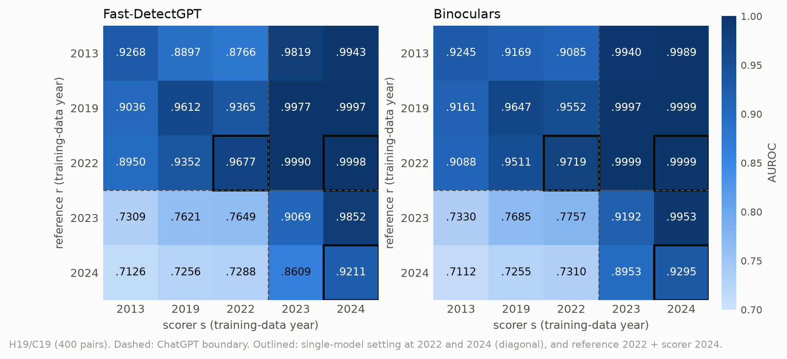

# 08. 탐지기의 두 자리: 채점 모델과 기준 모델의 학습 연도가 반대로 작용하나

- 브랜치: `exp/08-detector-slots`
- 마감: 11/22 (논문 위치 잡기 판정)
- 장비: 로컬 GTX 1060 6GB, fp16 (DatedGPT 1.35B, 01과 같은 설정)
- 관련: 06(PIT, Runpod 대기)의 구성은 이 실험의 판정을 보고 정합니다. 07(TiC-LM)의 출력은 아래 R1 판정에만 읽기 전용으로 씁니다.

## 왜 하나

### 지금까지 본 것

01과 07은 같은 현상을 보였습니다. 새 언어모델 하나로 매긴 점수만으로 AI 글을 가르는 성능(likelihood 탐지)이 ChatGPT 이전 데이터로 배운 모델에서는 평평하다가, ChatGPT 이후 데이터로 배운 모델에서만 뜁니다.

**07 출력에 대한 판정 R1 (2026-11-15).**
- 규칙은 16:00에 정했습니다(세션 작업 폴더, 이미 본 DatedGPT로 보정). TiC-LM 채점은 18:19에 시작했습니다.
- 다만 규칙을 점수보다 먼저 커밋하지는 않았습니다. 근거는 파일 수정 시각뿐입니다.
- 규칙: 단일 모델 log p의 AUROC를 logit으로 바꾼 단계 크기 J를 씁니다. 마지막 단계(2023-01 → 2024-07)가 앞 다섯 단계 대비 z_J > 2.776이고, AUROC 차이의 짝 bootstrap CI가 0보다 커야 합니다(`scripts/tic_r1_gate.py`).

| 묶음 | ChatGPT 이전 여섯 시점 AUROC | 2024-07 | 차이 [95% CI] | z_J | 판정 |
| --- | --- | --- | --- | --- | --- |
| H19/C19 | 0.907 → 0.930 | 0.984 | +0.055 [+0.044, +0.066] | +26.6 | 성립 |
| B/C | 0.959~0.962 | 0.990 | +0.029 [+0.022, +0.037] | +19.6 | 성립 |

H19/C19의 차이를 +0.005~+0.03으로 예측했는데 실제 효과는 그보다 컸습니다.

### 그래서 뭐가 문제인가

"최신 모델일수록 잘 잡는다"만으로는 결론이 "최신 모델을 써라"로 끝납니다. 탐지 연구에 주는 정보가 거의 없습니다(사용자 지적, 11/15).

반대 사례가 01 재분석에 하나 있습니다(사후 분석이고, 우리 점수 Δ에서만 봤습니다). 채점 모델을 2024로 고정하고 Δ = log p_2024 − log p_r의 기준 모델 r을 2022에서 2023으로 바꾸면 AUROC가 크게 떨어집니다.

| 묶음 | r = 2022 | r = 2023 |
| --- | --- | --- |
| H19/C19 | 0.997 | 0.898 |
| H24/C24 | 0.952 | 0.768 |
| B/C | 0.954 | 0.756 |

기준 모델이 AI 글에 익숙해지자 탐지가 무너졌습니다. 같은 2023년 모델이 채점 자리에서는 탐지를 돕고, 기준 자리에서는 해칩니다.

### 질문

널리 쓰는 zero-shot 탐지기인 Fast-DetectGPT와 Binoculars에도 같은 두 자리가 있습니다.
- Q1. 채점 자리의 모델이 ChatGPT 이후 데이터로 배우면 두 탐지기가 좋아지나?
- Q2. **기준 자리의 모델이 ChatGPT 이후 데이터로 배우면 나빠지나?** 그래서 "채점은 최신, 기준은 2022년 이전" 조합이 "두 자리 모두 최신"보다 나은가? 나으면 "그냥 최신 모델을 쓰면 된다"는 조언이 틀린 것이 됩니다.
- Q3. 그 하락은 기준 모델이 ChatGPT 경계를 넘을 때 생기나, 아니면 기준이 채점 모델에 가까워지기만 해도 생기나?

## 두 자리

두 탐지기 모두 "글 x가 채점 모델 s에게 얼마나 예상대로인가"를 "기준 모델 r이 다음 토큰으로 내놓을 법한 것이 s에게 얼마나 예상대로인가"와 비교합니다. 계산은 04의 `scripts/baseline_scores.py`와 같은 함수입니다.

| 탐지기 | 점수 | 채점 자리 s | 기준 자리 r | AI 쪽 |
| --- | --- | --- | --- | --- |
| Fast-DetectGPT (analytic) | D(x) = Σ_t [log s(x_t) − μ_t] / √(Σ_t var_t), μ_t = Σ_v r(v) log s(v) | scoring model | sampling model | 높을수록 |
| Binoculars | B(x) = mean_t −log s(x_t) / mean_t Σ_v r(v) (−log s(v)) | performer | observer | 낮을수록 |

- 칸 r_s는 기준 r, 채점 s입니다. 대각선 r = s는 모델 하나를 두 자리에 다 쓰는 흔한 설정입니다.
- 기준 모델이 AI 글에 익숙하면 "내놓을 법한 다음 토큰"이 이미 AI 글처럼 됩니다. 그러면 AI 글이 튀지 않아 탐지가 나빠질 것이라는 것이 이 실험의 가설입니다.

## 모델

DatedGPT 다섯 연도를 씁니다. 2013(가장 오래됨), 2019(중간), 2022(ChatGPT 이전 마지막), 2023과 2024(이후)입니다.
- 모두 1.35B Llama 구조이고 토크나이저가 같습니다(어휘 32,000).
- 칸은 5 × 5 = 25개입니다.

## 데이터 (01과 같음, 새로 생성하지 않음)

| 묶음 | 사람 글 | AI 글 | 쌍 | 역할 |
| --- | --- | --- | --- | --- |
| **H19/C19** | arXiv cs 2019 초록 (ChatGPT 이전에 쓴 글) | 같은 제목으로 채팅 모델이 쓴 초록 (Llama-3.2-1B-Instruct 200, Qwen2.5-1.5B-Instruct 200) | 400 | **주** (사람 라벨이 깨끗함) |
| B/C | arXiv cs 2025-07~2026-10 초록 (모든 vintage 크롤 이후) | 같음 | 400 | 재현 (학습 포함 없음, 다만 사람 글에 AI 다듬기가 섞였을 수 있음) |
| H24/C24 | arXiv cs 2024 초록 | 같음 | 399 | 탐색 (최근 사람 글) |

입력은 `data/01_all.jsonl`에서 이 여섯 그룹만 고른 2,398편입니다.

## 채점 (`scripts/score_slots.py`)

- 두 모델을 GPU에 함께 올리면 최대 5,338MiB를 써서 공유 메모리로 넘치고, 글 한 편에 약 1초가 걸립니다(11/15 측정). 모델 하나만 올리면 0.166초입니다.
- 그래서 글을 64편씩 묶습니다. 다섯 연도 모델이 차례로 그 묶음을 채점하고, fp16 logit을 RAM에 둡니다. 그다음 25칸을 GPU에서 한 번에 계산합니다.
- 묶음마다 모델 순서를 뒤집어서, 앞 묶음의 마지막 모델을 다음 묶음에서 다시 씁니다.
- 앞 200토큰만 쓰고, 토크나이저의 특수 토큰을 붙입니다(01과 같음). 짝끼리 길이는 맞추지 않습니다(04·07의 탐지와 같음).
- 걸리는 시간은 약 65분으로 추정합니다(실측 아님).

## 파이프라인 확인 (2026-11-15, 격자 채점 전)

- **대각선 ll과 01 점수 파일:** 글 12편에서 다섯 연도 모두 글 평균 log p의 차이가 0.00000입니다. 같은 토큰화이고 같은 숫자입니다.
- **직접 계산과 묶음 계산:** 두 모델을 함께 올려 배치 1로 직접 계산한 값과 비교했습니다. 칸 2022_2024와 2024_2022에서 최대 차이는 Fast-DetectGPT 0.0066, Binoculars 0.0004입니다. fp16 배치 구성 차이이고, 허용치 0.02 안이라 통과입니다(`scripts/slots_check.py`).
- **판정 코드:** 합성 격자로 검증했습니다(`tests/test_slots.py`).
  - 기준 자리 손해를 심은 데이터 → 채택
  - 채점 자리 이득만 심은 데이터 → 폐기(H3 불성립)
  - 효과가 없는 데이터 → 폐기(H1 불성립)

이 확인에서는 AUROC를 계산하지 않았습니다.

## 측정 (`scripts/slots_grid.py`)

- **A(r_s):** 칸 r_s의 AUROC(C vs 사람, 짝)입니다. 같은 칸의 TPR@5%FPR도 냅니다.
- **E = 1 − A:** AI 글 하나와 사람 글 하나를 뽑았을 때 거꾸로 줄 세울 확률입니다. 천장 근처에서는 AUROC 차이보다 E의 비율이 크기를 더 잘 보여 줍니다.
- **CI:** 짝 단위 2,000회 bootstrap(seed 0)이고, 모든 칸이 같은 표본을 씁니다.
- **참고값:** 단일 모델 ll(s만)과 Δ = ll_s − ll_r도 같은 칸으로 냅니다. 둘 다 01에서 이미 본 양입니다.

## 가설 (격자 채점 전, 2026-11-15)

- **H1 (채점 자리):** 기준을 2022로 두고 채점을 2022에서 2024로 바꾸면 좋아집니다. A(2022_2024) − A(2022_2022) > 0.
- **H2 (기준 자리, 판정 핵심):** 채점을 2024로 두고 기준을 2024에서 2022로 바꾸면 좋아집니다. 즉 "채점 최신 + 기준 2022" 조합이 "두 자리 모두 최신"보다 낫습니다. A(2022_2024) − A(2024_2024) > 0.
- **H3 (경계):** 채점을 2024로 두고 기준을 2022에서 2023으로 바꾸면 나빠집니다. 기준이 채점 모델에 가까워지는데도 그렇습니다. A(2023_2024) − A(2022_2024) < 0.
- **H4 (대조):** 채점을 2024로 두고 기준을 2013에서 2022로 바꿔도 나빠지지 않습니다. ChatGPT 이전 모델끼리는 기준을 바꿔도 손해가 없습니다. A(2022_2024) − A(2013_2024)가 0보다 유의하게 작지 않습니다.

## 판단 기준

| 가설 | 묶음마다 성립 조건 |
| --- | --- |
| H1 | 차이의 CI 하한 > 0 |
| H2 | CI 하한 > 0 **그리고** E(2024_2024) / E(2022_2024) ≥ 1.3 (두 자리 모두 최신이면 순서 오류가 30% 이상 많음). 두 칸 모두 AUROC ≥ 0.998이면 그 묶음은 천장이라 판정에서 뺌 |
| H3 | CI 상한 < 0 |
| H4 | CI 상한 > 0 |

- **탐지기별 H2:** H19/C19와 B/C 모두에서 성립해야 합니다. 천장인 묶음은 빼고, 둘 다 천장이면 판정 불가입니다.
- **방향 판정:** 두 탐지기(Fast-DetectGPT, Binoculars)의 H2로 정합니다.

| 결과 | 결론 | 다음 |
| --- | --- | --- |
| 두 탐지기 모두 H2 성립 | **새 방향 채택.** 채점 모델의 학습 연도는 zero-shot 탐지의 숨은 변수이고, 두 자리에 반대로 작용합니다. 권고는 "채점 자리에는 최신, 기준 자리에는 2022년 이전 데이터로 배운 모델"이고, 경고는 "같은 최신 모델을 두 자리에 쓰면 손해"입니다 | 06(PIT, Runpod)에 같은 격자를 넣어 다른 계열에서 재현합니다. 예측은 06 문서에 먼저 적습니다. 논문 기여를 탐지 쪽으로 다시 배치합니다 |
| 하나만 H2 성립 | 부분. 그 탐지기에 한정됩니다 | 06에서 그 탐지기로 재현되면 채택하고, 아니면 폐기합니다 |
| 둘 다 H2 불성립 | "최신 모델을 써라"로 끝나므로 **새 방향을 폐기**합니다. 원래 방향(측정 도구)을 유지하고, 탐지 관찰(01·07의 단일 모델 도약)은 부 기여로 씁니다 | 06은 원래 명세대로 돌립니다 |
| 판정 불가 (두 묶음 모두 천장) | H24/C24와 TPR@5%로 탐색만 합니다 | 06으로 미룹니다 |

H3과 H4는 해석에 씁니다.
- H2가 성립하는데 H4가 불성립하면, 손해는 ChatGPT 이후 데이터 때문이 아닐 수 있습니다. 기준이 채점 모델에 가까워지기만 해도 생기는 손해일 수 있으니 그렇게 적습니다.
- H2가 성립하는데 H3이 불성립하면, 손해는 2024 기준에서만 생긴 것입니다. 시작 시점은 적지 않습니다.

## 미리 적어둔 예측 (2026-11-15, 격자 채점 전)

근거는 01의 단일 모델 AUROC와 Δ의 기준 효과입니다. 둘 다 이미 봤고, Δ의 기준 효과는 사후 분석입니다. DatedGPT로 Fast-DetectGPT나 Binoculars를 계산한 적은 없습니다.

- **대각선 2022의 수준:** 두 탐지기 모두 H19/C19 0.97~0.995, B/C 0.95~0.99로 봅니다. H19/C19가 천장(0.998)에 닿을 가능성은 낮다고 봅니다.
- **H1:** 두 탐지기, 두 묶음 모두 성립하고 차이는 +0.003~+0.03입니다. 확신은 중상입니다.
- **H2:** 두 탐지기 모두 성립하고, 오류 비율 E(2024_2024) / E(2022_2024)는 1.3~3입니다. 확신은 중간(약 55%)입니다.
  - Δ에서는 기준 효과가 컸습니다(B/C 0.954 → 0.756). 하지만 두 탐지기는 기준 모델을 글에 직접 대지 않고 다음 토큰 분포로만 쓰므로 효과가 더 작을 수 있습니다.
- **H3:** 성립합니다. 확신은 중간(약 60%)입니다.
- **H4:** 성립합니다. 확신은 중상입니다.
- **대각선 갱신(단일 모델 2022 → 2024):** 부호는 모르고, |차이| < 0.01로 봅니다. 채점 자리 이득과 기준 자리 손해가 부딪치기 때문입니다.
- **묶음 비교:** H2의 효과는 H19/C19보다 B/C와 H24/C24에서 클 것입니다. Δ에서 그랬기 때문입니다. 확신은 낮습니다.
- **종합:** 방향 판정은 "채택"으로 봅니다(약 55%).

## 한계 (미리)

- **계열이 하나(DatedGPT)이고 1.35B입니다.** 다른 계열에서의 재현은 06(PIT)에 맡깁니다.
- **AI 글은 작은 공개 채팅 모델 두 개가 썼습니다.** GPT-4급 상용 모델의 글에서도 같은지는 모릅니다.
- **Binoculars는 원래 같은 시점의 base와 instruct 쌍을 씁니다.** 여기서는 연도가 다른 두 base 모델로 같은 식을 계산합니다. Fast-DetectGPT는 원 논문에도 sampling과 scoring에 다른 모델을 쓰는 설정이 있습니다.
- **B(2025년 이후 사람 초록)에는 AI가 다듬은 글이 섞였을 수 있습니다.** 05의 추정으로는 2024년 초록의 약 1/3입니다. 재현 묶음의 라벨이 그만큼 흐립니다.
- **데이터와 단일 모델 결과는 이미 봤습니다.** H3의 방향은 Δ의 사후 분석에서 왔습니다. 두 탐지기의 칸 값은 처음 계산합니다.
- **짝끼리 길이를 맞추지 않습니다.**
- **로컬 fp16입니다.** 01과 같은 설정이고, 대각선 ll이 01과 같습니다.

## 실행

```bash
MAIN=/c/Users/OFFICE/Study-Temporal_Reference_Detection   # data/, outputs/, .venv/
PY="$MAIN/.venv/Scripts/python.exe -I"
export HF_HUB_OFFLINE=1 TQDM_DISABLE=1
$PY scripts/score_slots.py --input $MAIN/data/01_all.jsonl --out $MAIN/outputs/s08_check.jsonl --limit 12
$PY scripts/slots_check.py --input $MAIN/data/01_all.jsonl --check $MAIN/outputs/s08_check.jsonl --yc-dir $MAIN/outputs
$PY scripts/score_slots.py --input $MAIN/data/01_all.jsonl --out $MAIN/outputs/s08_grid.jsonl
$PY scripts/slots_grid.py --grid $MAIN/outputs/s08_grid.jsonl --json $MAIN/outputs/s08_eval.json > $MAIN/outputs/s08_eval.txt
$PY scripts/tic_r1_gate.py --outputs $MAIN/outputs > $MAIN/outputs/tic_r1_gate.txt
$PY scripts/plot_slots.py --eval $MAIN/outputs/s08_eval.json --out docs/experiments/figs/08-detector-slots.png
```

## 결과 (2026-11-16)

채점은 2026-11-15 23:47부터 11-16 00:47까지 60분 걸렸습니다. 2,398편 × 25칸이고, 로그는 `outputs/run_08_slots.log`입니다.



H19/C19의 AUROC입니다. 행은 기준 모델, 열은 채점 모델입니다. 점선은 ChatGPT 경계이고, 테두리 친 칸은 단일 모델 2022, 단일 모델 2024, 기준 2022 + 채점 2024입니다.

### 판정

| 묶음 | Fast-DetectGPT | Binoculars |
| --- | --- | --- |
| H19/C19 (주) | H1·H2·H3·H4 성립 | H1·H2·H3·H4 성립 |
| B/C (재현) | H1·H2·H3·H4 성립 | H1·H2·H3·H4 성립 |
| H24/C24 (탐색) | H1·H2·H3·H4 성립 | H1·H2·H3·H4 성립 |

**H2가 두 탐지기에서 모두 성립합니다. 판단 기준에 따라 새 방향을 채택합니다.** 천장(두 칸 모두 0.998 이상)에 걸린 묶음은 없습니다.

### 1. 두 자리는 반대로 작용합니다 (H1, H2)

AUROC이고, 괄호는 TPR@5%FPR입니다.

| 설정 | F, H19/C19 | Bi, H19/C19 | F, B/C | Bi, B/C |
| --- | --- | --- | --- | --- |
| 단일 모델 2022 (2022_2022) | 0.968 (0.83) | 0.972 (0.86) | 0.986 (0.92) | 0.987 (0.94) |
| 단일 모델 2024 (2024_2024) | 0.921 (0.68) | 0.930 (0.74) | 0.974 (0.86) | 0.975 (0.88) |
| 기준 2022 + 채점 2024 (2022_2024) | 0.9998 (1.00) | 0.9999 (1.00) | 0.9990 (1.00) | 0.9997 (1.00) |

- **채점 자리 (H1):** 기준을 2022로 두고 채점을 2024로 바꾸면 좋아집니다. H19/C19에서 F +0.032 [+0.023, +0.042], Bi +0.028이고, B/C에서는 +0.013, +0.013입니다.
- **기준 자리 (H2):** 채점을 2024로 두고 기준을 2024에서 2022로 바꾸면 좋아집니다. H19/C19에서 F +0.079 [+0.062, +0.097], Bi +0.071 [+0.055, +0.088]이고, B/C에서는 +0.025, +0.025입니다.
  - 순서 오류 비율은 26~1,026배입니다. 다만 분모(기준 2022 + 채점 2024의 오류 0.0001~0.001)가 0에 가까워 비율 자체는 불안정합니다. 크기는 AUROC 차이와 그 CI로 읽습니다.
- **기준 자리에 ChatGPT 이후 모델을 넣으면** 채점 모델이 ChatGPT 이전일 때 탐지가 무너집니다. H19/C19 F에서 0.71~0.76이고, 기준이 이전 모델이면 0.88~0.97입니다.

### 2. 최신 모델 하나를 그대로 쓰면 오히려 나빠집니다 (설명용, 예측 틀림)

단일 모델 설정(모델 하나를 두 자리에 다 씀)을 2022에서 2024로 바꿨을 때입니다.

| 묶음 | F | Bi |
| --- | --- | --- |
| H19/C19 | −0.047 [−0.060, −0.034] | −0.042 [−0.056, −0.030] |
| B/C | −0.012 [−0.019, −0.006] | −0.013 [−0.020, −0.006] |
| H24/C24 | −0.019 [−0.027, −0.010] | −0.016 [−0.025, −0.008] |

- 세 묶음, 두 탐지기에서 모두 나빠졌고 CI가 모두 0 아래입니다. H19/C19 F의 TPR@5%는 0.83에서 0.68로 떨어졌습니다.
- "|차이| < 0.01, 부호 모름"이라는 예측은 틀렸습니다.
- **(사후 관찰) 탐지기 순위가 뒤집힙니다.** 같은 모델로 단순 likelihood와 비교했습니다(H19/C19).
  - 2022 모델: F 0.968 > likelihood 0.954
  - 2024 모델: likelihood 0.9955 (TPR 0.98) > Bi 0.930 > F 0.921
  - "Fast-DetectGPT가 likelihood보다 낫다"는 결론이 채점 모델의 데이터 연도 하나로 뒤집힙니다. 미리 세운 가설이 아니므로 사후 관찰로 적습니다.

### 3. 왜: 최신 모델은 AI 글을 "예상합니다" (사후 분해)

H19/C19의 Qwen 짝 200개 평균입니다. ll은 글의 평균 log p이고, X는 기준 모델이 내놓을 다음 토큰에 대해 채점 모델이 느끼는 놀람의 평균입니다. 대각선에서 X는 채점 모델 자신의 엔트로피입니다. (−ll) − X가 음수일수록 AI 쪽으로 판정됩니다.

| 칸 | 사람 ll | 사람 X | 사람 (−ll) − X | AI ll | AI X | AI (−ll) − X | AI의 F 평균 |
| --- | --- | --- | --- | --- | --- | --- | --- |
| 2022_2022 | −2.793 | 2.763 | +0.030 | −2.287 | 2.559 | −0.272 | +1.72 |
| 2024_2024 | −2.786 | 2.730 | +0.056 | −1.806 | 1.945 | −0.138 | +0.99 |
| 2022_2024 | −2.786 | 3.027 | −0.241 | −1.806 | 3.157 | −1.350 | +6.39 |

- 2024 모델은 AI 글을 더 잘 맞힙니다(ll −2.287 → −1.806). 그런데 AI 문맥에서 자기 확신도 그만큼 더 커집니다(X 2.559 → 1.945).
- 그래서 AI 글이 "예상보다 얼마나 더 예측 가능한가"는 오히려 줄어듭니다(−0.272 → −0.138). 사람 글은 거의 그대로입니다.
- 최신 모델은 AI 문체를 너무 잘 알아서 AI 글이 튀지 않습니다.
- 기준을 2022로 두면 X는 "사람 글처럼 이어 쓰는 모델의 예측"이 되고, AI 글만 그보다 훨씬 예측 가능해집니다(−1.350).

**놓친 글 (단일 모델 2024, F가 사람 95% 문턱 1.30 아래인 AI 초록):**
- `1909.04390:a`: F 2024_2024 −1.65, 2022_2022 −0.20, 2022_2024 +4.18. "The study investigates the neural correlates underlying autobiographical memory valence classification using functional Magnetic Resonance Imaging (fMRI) data. The research aims to identify distinct patterns …"
- `1905.07061:a`: −0.61, +1.36, +6.04. "This study introduces non-parametric priors for generative adversarial networks (GANs), focusing on addressing the common issue where traditional GAN architectures require extensive tuning …"
- `1908.00688:a`: −0.52, +0.80, +5.93. "This paper introduces OntoPlot, an innovative visualization technique specifically designed to address the challenges posed by non-hierarchical relationships …"

셋 다 전형적인 채팅 모델 초록 문체이고, 기준을 2022로 두면 모두 잡힙니다.

### 4. 경계와 대조 (H3, H4)

- **H3:** 채점을 2024로 두고 기준을 2022에서 2023으로 바꾸면 나빠집니다. H19/C19에서 F −0.015 [−0.021, −0.009], Bi −0.005 [−0.008, −0.002]입니다.
  - 채점 2024가 천장 근처라 차이가 작게 보입니다. 채점을 2022로 두면 같은 변화가 0.968 → 0.765(F)입니다.
  - 하락은 첫 ChatGPT 이후 vintage(2023)부터 시작합니다.
- **H4:** 채점을 2024로 두고 기준을 2013에서 2022로 바꾸면 오히려 조금 좋아집니다. H19/C19에서 F +0.006, Bi +0.001이고, B/C에서는 +0.011, +0.002입니다.
  - 기준이 채점 모델에 가까워진다고 손해를 보지는 않습니다. 손해는 기준이 ChatGPT 경계를 넘을 때만 생깁니다.
- **(사후 관찰)** ChatGPT 이전 모델끼리는 대각선이 가장 좋습니다. 예를 들어 F에서 채점 2022는 기준 2022 0.968, 2019 0.937, 2013 0.877입니다. 서로 다른 연도를 섞는 것이 늘 좋은 것은 아니고, 좋아지는 것은 "기준은 ChatGPT 이전, 채점은 이후"일 때입니다.

### 5. 생성기별 (탐색)

| 생성기 (H19/C19) | F 2022_2022 | F 2024_2024 | F 2022_2024 |
| --- | --- | --- | --- |
| Llama-3.2-1B-Instruct (200) | 1.0000 | 0.9959 | 1.0000 |
| Qwen2.5-1.5B-Instruct (200) | 0.9275 | 0.8414 | 0.9994 |

- Llama 글은 어느 칸에서든 거의 다 잡혀서(천장) 차이가 보이지 않습니다. 효과는 Qwen 글에서 나옵니다. B/C와 H24/C24도 같은 모양입니다.
- 그러니 이 결과는 사실상 "잡기 어려운 생성기 하나"에 대한 것입니다. 더 큰 생성기와 다른 계열로 넓혀야 합니다.

### 6. 예측과 비교

| 예측 | 결과 | 판정 |
| --- | --- | --- |
| 대각선 2022 수준: H19/C19 0.97~0.995, B/C 0.95~0.99 | H19/C19 F 0.968, Bi 0.972 / B/C 0.986, 0.987 | 거의 맞음 (H19/C19 F가 조금 낮음) |
| H1: 두 탐지기·두 묶음 성립, +0.003~+0.03 | 성립, +0.013~+0.032 | 맞음 (H19/C19 F가 범위를 조금 넘음) |
| H2: 두 탐지기 성립, 오류 비율 1.3~3 (55%) | 성립, 차이 +0.025~+0.079, 비율 26~1,026 | 방향 맞음, 크기는 훨씬 큼 |
| H3 성립 (60%) | 성립 | 맞음 |
| H4 성립 | 성립 | 맞음 |
| 대각선 갱신 |차이| < 0.01, 부호 모름 | −0.012 ~ −0.047, 모두 CI가 0 아래 | **틀림**: 최신 단일 모델이 더 나쁨 |
| H2 효과가 H19/C19보다 B/C·H24/C24에서 큼 | H19/C19가 가장 큼 (+0.079 vs +0.025, +0.037) | 틀림 (B/C는 바탕 AUROC가 높아 차이가 작음) |
| 방향 판정: 채택 (55%) | 채택 | 맞음 |

기준 자리의 손해를 작게 잡았습니다. 기준 모델은 글을 직접 채점하지 않고 다음 토큰 분포로만 들어가므로 효과가 작을 것이라고 봤습니다. 실제로는 분포를 통해서도 크게 작용했습니다.

### 판단

- **새 방향을 채택합니다 (판단 기준대로).** zero-shot 탐지기가 쓰는 언어모델의 학습 데이터 연도는 숨은 변수이고, 두 자리에 반대로 작용합니다.
  - 채점 자리에서는 ChatGPT 이후 모델이 돕습니다.
  - 기준 자리에서는 같은 모델이 해칩니다.
  - 흔한 단일 모델 설정에서는 손해가 이득보다 커서, 최신 모델로 바꾸면 오히려 나빠집니다(F 0.968 → 0.921). "그냥 최신 모델 쓰면 된다"는 틀린 조언입니다.
- **권고:** 채점 자리에는 ChatGPT 이후, 기준 자리에는 ChatGPT 이전 데이터로 배운 모델을 씁니다. 같은 계열의 시점별 모델이 이것을 가능하게 합니다(H19/C19 F 0.9998).
- **한계:**
  - 계열이 하나(DatedGPT 1.35B)입니다.
  - 생성기는 둘이고, 그중 하나(Llama)는 천장입니다.
  - 좋은 칸들이 천장 근처입니다.
  - 짝끼리 길이를 맞추지 않았습니다.
  - 순위 역전(2절)과 원인 분해(3절)는 사후 분석입니다.
- **다음 (판단 기준의 표대로):**
  - 06(PIT)에 같은 격자를 넣어 다른 계열에서 재현합니다. 예측은 06 문서에 먼저 적습니다. Runpod 충전과 사용자 승인이 필요합니다.
  - 생성기를 넓힙니다. 01의 다른 AI 글이나 04의 RAID·APT를 씁니다.
  - 논문 기여를 탐지 쪽으로 다시 배치합니다(사용자 결정).
